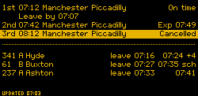

# inky-departures

A train and bus departure app for your station and stops in Great Britain. One install is one app with two views of the same departures:

- **The board:** a Raspberry Pi with a four-colour Inky pHAT (250x122), a Waveshare 10.85" e-Paper (G) (1360x480), or a Waveshare 7.9" HDMI screen (1280x400, on its side).
- **The dashboard:** a web page for a phone or computer at home, with the next 10 trains and buses, calling points, bus strips and maps, the weather, disruptions and punctuality history.

A Pi can run either view or both; Docker and a desktop run the dashboard. Each install has one settings site, at `/settings` on port 8090, with one password and a setup wizard that finds your station, stops, walk times and bus companies from your postcode. The examples use Glossop, with trains to Manchester and buses from two nearby stops (`examples/glossop.toml`).



New here? The [user guide](docs/user-guide.md) explains what everything on the board and the dashboard means, how to install it, how to use the settings, and how to look after it. [Getting your keys](docs/keys.md) covers the free keys it needs.

- **Where it works:** trains anywhere in Great Britain (National Rail Darwin). Bus times and positions from BODS cover England only. The rain warning works anywhere. Bank holidays follow England and Wales, Scotland or Northern Ireland.
- **Trains:** National Rail Darwin, via the Rail Data Marketplace. Free.
- **Buses:** worked out the way [bustimes.org](https://bustimes.org) does, from the DfT's Bus Open Data Service (BODS) timetable for your stops plus live bus positions, free and checked all day. On the board, TransportAPI (free plan: 30 hits a day) can stand in while there is no usable timetable, or be the only source.
- **E-paper** takes about 20 s to refresh, so the board redraws only when what it shows changes, and never more than once every 2 minutes. An HDMI screen redraws every second, with a running clock, countdowns and a page showing where the next bus is.
- **Two looks** for the board: `sign`, an amber dot-matrix station board (its font drawn for this project at one pixel per LED), and `plain`, black on white with a red accent.
- **Meaning is always in text** (`Exp 07:49`, `Cancelled`, `No info`, `+4`, `sch`, `Not updating`). Colour only reinforces it, so both views work for colour-blind viewers, and the board works on a mono panel.

## Install

- **Raspberry Pi** (the board, and the dashboard if you like): download a release tarball and its `SHA256SUMS`, check it with `sha256sum --check --ignore-missing SHA256SUMS`, unpack it and run `sudo ./deploy/pi/install.sh`. Nothing is piped from the internet into `sudo bash`. Then open `http://<pi name>.local:8090/settings`. `sudo ./deploy/pi/upgrade.sh VERSION` moves it to another release, checked the same way. See [On a Raspberry Pi](docs/user-guide.md#on-a-raspberry-pi).
- **Docker** (a NAS, say; the dashboard): copy the folder, copy `deploy/secrets.env.example` to `secrets.env`, and `docker compose up -d --build`. The container is `departureboard`, keeping its data in the `dashboard-data` volume. See [Docker](docs/user-guide.md#9-docker). From the first release, `deploy/docker/docker-compose.ghcr.yml` runs the published, signed image instead; [Docker on other NASes and on Linux](docs/docker.md) covers QNAP, Unraid, TrueNAS SCALE, and Docker or Podman.
- **Desktop** (a Mac or Linux laptop; the dashboard): `uv tool install departureboard` or `pipx install departureboard` (from PyPI from the first release), then `departureboard serve`. `deploy/desktop` has a launchd agent and a systemd user service to start it at login. See [Desktop](docs/user-guide.md#10-desktop).

No `config.toml` is needed: the setup wizard saves your settings in the install's store. `examples/config.example.toml` lists everything that can be set by hand.

The settings password is claimed with a code shown on the board, or put in the log where there is no board. Or set it from the command line; in Docker:

```bash
docker exec -it departureboard python -m departureboard serve --set-password --state-dir /data
docker exec -it departureboard python -m departureboard serve --reset-code --state-dir /data
```

Upgrading from the separate board settings page (port 8080) or `departureboard dashboard`: see [Upgrading](docs/user-guide.md#13-upgrading-from-before-the-two-views).

## Releases

CI runs ruff, the tests on Python 3.11, 3.12 and 3.13, and builds the wheel and the container (amd64, arm64) on every push and pull request. A tag `vX.Y.Z` matching `pyproject.toml`'s version publishes a release: the package on PyPI, a signed container image on GHCR (`ghcr.io/acornelissen/inky-departures`), and a source tarball for the Pi with `SHA256SUMS`, signed with Sigstore. `departureboard --version` prints the installed version. See `.github/workflows/release.yml` for how to verify the signatures.

## Develop on your laptop

With [mise](https://mise.jdx.dev) (it pins python, ruff and node in `mise.toml`):

```bash
mise install                 # the pinned tools
mise run setup               # .venv with the package and its dev tools
mise run test
mise run lint                # ruff
mise run demo                # sample board to preview.png, no keys
mise run emulate             # the browser panel emulator on sample data
```

Without mise: `uv sync && uv run pytest`.

Then, with the venv active (`. .venv/bin/activate`, or any shell where mise is activated):

```bash
departureboard demo --png preview.png            # sample data, no keys
departureboard demo --png big.png --display waveshare-10in85g   # or hdmi-1280x400
departureboard run --png preview.png --config config.toml --secrets secrets.env
departureboard serve --config config.toml --secrets secrets.env   # the dashboard and settings
```

## Emulator

A browser page that draws the panel at true proportions and logs every tick, so you can see when the board redraws and when it leaves the panel alone. E-paper panels show in e-paper colours and play the slow colour refresh; the HDMI screen swaps frames at once and ticks every second.

```bash
departureboard emulate --demo                       # fake data, 1 simulated minute every 2 s
departureboard emulate --fake-train \
  --config config.toml --secrets secrets.env        # fake trains, live buses
departureboard emulate --config config.toml --secrets secrets.env   # all live
departureboard emulate --demo --display hdmi-1280x400                # another panel
```

It opens <http://127.0.0.1:8780/>, or the next free port (`--port` picks another; `--no-browser` leaves the browser alone). Live modes emulate the `display` in your config; `--display` overrides it. Choose realistic (20 s), quick or instant refresh, and the scale (1× to 4× for the pHAT, ½× or 1× for the bigger panels); 1× is the panel's real pixel count. `--tick SECONDS` sets the tick (e-paper: 2 in the demo, 60 live; the screen: 1), and `--accent red` or `yellow` the demo's colour. The demo drops the bus feed from 07:30 to 07:52 simulated time, so the "Not updating" badge shows up.

On start the emulator fetches every source once, even outside its windows, so the board fills straight away; after that it polls only inside the windows. A live start therefore costs one TransportAPI hit per bus stop. The daily budget still applies, and when it is spent the first fetch is skipped too. `departureboard run` does the same on its very first run, when there is no saved state yet. Live modes keep state in the store, so the TransportAPI budget holds across restarts.

## The dashboard's API

The server and the dashboard page talk through a read-only JSON and SSE API, specified in [docs/dashboard-api.md](docs/dashboard-api.md); the page is vanilla JS modules with no build step, under a strict CSP.

## Layout

| Module | Role |
|---|---|
| `cli/` | The commands, a module each, and the parser in `cli/main.py` (see the [user guide](docs/user-guide.md#11-commands)) |
| `installs.py` | The kinds of install (Pi, Docker, desktop) and everything that differs between them |
| `store.py` | The store: the one folder an install saves in, and how settings and keys are layered over `config.toml` |
| `migrate.py` | Brings the old dashboard's folder into the store, once, on a desktop |
| `schema.py` | Every setting the settings and setup save, by group (general, board, dashboard); `[app] views`; the board's defaults |
| `config.py` | Loads the settings and keys into the board's sources; checks whether the app is set up |
| `version.py` | The installed version, for `--version` |
| `model.py` | Provider-neutral `Departure` and lateness maths |
| `darwin.py`, `transportapi.py` | Sources; HTTP injected, so parsing is tested with fixtures |
| `timetable.py`, `schedule_model.py` | BODS TransXChange to the journeys calling at your stops, and when each runs (`timetable` command) |
| `roadshape.py` | The roads between stops for the dashboard's bus maps, from the OpenStreetMap car router, once per timetable build |
| `livebus.py` | Pure: matches live buses to timetabled journeys and works out departures and delays |
| `bodsbus.py` | The `source = "bods"` bus source: timetable plus live positions, TransportAPI fallback |
| `schedule.py`, `budget.py` | When to poll, and the daily hit cap |
| `view.py` | Departures to text rows plus a change signature |
| `panel.py` | Panel sizes; bigger panels draw each sign dot as a block of pixels |
| `themes.py` | `sign` and `plain`: wording plus renderer |
| `sign.py`, `dotfont.py` | Station board renderer and its dot-matrix font |
| `render.py` | Plain renderer |
| `display.py` | Inky or PNG output; picks the display named in config |
| `waveshare.py` | Waveshare 10.85" e-Paper (G) driver |
| `screen.py` | HDMI screen output with pygame |
| `emulator.py`, `emulator.html`, `emulation.py` | Browser panel emulator and its demo/live wiring |
| `bods.py`, `route.py` | Live bus positions from BODS; placing the next bus on its route strip |
| `routesetup.py` | Builds a route strip from a BODS timetable and NaPTAN (`route` command) |
| `weather.py` | Open-Meteo forecast and the rain-warning rule |
| `holidays.py` | Bank holidays from GOV.UK (England and Wales, Scotland, Northern Ireland), cached weekly |
| `walk.py` | Walking times, and when to leave for the next departure |
| `app.py` | One tick of the board: poll what's due, redraw only on change |
| `state.py` | JSON state kept between runs |
| `status.py` | The Board tab's Status section; short, key-free error messages |
| `fake.py` | Deterministic fake sources (sample Glossop data) and simulated clock |
| `http.py` | Small HTTPS helper, standard library only |
| `safexml.py` | XML parsing that refuses a DOCTYPE |
| `dashserver.py` | The one web server: the dashboard's page, files and API, and everything under `/settings` handed to the settings site |
| `settingsite.py` | The settings site: sign-in, the General, Board and Dashboard tabs, and the setup wizard's address |
| `groupform.py` | One tab's form: its fields from `schema.py`, its checks, saving, and its key tests |
| `formpages.py`, `web.css` | The settings site's sign-in, claim and reset pages, and its stylesheet |
| `auth.py` | Passwords, sessions, form tokens, lockout, reset codes and the home-network request checks |
| `overlay.py` | Merges what a tab or the wizard changes into the store's `settings.toml` and `secrets.env` |
| `setup.py`, `osgb.py`, `data/` | First-run setup core: home from a postcode or address, nearby stations and stops, walk times, a config fragment |
| `discover.py` | Finds the bus companies and lines serving your stops and builds their timetable (`setup discover`, and the wizard's search) |
| `keytest.py` | Tests a key with one harmless call to its service (the wizard's and the tabs' test buttons) |
| `setupapi.py`, `wizard_static/` | The setup wizard: its JSON API, and its page (HTML, CSS, JS) |
| `setupspool.py` | On a Pi, hands the wizard's internet work from the web server to the fetch service through files in memory |
| `fetch.py` | The Pi's fetch service (`fetch` command): the wizard's lookups and the dashboard's pollers, outbound only |
| `handoff.py` | On a Pi, the dashboard's snapshot handed from the fetch service to the web server as a file |
| `dashconfig.py` | The dashboard's settings |
| `collector.py`, `snapshot.py` | The dashboard's pollers, and the versioned snapshot the page shows |
| `history.py` | Punctuality history in SQLite (dashboard) |
| `enrich.py` | Dashboard row extras: arrival times, the inbound bus, a bus due with no tracker |
| `area.py` | Dashboard: the area map's live buses, and timetable changes coming up |
| `disruptions.py` | Dashboard: bus disruptions from BODS SIRI-SX, rail incidents from the Knowledgebase |
| `dashboard_static/` | Dashboard page: HTML, CSS, JS modules, vendored Leaflet 1.9.4 |

To add a provider, implement `fetch() -> list[Departure]` with a `name` and add it to `config.py`.

## Licence

MIT: see [LICENSE](LICENSE). The data the app shows comes under its providers' own terms.

## Data credits

See [NOTICE.md](NOTICE.md) for every data source and licence.
