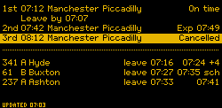

# inky-departures

A train and bus departure board for your station and stops, for a Raspberry Pi with a four-colour Inky pHAT (250x122), a Waveshare 10.85" e-Paper (G) (1360x480), or a Waveshare 7.9" HDMI screen (1280x400). The examples use a board in Glossop, showing trains to Manchester and buses from two nearby stops (`examples/glossop.toml`).



New here? The [user guide](docs/USER_GUIDE.md) explains what everything on the board means, how to use the settings page, and how to set it up and troubleshoot it.

- **Where it works:** trains anywhere in Great Britain (National Rail Darwin). Bus times and positions from BODS cover England only. The rain warning works anywhere. Bank holidays follow England and Wales, Scotland or Northern Ireland (`bank_holiday_division`).
- **Trains:** National Rail Darwin, via the Rail Data Marketplace. Free, polled every 2 minutes.
- **Buses:** either worked out the way [bustimes.org](https://bustimes.org) does, from the DfT's Bus Open Data Service (BODS) timetable for your stops plus live bus positions, free and checked all day; or TransportAPI, whose free plan is 30 hits/day, so polling is limited to set windows with a hard daily budget. With BODS, TransportAPI can stand in while there is no usable timetable.
- An e-paper panel takes about 20 s to refresh, so it redraws only when what it shows changes, and never more than once every 2 minutes. `Updated HH:MM` (`Upd HH:MM` in the plain look) is when the board last changed; if a feed stops arriving, the board says `Not updating`. Departures from an earlier fetch drop off once their time has passed, even outside the polling windows.
- Two looks, set with `theme`:
  - `sign` (default): an old-school station departure board, amber dot-matrix on black, using the panel's yellow. `1st`/`2nd`/`3rd` trains, `Exp 07:49`, `Cancelled`, and a `Leave by` line under the train you can still catch. The dot-matrix font is drawn for this project at one pixel per LED.
  - `plain`: white board, bold type, red accent. Same words, except the leave time sits in the header (`Leave 07:07 (07:12)`) and late trains show `+7`.
- Wide displays show train platforms. A National Rail disruption notice replaces the bottom line while it lasts, and a rain warning (Open-Meteo, free, no key) appears when rain is likely before you'd reach your train or bus. Bank holidays count as Sundays.
- Meaning is always in text (`Exp 07:49`, `Cancelled`, `No info`, `+4`, `sch`, `Not updating`). Colour only reinforces it, so the board works for colour-blind viewers and on a mono panel (the sign look falls back to white on black).

## 1. Get access

Step-by-step sign-up for every key, which features need which, and how to check each one works: [Getting your keys](docs/KEYS.md). The short version follows.

### Rail Data Marketplace (trains)

1. Register at <https://raildata.org.uk> and confirm your email.
2. Search the product catalogue for **Live Departure Board**. Pick the LDBWS product, not "Live Fastest Departure Boards" or the staff versions.
3. Subscribe. It's free; accept the licence.
4. Open the subscription and copy the **consumer key** into `RDM_API_KEY`.
5. Check the endpoint URL shown on the product page. If its base differs from the default in `config.example.toml`, set `[train] base_url`.

Station codes are 3 letters; National Rail's station pages show them. For example, Glossop is `GLO` and Manchester Piccadilly is `MAN`.

### TransportAPI (buses)

1. Sign up at <https://developer.transportapi.com/signup> and choose the **Free** plan.
2. Your account starts with one app. Copy its `app_id` and `app_key` into `TAPI_APP_ID` and `TAPI_APP_KEY`.
3. Find your stops' ATCO codes, either way works:
   - <https://bustimes.org>: search for the stop. The code is the last part of the stop page URL.
   - <https://www.openstreetmap.org>: zoom in, click the bus stop and read the `naptan:AtcoCode` tag.
4. Add them to `[bus.stops]` as `LABEL = "ATCO"`. The label is shown on the board (`A: Hyde`). Each stop costs one hit per poll, so two stops halve the polls you can make. Add `directions = ["Ashton"]` to filter.

### BODS (buses, the bustimes.org way)

BODS covers buses in England only.

1. Register at <https://data.bus-data.dft.gov.uk/> and copy the API key from your account settings into `BODS_API_KEY`.
2. Under `[bus]` set `source = "bods"` and `operators`, the national operator codes of the companies serving your stops (Glossop: `["BNML", "HIPK"]`). bustimes.org shows them on each operator's page; TransportAPI's `operator` field has them too.
3. Checks cost nothing, so check all day: `interval_minutes = 2`, `windows = ["Mon-Sun 06:00-23:00"]`.

`departureboard timetable` downloads the operators' timetables, keeps the journeys that call at your stops, and saves them beside the state file (about 1 MB). `departureboard-timetable.timer` checks hourly and rebuilds weekly, when a timetable in it ends, or when your stops or `operators` change. Each check, the board takes the journeys running today (by the timetable's own days, school terms and bank holiday rules), asks BODS where those lines' buses are, matches each bus to its journey by its first stop and timetabled start, and shows it as late by however far behind it is. A bus that's early is shown on time; one without a live position shows its timetabled time (`sch`).

Until there is a usable timetable (none yet, built for other stops, run out, or not rebuilt for four weeks), TransportAPI stands in if its keys are set: every `fallback_interval_minutes` (default 12), within `daily_budget`, and only inside `fallback_windows` (default: the bus windows). Keep those to the commute, as the free allowance won't stretch across a whole day. The settings page's status says when it does, and when live positions are failing.

### Walking times

Trains show when to leave for the next one you can still reach (`Leave by 07:07` under that train on the sign look, `Leave 07:07 (07:12)` in the plain header). Each bus row has its own `leave 07:16`. On e-paper it's a clock time, not a countdown, so it only changes when the next reachable departure changes; the HDMI screen counts down instead (`Leave in 3 min`). Set `walk_minutes` under `[train]`, and per stop label under `[bus.walk_minutes]`. To measure a route, ask the OpenStreetMap foot router:

```
https://routing.openstreetmap.de/routed-foot/table/v1/foot/HOME_LON,HOME_LAT;STOP_LON,STOP_LAT?sources=0
```

Round up and add a minute for crossings and platforms.

## 2. Install on the Pi

Raspberry Pi OS Lite (Bookworm or later) on the Zero W, with Wi-Fi and SSH set up in Raspberry Pi Imager.

```bash
git clone <this repo> inky-departures && cd inky-departures
sudo ./deploy/install.sh
sudo systemctl enable --now departureboard-web.service departureboard.timer
```

`config.toml` starts as a copy of `config.example.toml`. Until it is set up, the board shows **Set me up** and the settings page's address (`http://<pi name>.local:8080/`). Open it, claim the page with the code the board shows, and the setup wizard finds your station, bus stops, walk times and bus companies and saves them with your keys (see [Settings page](#settings-page)).

Or set it up by hand: put the keys in `/etc/departureboard/secrets.env` and replace each `CHANGE_ME` in `/etc/departureboard/config.toml`. `examples/glossop.toml` is a filled-in board to compare against.

Check the keys and codes with one live call each. With TransportAPI, the bus probe uses one hit per stop from your 30 daily hits; the default schedule uses 28. With BODS, build the timetable first, then probe:

```bash
sudo systemctl start departureboard-timetable.service   # takes a few minutes on a Zero W
journalctl -u departureboard-timetable -n 5
```

Run it through the service rather than by hand: the service reads the keys and writes the timetable as the board's user. To rebuild straight away rather than within the hour, delete `/var/lib/departureboard/bus-timetable.json` and start the service again.

```bash
sudo /opt/departureboard/venv/bin/departureboard probe train
sudo /opt/departureboard/venv/bin/departureboard probe bus
```

To try stops that aren't in the config, and keep the raw responses:

```bash
departureboard probe bus --stop V=1000DGVS3332 --stop W=1000DGVS3323 --save probe-raw
```

The bus probe output tells you whether you're getting live estimates (an expected time and status `late`/`on_time`) or only timetabled times (`unknown`, shown as `sch` on the board).

Start it:

```bash
sudo systemctl enable --now departureboard.timer
journalctl -u departureboard -f
```

With BODS, keep the timetable fresh too:

```bash
sudo systemctl enable --now departureboard-timetable.timer
```

To update an installed board later, copy the repo to the Pi and run `sudo ./deploy/update.sh` from it (add `--config FILE` or `--secrets FILE` to replace those too). It installs the new code, refreshes the systemd units and runs the board once.

An original Inky pHAT (before 2019, 212x104) has no EEPROM to detect it by: set `display = "inky-phat-v1"` in `config.toml`.

If the display errors about chip select, add `dtoverlay=spi0-0cs` to `/boot/firmware/config.txt` and reboot.

### Waveshare 10.85" e-Paper (G)

Set `display = "waveshare-10in85g"` in `config.toml` and add `dtoverlay=spi0-0cs` to `/boot/firmware/config.txt`: the panel is two controllers side by side, and the board drives both chip selects itself. Waveshare lists the Pi Zero 2 W, 3B, 4B and 5; the original Zero W isn't on the list.

The driver follows Waveshare's `epd10in85g.py` command sequence over `spidev` and `gpiozero`. It doesn't load Waveshare's prebuilt `DEV_Config` shared library. Each sign dot is 4x4 panel pixels.

### Waveshare 7.9" HDMI screen (400x1280)

Set `display = "hdmi-1280x400"` and `rotate = 90` (or `270`, depending on which way up it's mounted). A Pi Zero needs a mini HDMI adapter; a Zero 2 W or better is recommended.

A screen can redraw every second, so it shows more than the e-paper boards do:

- A running clock (`07:03:15`) in place of `Updated`.
- Leave times count down: `Leave in 3 min`, then `Leave now`. They round down, so they never give you more time than you have.
- No 2-minute redraw limit. Feeds are still polled on the same schedule, so the TransportAPI budget is unchanged.

pygame is only installed for the screen: run `sudo ./deploy/install.sh --screen`, or set `display` in `/etc/departureboard/config.toml` first. `update.sh` installs it if you switch to the screen later.

It runs as a long-lived service instead of the timer, drawing full screen with pygame (no desktop needed):

```bash
sudo systemctl disable --now departureboard.timer
sudo systemctl enable --now departureboard-screen.service
```

State is written only when new data arrives, not on every redraw, to spare the SD card. Touch isn't used yet, and the backlight stays on.

#### Where the next bus is

On a screen the board can alternate with a second page: 15 s of departures, then 10 s showing the stops before yours with the next bus you can still catch drawn on the road between them, and how many stops away it is. Positions come from the DfT's [Bus Open Data Service](https://data.bus-data.dft.gov.uk/) (free; register and copy the API key from your account settings into `BODS_API_KEY`). They're polled every 30 s inside your bus windows, never written to the SD card, and the page says "Position not updating" if they stop arriving. Set the stops up under `[bus.routes.<line>]` in `config.toml`. On your laptop, the `route` command builds the block for you from the operator's BODS timetable and NaPTAN: it picks enough stops before yours to cover your walk plus 5 minutes of travel (at most 8), so the bus is on the strip before you need to leave.

```bash
departureboard route 341 --stop A --noc BNML --config config.toml --secrets secrets.env >> config.toml
```

`--noc` is the operator code: TransportAPI's `operator` field, which `probe bus --save DIR` writes out. Timetable downloads for a large operator can be hundreds of MB; `--txc FILE` uses one you've already downloaded instead. The emulator's screen demo shows it with a fake bus:

```bash
departureboard emulate --demo --display hdmi-1280x400
```

### Settings page

A password-protected page on your home network for everyday settings: the look, accent and rotation, stations and stops, when to check, walking times, and API keys. Keys are write-only: the page says whether one is set but never shows it.

```bash
sudo systemctl enable --now departureboard-web.service
```

Then open `http://<pi name>.local:8080/` from a phone or laptop on the same network. The first visit claims the page: press **Show a code on the board**, read the 6-digit code off the board, and type it with a new password. A forgotten password works the same way, from **Forgot password?** on the sign-in page. Or set the password on the Pi with `sudo -u departureboard /opt/departureboard/venv/bin/departureboard web --set-password`, and print a code with `... web --reset-code` when the board can't show one.

**Set up home, station and stops** (`/setup/`) is the setup wizard: postcode or address, the nearest stations and stops, walk times, keys, then a search for the bus companies serving your stops, which builds their timetable. Until the board is set up it opens straight after claiming or signing in. The [user guide](docs/USER_GUIDE.md#setting-up-home-station-and-stops) says what it sends where.

- Saved settings go to `/var/lib/departureboard/settings.toml`, layered over `config.toml`, which is never rewritten. Keys go to `/var/lib/departureboard/secrets.env` (0600). The form and the wizard both merge what they change into those files, so neither loses what the other saved.
- Nothing is saved unless every field passes its check and the whole configuration loads.
- The e-paper board picks changes up on its next minute. The screen reloads within a second, and restarts itself if the display settings changed.
- Changing between e-paper and the screen means switching services, so the display type stays in `config.toml`.
- Security:
  - Only private and link-local addresses get in, checked by the page and by the service's systemd IP firewall.
  - On a Pi Zero (W) kernel, systemd can't enforce the unit's IP firewall or memory cap: Raspberry Pi OS turns memory
    accounting off there, and the BPF firewall can't be set up (it logs "Preparation of BPF allow maps failed").
    The page's own address and host checks, sign-in, lockout, task limit and two-at-a-time password checks still apply,
    so keep it behind your router with no port forwarded to 8080.
  - Requests must name a local host, which stops DNS-rebinding pages.
  - A signed-in session, a form token and a same-origin check are needed to change anything.
  - The wizard under `/setup/` is the only part with JavaScript, and the only part whose Content-Security-Policy
    allows it (`script-src 'self'`). It serves a fixed list of files with set content types, and its JSON API needs
    the session, its form token in an `X-CSRF-Token` header, a same-origin request and a body under 16 kB.
  - The page's own service can't reach the internet (its unit's IP filter), so a flaw in it can't be used to. The
    wizard's lookups (postcodes, stops, walk times, key tests, bus timetables) run in a separate
    `departureboard-setup.service` with outbound access only, started by `departureboard-setup.path` when the page
    leaves a request in `/run/departureboard-setup/` and stopped a minute after the last. It reads the saved keys
    itself; a request holds only what you typed or pasted, is kept in memory (never on the SD card) and is deleted as
    it is read.
  - Five wrong passwords lock an address out for 15 minutes.
  - Being on the network is not enough to set a password: that needs a one-time code from the board's display (or
    the command line). A code lasts 10 minutes and works once; five wrong tries void it; at most one is shown a minute
    and ten a day. Setting a password this way signs every other browser out.
  - The page is plain HTTP on your LAN, so use a password you don't use anywhere else.

## 3. Develop on your laptop

```bash
python3 -m venv .venv && . .venv/bin/activate
pip install -e ".[dev]"
pytest
departureboard demo --png preview.png            # sample data, no keys
departureboard demo --png big.png --display waveshare-10in85g   # or hdmi-1280x400
departureboard run --png preview.png --config config.toml --secrets secrets.env
```

## Emulator

A browser page that draws the panel at true proportions and logs every tick, so you can see when the board redraws and when it leaves the panel alone. E-paper panels show in e-paper colours and play the slow colour refresh; the HDMI screen swaps frames at once and ticks every second.

```bash
departureboard emulate --demo                       # fake data, 1 simulated minute every 2 s
departureboard emulate --fake-train \
  --config config.toml --secrets secrets.env        # fake trains, live buses
departureboard emulate --config config.toml --secrets secrets.env   # all live
departureboard emulate --demo --display hdmi-1280x400                # another panel
```

It opens <http://127.0.0.1:8780/>. Live modes emulate the `display` in your config; `--display` overrides it. Choose realistic (20 s), quick or instant refresh, and the scale (1× to 4× for the pHAT, ½× or 1× for the bigger panels); 1× is the panel's real pixel count. The demo drops the bus feed from 07:30 to 07:52 simulated time, so the "Not updating" badge shows up.

On start the emulator fetches every source once, even outside its windows, so the board fills straight away; after that it polls only inside the windows. A live start therefore costs one TransportAPI hit per bus stop. The daily budget still applies, and when it is spent the first fetch is skipped too. `departureboard run` does the same on its very first run, when there is no saved state yet.

Live modes keep state in `state_file`, so the TransportAPI budget holds across restarts.

## Dashboard

`departureboard dashboard` serves a full departures page on your Mac (or, with `docker-compose.yml`, on a Synology NAS): 10 trains and 10 buses, calling points, bus strips and a Leaflet map, weather, leave alerts and punctuality history. See the [user guide](docs/USER_GUIDE.md#4-the-dashboard).

Its **Settings** need a password, claimed with a code from the dashboard's log. Or set it from the command line, while the dashboard runs, with `departureboard dashboard --set-password` (it uses the same folder as the dashboard, or the one given with `--state-dir`), and print a code with `--reset-code`. In Docker:

```bash
docker exec -it departureboard-dashboard python -m departureboard.cli dashboard --set-password --state-dir /data
docker exec -it departureboard-dashboard python -m departureboard.cli dashboard --reset-code --state-dir /data
``` The server and page talk through a read-only JSON and SSE API, specified in [docs/dashboard-api.md](docs/dashboard-api.md); the page is vanilla JS modules with no build step, under a strict CSP.

## Layout

| Module | Role |
|---|---|
| `model.py` | Provider-neutral `Departure` and lateness maths |
| `darwin.py`, `transportapi.py` | Sources; HTTP injected, so parsing is tested with fixtures |
| `timetable.py`, `schedule_model.py` | BODS TransXChange to the journeys calling at your stops, and when each runs (`timetable` command) |
| `roadshape.py` | The roads between stops for the dashboard's bus maps, from the OpenStreetMap car router, once per timetable build |
| `livebus.py` | Pure: matches live buses to timetabled journeys and works out departures and delays |
| `bodsbus.py` | The `source = "bods"` bus source: timetable plus live positions, TransportAPI fallback |
| `schedule.py`, `budget.py` | When to poll, and the daily hit cap |
| `view.py` | Departures to text rows plus a change signature |
| `panel.py` | Panel sizes; bigger panels draw each sign dot as a block of pixels |
| `themes.py` | `sign` and `plain`: wording plus renderer |
| `sign.py`, `dotfont.py` | Station board renderer and its dot-matrix font |
| `render.py` | Plain renderer |
| `display.py` | Inky or PNG output; picks the display named in config |
| `waveshare.py` | Waveshare 10.85" e-Paper (G) driver |
| `screen.py` | HDMI screen output with pygame |
| `emulator.py`, `emulator.html`, `emulation.py` | Browser panel emulator and its demo/live wiring |
| `bods.py`, `route.py` | Live bus positions from BODS; placing the next bus on its route strip |
| `routesetup.py` | Builds a route strip from a BODS timetable and NaPTAN (`route` command) |
| `setup.py`, `osgb.py`, `data/` | First-run setup core: home from a postcode or address, nearby stations and stops, walk times, a config fragment |
| `weather.py` | Open-Meteo hourly forecast and the rain-warning rule |
| `holidays.py` | Bank holidays from GOV.UK (England and Wales, Scotland, Northern Ireland), cached weekly |
| `status.py` | The settings page's Status section; short, key-free error messages |
| `safexml.py` | XML parsing that refuses a DOCTYPE |
| `fake.py` | Deterministic fake sources (sample Glossop data) and simulated clock |
| `app.py` | One tick: poll what's due, redraw only on change |
| `web.py`, `settingsform.py`, `web.css` | Settings page: sign-in and request checks; the form, its checks and saving |
| `history.py` | Punctuality history in SQLite (dashboard) |
| `dashconfig.py`, `collector.py`, `snapshot.py`, `dashserver.py` | Dashboard: settings, pollers, the versioned snapshot, the HTTP/SSE server |
| `dashboard_static/` | Dashboard page: HTML, CSS, JS modules, vendored Leaflet 1.9.4 |
| `cli.py`, `config.py` | `run` / `probe` / `demo` / `timetable`; TOML settings, env secrets |

To add a page or provider, implement `fetch() -> list[Departure]` with a `name` and add it to `config.py`.

## Licence

MIT: see [LICENSE](LICENSE). The data the board shows comes under its providers' own terms.

## Data credits

See [NOTICE.md](NOTICE.md) for every data source and licence.
