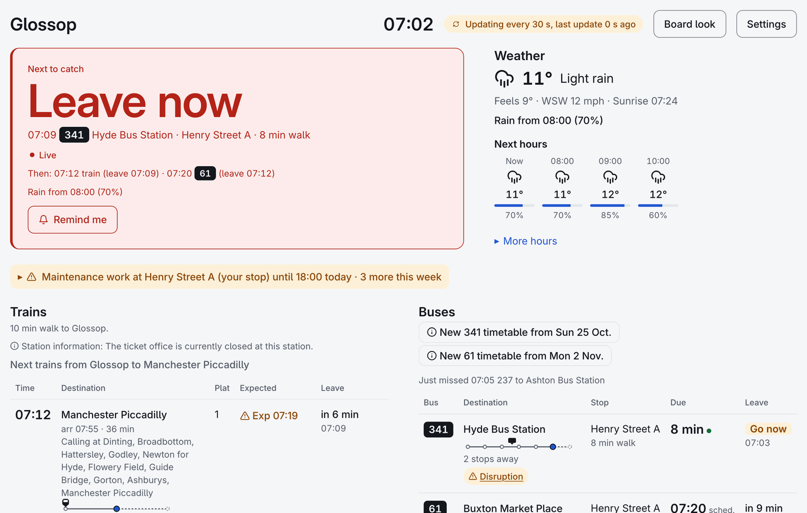
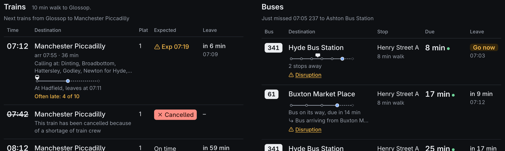
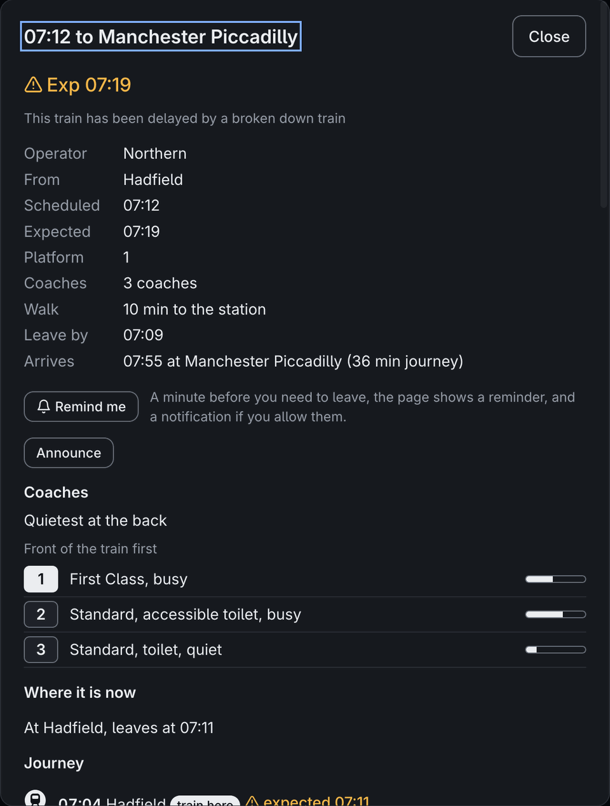
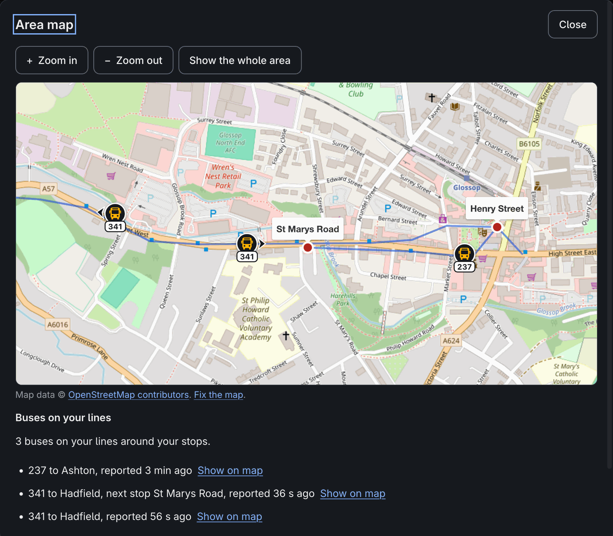
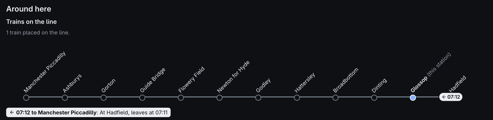
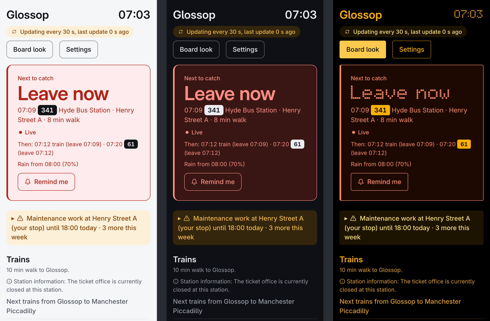
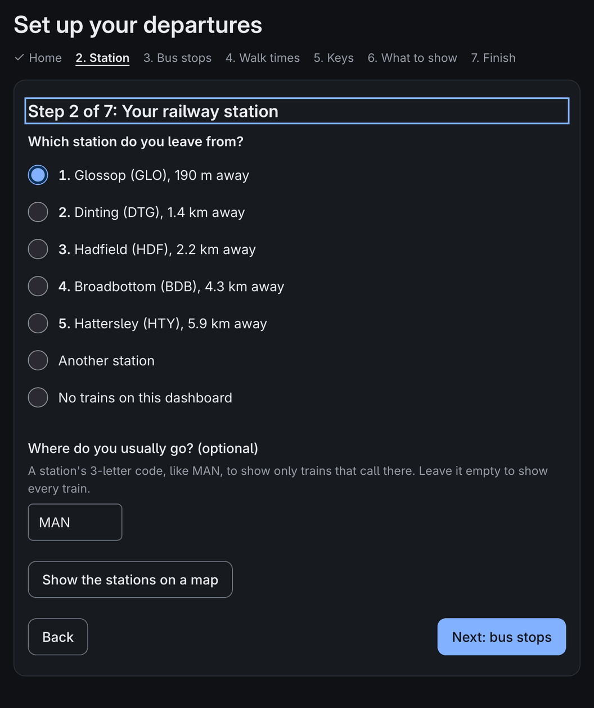
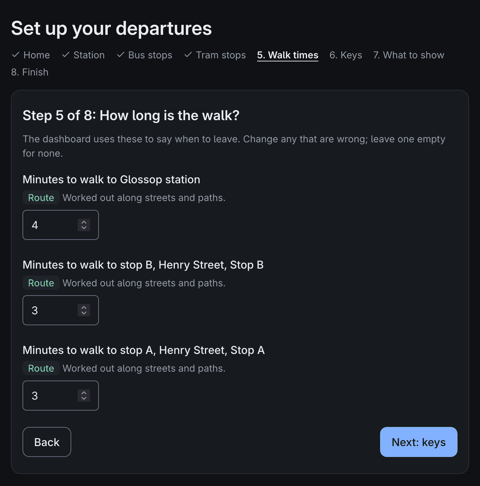
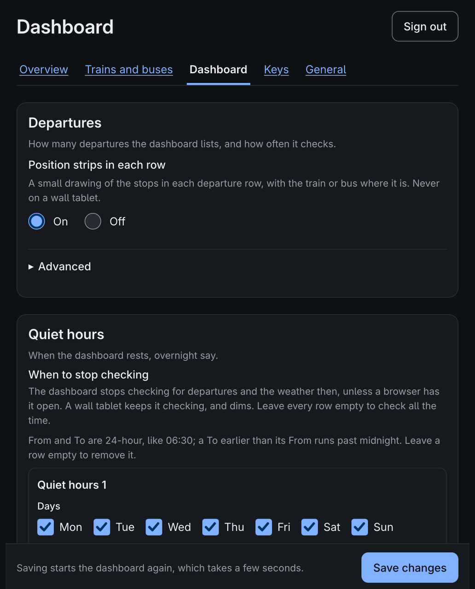

# Two Bells

**Know when to leave.** Live trains and buses for your station and stops in Great Britain, with the walk already worked out: a departure board by the door and a dashboard on your phone, from one small app you run at home.

[](https://github.com/acornelissen/twobells/actions/workflows/ci.yml)
[](LICENSE)

<picture>
  <source media="(prefers-color-scheme: dark)" srcset="docs/images/dashboard-dark.png">
  
</picture>

One install is one app with two views of the same departures:

- **The board:** a Raspberry Pi with a four-colour Inky pHAT (250x122). The app also draws for a Waveshare 10.85" e-Paper (G) (1360x480), a Waveshare 7.9" HDMI screen (1280x400, on its side) and an 11.3" HDMI bar screen (1920x440); those are tested in software but not yet on the hardware.
- **The dashboard:** a web page for a phone or computer at home, with the next 10 trains and buses, calling points, bus strips and maps, the weather, disruptions and punctuality history.

A Pi can run either view or both; Docker and a desktop run the dashboard. Each install has one settings site, at `/settings` on port 8090, with one password and a setup wizard that finds your station, stops, walk times and bus companies from your postcode. The examples use Glossop, with trains to Manchester and buses from two nearby stops (`examples/glossop.toml`).

## Why it's worth a place by your door

- **It tells you when to leave, not just when it goes.** Every train and bus comes with your walk to its stop, so the page says *Leave now*, *Leave in 4 min* or *Go now*, and can remind you a minute before.
- **Live trains, properly.** National Rail Darwin gives the platform, coaches, delays and their reasons, every calling point, and where the train is right now.
- **Live buses, for free, all day.** Worked out the way [bustimes.org](https://bustimes.org) does it, from the BODS timetable plus live bus positions. A strip under each bus shows how many stops away it is.
- **The things that change your plan.** Disruptions on your journeys, rain on its way, a new timetable starting soon, and which trains are *often late*.
- **Yours, at home.** It runs on a Pi, a NAS or a laptop on your own network, with free API keys and no cloud account. The Pi's web server never connects to the internet, and releases are signed.
- **Easy to read for everyone.** It is built to WCAG 2.2 AA, for the keyboard and screen readers, and always says what it means in words. Colour only backs the words up.

## The dashboard

The next trains and buses side by side, each with its walk, its countdown and where it is now:



Open a train for its whole journey, or the area map for every bus on your lines:

<p>
  
  
</p>

Where there is room, the line runs across the page with each train placed on it:



Light, dark, the amber Dot matrix look, the white and yellow TFT look or the Split-flap look, at any size from a phone to a wall tablet (`/?kiosk`):



## The board

An e-paper board needs no attention: it redraws only when what it shows changes. It comes in two looks: `sign`, an amber dot-matrix station board whose font was drawn for this project one pixel per LED, and `plain`, black on white with a red accent.


On the 10.85" e-paper there is room for platforms (as the app draws it; not yet run on the panel itself):


An HDMI screen redraws every second, with a running clock and countdowns, and a page showing where your next bus is (again as the app draws it, not yet tried on a real screen):


## Set up in a few minutes

No config files to write. Give the setup wizard your postcode or address: it finds your nearest stations and bus stops, works out the walk to each along real streets, finds your bus companies and builds their timetable.

<p>
  
  
</p>

Everything else is on the settings site, in plain words, behind one password:



## What it covers

- **Where it works:** trains anywhere in Great Britain. Bus times and positions from BODS cover England only. The rain warning works anywhere. Bank holidays follow England and Wales, Scotland or Northern Ireland.
- **Trains:** National Rail Darwin, via the Rail Data Marketplace. Free.
- **Buses:** worked out the way [bustimes.org](https://bustimes.org) does, from the DfT's Bus Open Data Service (BODS) timetable for your stops plus live bus positions, free and checked all day. On the board, TransportAPI (free plan: 30 lookups a day) can stand in while there is no usable timetable.
- **Meaning is always in text** (`On time`, `Exp 07:49`, `Delayed`, `Cancelled`, `No report`, `sch`, `Not updating`). Colour only reinforces it, so both views work for colour-blind viewers, and the board works on a mono panel.

## Install

- **Raspberry Pi** (the board, and the dashboard if you like): download a release tarball and its `SHA256SUMS`, check it, unpack it and run `sudo ./deploy/pi/install.sh`. Nothing is piped from the internet into `sudo bash`. See [Install on a Raspberry Pi](docs/install-pi.md).
- **Docker** (a NAS, say; the dashboard): the signed image `ghcr.io/acornelissen/twobells`, or build it from source with `docker compose up -d --build`. See [Docker](docs/docker.md), with steps for Synology, QNAP, Unraid, TrueNAS SCALE, and Docker or Podman on Linux.
- **Desktop** (a Mac or Linux laptop; the dashboard): `uv tool install twobells` or `pipx install twobells`, then `twobells serve`. See [Desktop](docs/desktop.md).

Then open the settings at `/settings` on port 8090 and let the [setup wizard](docs/setup-wizard.md) do the rest. No `config.toml` is needed. You'll need free [keys](docs/keys.md) for trains and buses.

The settings password is claimed with a code shown on the board, or put in the log where there is no board. Or set it from the command line; in Docker:

```bash
docker exec -it twobells python -m twobells serve --set-password --state-dir /data
docker exec -it twobells python -m twobells serve --reset-code --state-dir /data
```

## Documentation

The [user guide](docs/user-guide.md) is the index to everything: reading the board and the dashboard, installing, the settings, keys, looking after a Pi, and troubleshooting. What changed in each release is in [CHANGELOG.md](CHANGELOG.md).

## Contributing

[CONTRIBUTING.md](CONTRIBUTING.md) covers setting up with [mise](https://mise.jdx.dev), running the app and the browser panel emulator, the checks a change must pass, and releases. [Architecture](docs/architecture.md) shows how the code is laid out, and [Dashboard API](docs/dashboard-api.md) the contract between the server and the dashboard page.

## Security

Found a vulnerability? Please report it privately, as [SECURITY.md](SECURITY.md) says.

## Licence

MIT: see [LICENSE](LICENSE). The data the app shows comes under its providers' own terms.

## Data credits

See [NOTICE.md](NOTICE.md) for every data source and licence.
