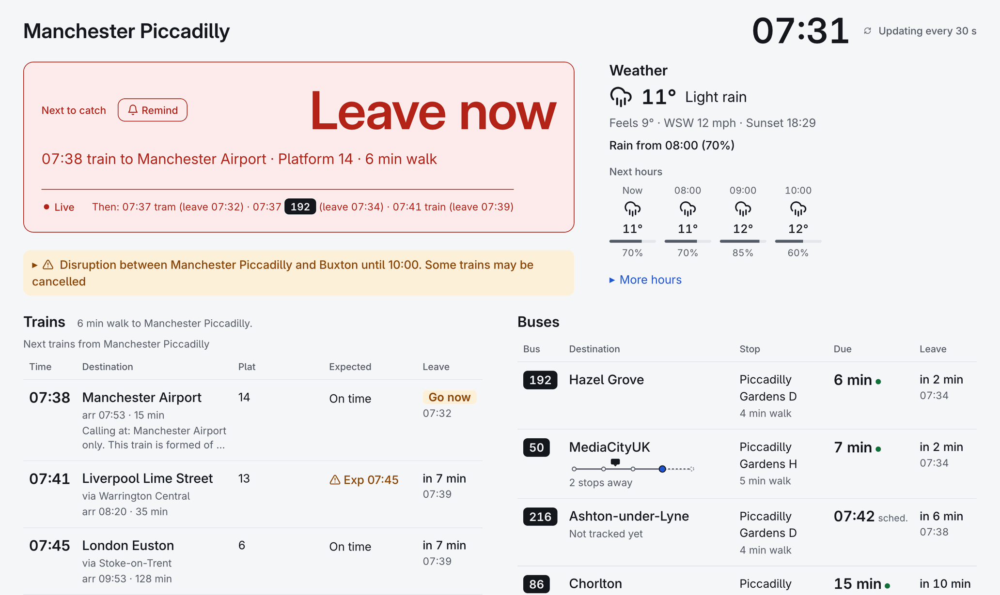
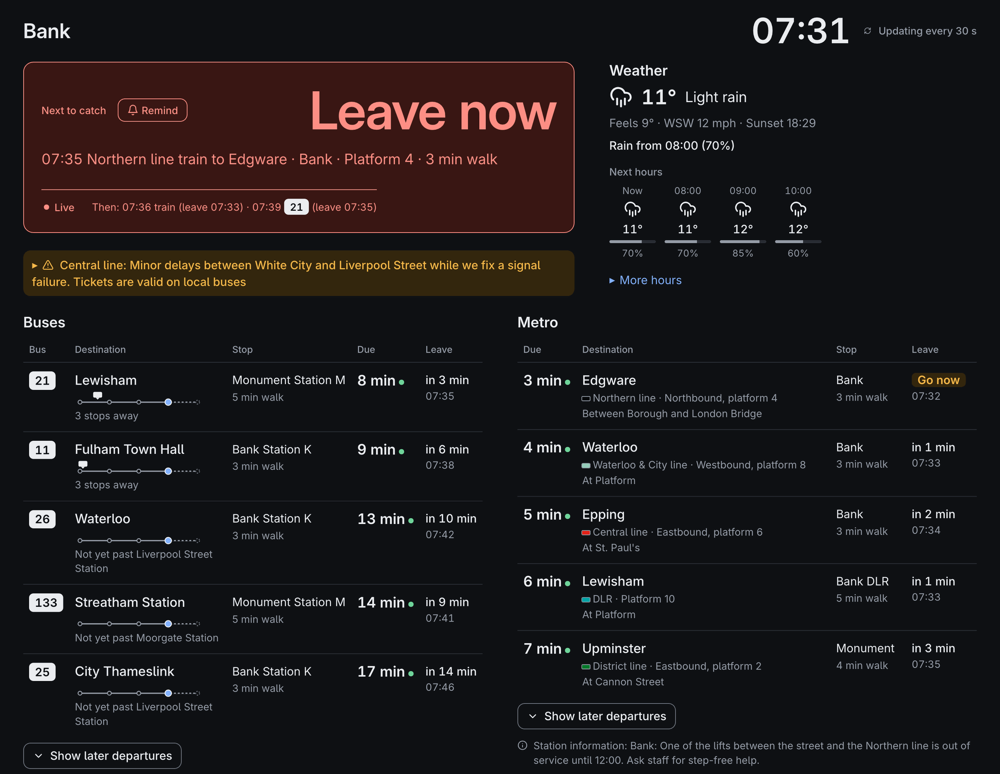
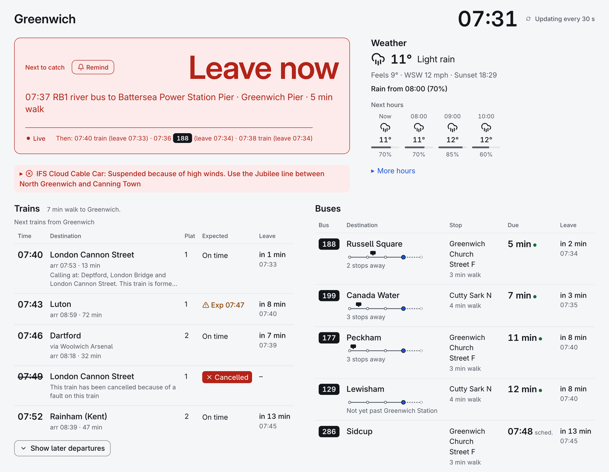
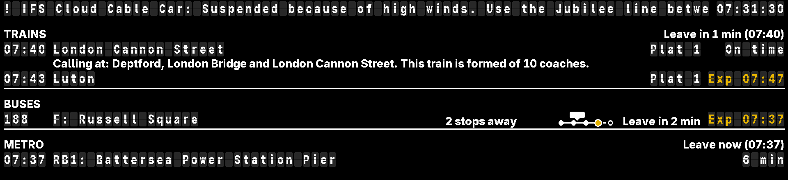
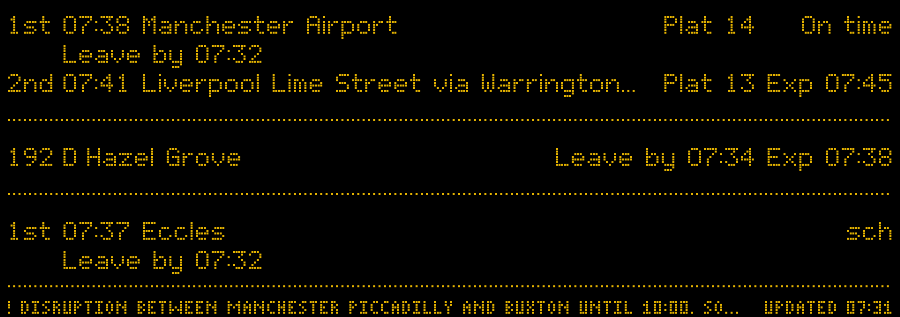

# Two Bells

**Know when to leave.** Live trains and buses for your station and stops in Great Britain, and Manchester's trams or London's Underground where you have them, with the walk already worked out: a departure board by the door and a dashboard on your phone, from one small app you run at home.

[](https://github.com/acornelissen/twobells/actions/workflows/ci.yml)
[](LICENSE)

<picture>
  <source media="(prefers-color-scheme: dark)" srcset="docs/images/dashboard-piccadilly-dark.png">
  
</picture>

A made-up morning at Manchester Piccadilly. In every picture here the stations, stops and lines are real and the times invented.

One install is one app with two views of the same departures:

- **The board:** a Raspberry Pi with a four-colour Inky pHAT (250x122). The app also draws for a Waveshare 10.85" e-Paper (G) (1360x480), a Waveshare 7.9" HDMI screen (1280x400, on its side) and an 11.3" HDMI bar screen (1920x440); those are tested in software but not yet on the hardware.
- **The dashboard:** a web page for a phone or computer at home, with the next 10 trains and 15 buses (and 10 trams), calling points and coaches, bus strips and maps, the weather, disruptions, punctuality history, a Performance page with Delay Repay, and station announcements.

A Pi can run either view or both; Docker and a desktop run the dashboard. Each install has one settings site, at `/settings` on port 8090, with one password and a setup wizard that finds your station, bus and tram stops, walk times and bus companies from your postcode. Each view shows the modes of transport you choose. The examples, and the pictures from [The dashboard](#the-dashboard) on, use Glossop, with trains to Manchester and buses from two nearby stops (`examples/glossop.toml`).

## Busy places, every mode at once

In London the Underground, DLR, river buses and cable car come live from TfL, beside the buses and trains: at Bank the Underground, the DLR and London's buses, and at Greenwich trains, buses, the river bus and the cable car's status.

<p>
  
  
</p>

By the door, an 11.3" bar screen shares the same departures between three modes, here in the station board and split-flap looks (as the app draws them; not yet run on the screen itself):




## Why it's worth a place by your door

- **It tells you when to leave, not just when it goes.** Every train and bus comes with your walk to its stop, so the page says *Leave now*, *Leave in 4 min* or *Go now*, and can remind you a minute before.
- **Live trains, properly.** National Rail Darwin gives the platform, coaches, delays and their reasons, every calling point, and where the train is right now.
- **Live buses, for free, all day.** Worked out the way [bustimes.org](https://bustimes.org) does it, from the BODS timetable plus live bus positions. A strip under each bus shows how many stops away it is.
- **Trams and the Underground too.** Manchester's Metrolink from TfGM's own timetable, and London's Underground, DLR, trams, cable car and river buses live from TfL, each in a section of its own with its walk and when to leave.
- **The things that change your plan.** Disruptions on your journeys, rain on its way, a new timetable starting soon, and which trains are *often late*.
- **Yours, at home.** It runs on a Pi, a NAS or a laptop on your own network, with free API keys and no cloud account. The Pi's web server never connects to the internet, and releases are signed.
- **Easy to read for everyone.** It is built to WCAG 2.2 AA, for the keyboard and screen readers, and always says what it means in words. Colour only backs the words up.

## The dashboard

The next trains and buses side by side, each with its walk, its countdown and where it is now:


Manchester's trams have a section too, wherever home is; in London the Underground and DLR come live, with each line's colour and where each train is now, as at [Bank](#busy-places-every-mode-at-once).

Open a train for its whole journey, or the area map for every bus on your lines:

<p>
  
  
</p>

Where there is room, the line runs across the page with each train placed on it:


Light, dark, the amber Dot matrix look, the white and yellow TFT look or the Split-flap look, at any size from a phone to a wall tablet (`/?kiosk`):


## The board

An e-paper board needs no attention: it redraws only when what it shows changes. It comes in two looks: `sign`, an amber dot-matrix station board whose font was drawn for this project one pixel per LED, and `plain`, black on white with a red accent.


On the 10.85" e-paper there is room for platforms and [three modes](docs/configuration.md#modes-of-transport) (as the app draws it; not yet run on the panel itself):



An HDMI screen redraws every second, with a running clock and countdowns, two more looks (`tft`, white and yellow on black, and `flap`, a split-flap board whose tiles turn), and if you want them the first train's calling points, a platform clock page and station announcements through a speaker. It also has a page showing where your next bus is (again as the app draws it, not yet tried on a real screen):


## Set up in a few minutes

No config files to write. Give the setup wizard your postcode or address: it finds your nearest stations, bus stops and tram stops (or any tram stop by name), works out the walk to each along real streets, finds your bus companies and builds their timetable.

<p>
  
  
</p>

Everything else is on the settings site, in plain words, behind one password:


## What it covers

- **Where it works:** trains anywhere in Great Britain. Bus times and positions from BODS cover England only. Trams: Manchester's Metrolink and London's metro. The rain warning works anywhere. Bank holidays follow England and Wales, Scotland or Northern Ireland.
- **Trains:** National Rail Darwin, via the Rail Data Marketplace. Free.
- **Buses:** worked out the way [bustimes.org](https://bustimes.org) does, from the DfT's Bus Open Data Service (BODS) timetable for your stops plus live bus positions, free and checked all day. On the board, TransportAPI (free plan: 30 lookups a day) can stand in while there is no usable timetable.
- **Trams:** Manchester's Metrolink from the timetable TfGM publishes each night (booked times, no key), and London's Underground, DLR, trams, cable car and river buses live from TfL's Unified API (free; an optional key raises TfL's allowance).
- **Meaning is always in text** (`On time`, `Exp 07:49`, `Delayed`, `Cancelled`, `No report`, `sch`, `Not updating`). Colour only reinforces it, so both views work for colour-blind viewers, and the board works on a mono panel.

## Install

- **Raspberry Pi** (the board, and the dashboard if you like): download a release tarball, its `SHA256SUMS` and that file's signature, check them with cosign and `sha256sum`, unpack the tarball and run `sudo ./deploy/pi/install.sh`. To move to a later release, `sudo ./deploy/pi/upgrade.sh <version>` checks and installs it the same way. Nothing is piped from the internet into `sudo bash`. See [Install on a Raspberry Pi](docs/install-pi.md).
- **Docker** (a NAS, say; the dashboard): the signed image `ghcr.io/acornelissen/twobells`, or build it from source with `docker compose up -d --build`. See [Docker](docs/docker.md), with steps for Synology, QNAP, Unraid, TrueNAS SCALE, and Docker or Podman on Linux.
- **Desktop** (a Mac or Linux laptop; the dashboard): `uv tool install twobells` or `pipx install twobells`, then `twobells serve`. See [Desktop](docs/desktop.md).

Then open the settings at `/settings` on port 8090 and let the [setup wizard](docs/setup-wizard.md) do the rest. No `config.toml` is needed. You'll need free [keys](docs/keys.md) for trains and buses.

The settings password is claimed with a code shown on the board, or put in the log where there is no board. Or set it from the command line; in Docker:

```bash
docker exec -it twobells python -m twobells serve --set-password --state-dir /data
docker exec -it twobells python -m twobells serve --reset-code --state-dir /data
```

## Documentation

The [user guide](docs/user-guide.md) is the index to everything: reading the board and the dashboard, installing, the settings, keys, looking after a Pi, and troubleshooting. What changed in each release is in [CHANGELOG.md](CHANGELOG.md).

## Contributing

[CONTRIBUTING.md](CONTRIBUTING.md) covers setting up with [mise](https://mise.jdx.dev), running the app and the browser panel emulator, the checks a change must pass, and releases. [Architecture](docs/architecture.md) shows how the code is laid out, and [Dashboard API](docs/dashboard-api.md) the contract between the server and the dashboard page.

## Security

Found a vulnerability? Please report it privately, as [SECURITY.md](SECURITY.md) says.

## Licence

MIT: see [LICENSE](LICENSE). The data the app shows comes under its providers' own terms.

## Data credits

See [NOTICE.md](NOTICE.md) for every data source and licence.
