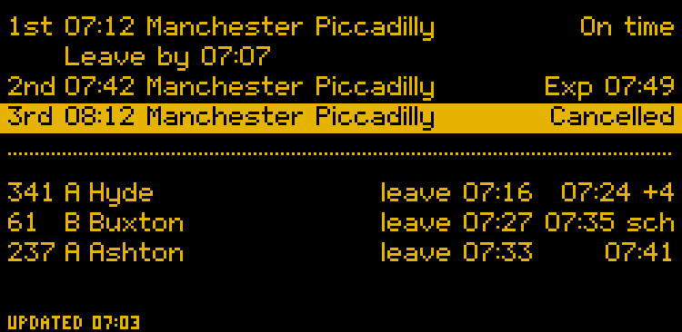
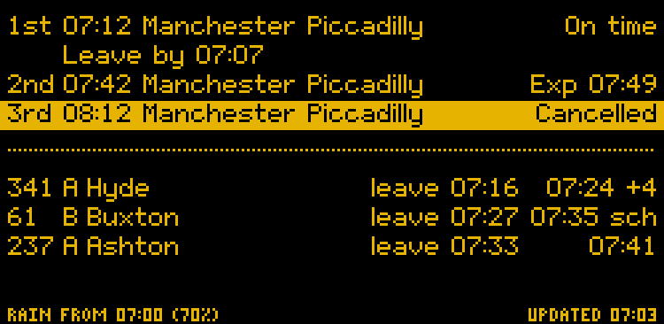
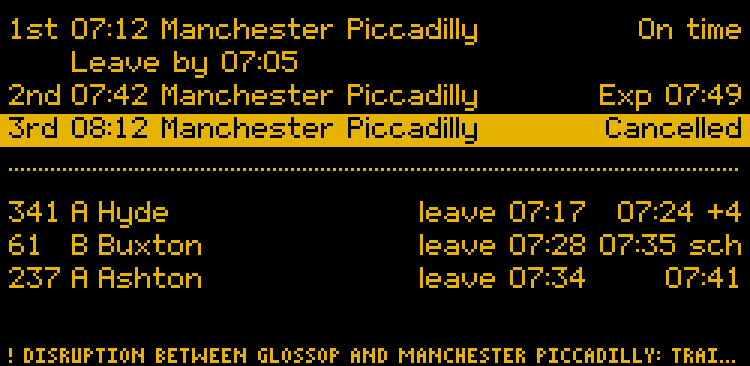
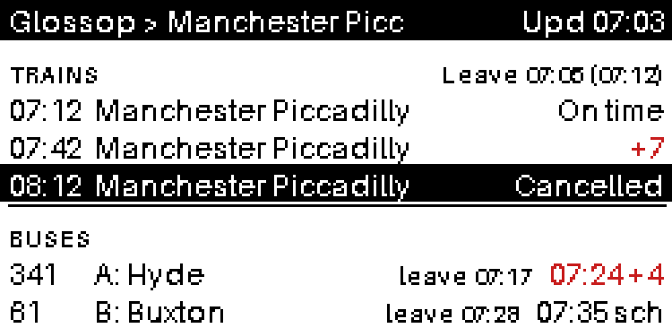
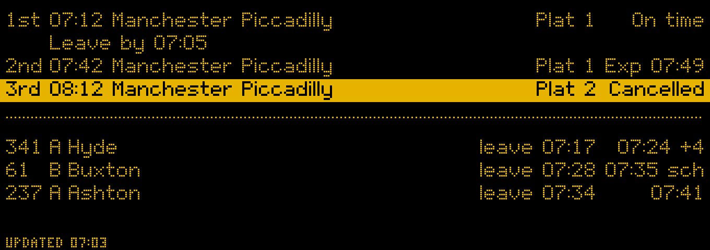
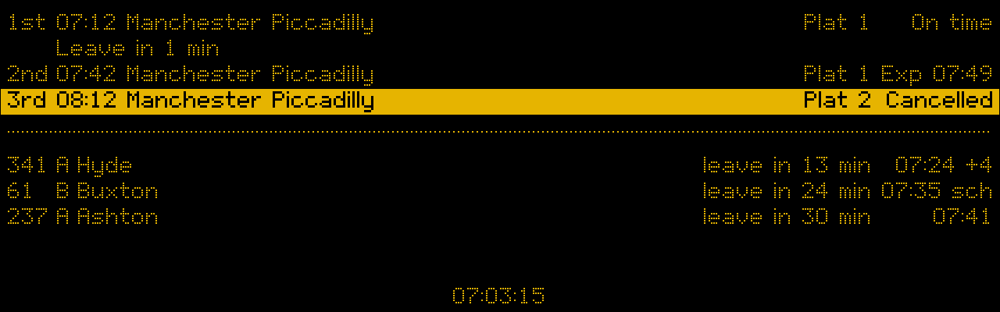
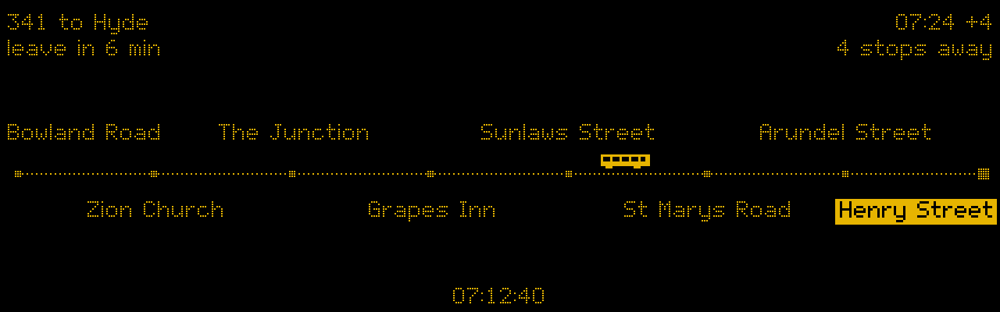
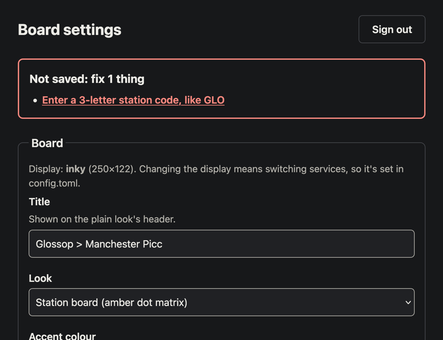

# Departure board user guide

The board shows the next trains from your station and the next buses from your stops, and tells you when to set off so you catch them. The examples in this guide come from a board in Glossop, showing trains to Manchester and buses from the Henry Street stops.

This guide has four parts:

1. [Reading the board](#1-reading-the-board): for everyone in the house.
2. [Changing settings](#2-changing-settings): using the settings page from a phone or laptop.
3. [Setting up and looking after it](#3-setting-up-and-looking-after-it): for whoever installs and maintains it.
4. [The dashboard](#4-the-dashboard): the full version in a web browser, on a Mac or a NAS.

Developer details (code layout, tests, the emulator) are in the [README](../README.md).

---

## 1. Reading the board

The board can run on three kinds of display. They all show the same information:

| Display | Size | How it updates |
|---|---|---|
| Inky pHAT e-paper | small, 2.13" | Redraws only when something changes, at most every 2 minutes. Each redraw takes about 20 seconds and flickers. That's normal. |
| Waveshare e-paper | wide, 10.85" | Same as the pHAT, just bigger. |
| HDMI screen | wide, 7.9" | Updates every second, with a running clock, countdowns and a second page showing where your bus is. |

The words always carry the meaning. Colour and highlighting only back them up, so the board reads the same in black and white or to someone who is colour-blind.

### The station board look

This is the usual look: amber dots on black, like a railway station sign.



**Trains (top half)**

Each line reads: *which train*, *scheduled time*, *destination*, *status*.

| You see | It means |
|---|---|
| `1st 07:12 … On time` | The next train, running to time. |
| `Exp 07:49` | Running late; expected to leave at 07:49. |
| `Delayed` | Late, but no expected time yet. |
| `Cancelled`, on a highlighted bar | It isn't running. |
| `No info` | No information about this train yet. |
| `Leave by 07:05` | Set off at 07:05 to walk to the station and catch the train above it. It sits under the first train you can still reach, so if the 1st is too soon, it moves down to the 2nd. |

**Buses (bottom half)**

Each line reads: *route*, *stop*, *destination*, *when to leave*, *when it goes*.

| You see | It means |
|---|---|
| `341 A Hyde` | Route 341 from Henry Street Stop A, going to Hyde. |
| `leave 07:17` | Set off at 07:17 to walk to that stop in time. |
| `07:41` | Live tracking says it's on time. |
| `07:24 +4` | Live tracking says it's 4 minutes late and will leave at 07:24. |
| `07:35 sch` | Timetable time only ("scheduled"): there's no live position for this bus yet, so it could be late. |
| `Cancelled`, on a highlighted bar | It isn't running. |

**Bottom line**

| You see | It means |
|---|---|
| `UPDATED 07:03` | When the board last changed. The e-paper only redraws when something changes, so this can be a few minutes ago. |
| `NOT UPDATING: BUSES`, highlighted | No new bus information has arrived for a while. What's shown is the last known, and may be out of date. The same applies to trains. |
| `RAIN FROM 07:00 (70%)` | Rain is likely (here a 70% chance) before you'd reach your next train or bus. Only shown when rain is likely; nothing on dry days. |
| `! DISRUPTION …` | A National Rail incident notice for the station. It takes the whole line while it lasts, and goes when the notice is withdrawn. On the small display it's cut short with `…`. |





### The plain look

The same information in black on white, with red highlights. The words are the same as the station board look; only where some of them sit differs. Someone may have switched to it on the settings page.



The differences:

| Plain look | Station board look |
|---|---|
| `Upd 07:03` in the top bar | `UPDATED 07:03` at the bottom |
| `Leave 07:05 (07:12)` next to TRAINS: leave at 07:05 for the 07:12 | `Leave by 07:05` under the train |
| `+7` in the accent colour: 7 minutes late | `Exp 07:49` |
| `Cancelled` on a black bar | `Cancelled` on a highlighted bar |
| `! NOT UPDATING` in the accent colour, next to TRAINS or BUSES | `NOT UPDATING: …` at the bottom |
| A rain warning or disruption notice in the top bar, in place of the title | At the bottom |

The plain look shows 3 trains and 2 buses.

### The bigger e-paper display

The 10.85" display shows the same board with bigger dots and more room, so long destinations fit, and each train's platform shows (`Plat 1`). Platforms aren't shown on the small display, where there isn't room.



### The HDMI screen

The screen can redraw every second, so it shows a bit more:



- **A running clock** at the bottom, in place of "Updated".
- **Countdowns** in place of clock times: `Leave in 3 min`, then `Leave now` in the last minute. They round down, so `Leave in 3 min` means you have at least 3 minutes, never less.
- On the screen, a bus you can no longer reach on foot loses its leave time, rather than saying "leave now".
- **Platforms**, as on the bigger e-paper display.
- A rain warning or disruption notice sits at the bottom left and the clock moves to the right. A notice too long for one line is shown a part at a time, changing every 5 seconds; each part starts with `!` and all but the last end with `…`.

#### Where the next bus is

If it's set up, the screen switches every 25 seconds: 15 seconds of departures, then 10 seconds of this page.



- **Top line:** the bus you can still catch, and when it goes (`341 to Hyde … 07:24 +4`).
- **Second line:** when to leave, and how many stops away the bus is, counting your stop.
- **The line of stops:** the stops the bus calls at before yours. Your stop is the highlighted one on the right; the bus is drawn on the road where it is now.

It also says:

| You see | It means |
|---|---|
| `Not yet past Bowland Road` | The bus is further back than the first stop shown. |
| `At your stop` | It's at your stop now. |
| `Position not updating` | Live positions have stopped arriving. Use the departure times instead. |

The page only appears when the board is checking buses (see *When it checks* below) and there's a tracked bus you can still catch.

### When it checks

The board only fetches new times during set windows. Train times and the bus timetable cost nothing, so their windows can cover the whole day; if bus times come from TransportAPI instead (see [Bus times](#bus-times)), its free limit means short windows, such as weekday mornings and early evenings. Outside the windows it keeps showing what it last knew, and doesn't say "not updating", because it isn't trying to. Departures drop off once their time has passed, so the evening never shows the morning's buses. The windows are on the settings page.

On bank holidays trains and buses run a Sunday service, so the board treats them like Sundays: weekday-only windows are off, and windows that include Sundays apply.

---

## 2. Changing settings

The settings page works from any phone or laptop on the home network.

1. Open `http://<board name>.local:8080/` (for example `http://departureboard.local:8080/`).
2. Sign in with the settings password.
3. Change what you need, then press **Save settings** at the bottom.



If something isn't right, nothing is saved. A box at the top lists the problems, each named by section and field (for example *Trains – Station code*); click one to jump to it, where the error is shown in words.

What you save replaces what's in `config.toml`, including emptying a box: clearing *Only trains calling at* really does show every train again. Settings the page doesn't show are kept, like the bus companies and route strips setup found, and the rain warning's location.

### Setting up home, station and stops

Near the top of the settings page, **Set up home, station and stops** opens the setup wizard: six short steps that find everything near home for you, instead of looking up codes. Until the board is set up, it opens by itself when you sign in.

1. **Home:** type your postcode, or search for an address, and check the place it finds. A map is there if you want it, but every step works without one.
2. **Station:** pick from the stations nearest home, type another station's code, or choose no trains. Optionally, say where you usually go (like `MAN`) to show only trains calling there.
3. **Bus stops:** tick the stops you use, up to 10. Each gets a short label for the board; the letter on the stop's sign is suggested.
4. **Walk times:** worked out from the walking route to each; change any that are wrong.
5. **Keys:** paste the keys the board needs for what you picked. See [Getting your keys](KEYS.md).
6. **Check and save:** with bus stops, saving first finds the bus companies serving them and builds their timetable, which can take a few minutes; leave the page open, or cancel. On a screen you can also ask for each line's route strip (slower).

Saving keeps your other settings: the look, rotation, text size and so on. Change anything else on the settings page afterwards. Choosing no trains, or no bus stops, switches them off (`enabled = false`, shown as **Off** on the settings page); running setup again and picking a station or stops switches them back on.

Where home goes: your postcode to postcodes.io (or the address you type to OpenStreetMap's Nominatim), then its position once to the OpenStreetMap foot router for walk times. The maps, only if you open them, load pictures from OpenStreetMap, which then sees roughly where home is. The board keeps only a rough position, to about 1 km, for the rain warning.

The wizard is the one part of the settings page that needs JavaScript. The rest works without it.

### What you can change

**Board**

- **Title:** shown in the plain look's top bar.
- **Look:** station board or plain.
- **Accent colour:** the look's own (amber for the station board, red for plain), or another that stays readable on the look's background. A colour too faint on the background isn't offered.
- **Rotation:** if the display is mounted upside down (or, for the screen, on its side).
- **Text size:** the plain look only. *Slightly bigger* and up show fewer departures on a small display.
- **Least minutes between redraws:** e-paper only. Lower means fresher but more wear and flicker; 2 is a good balance.

**Trains**

- **Trains:** on or off. Off, the board shows no trains and doesn't check for them; the rest of this section is kept, unchecked, for turning them back on.
- **Station code:** 3 letters, like `GLO` for Glossop. National Rail's station pages show it.
- **Only trains calling at:** for example `MAN`, so only trains to Manchester show. Empty shows every train.
- **Trains shown**, **Check every (minutes)**, and **Say "not updating" after (minutes)**.
- **When to check:** one window per line, written like `Mon-Fri 06:30-09:30`. Days can be `Mon-Sun`, `Sat,Sun`, `Mon-Fri`, or wrap round the week like `Fri-Mon`. A window can run past midnight: `Fri 22:00-01:00` runs from Friday night into Saturday morning.
- **Walk to the station (minutes):** used for the leave time. Empty means no leave time.

**Buses**

- **Buses:** on or off, as for trains.
- **Stops:** one per line, written `LABEL = ATCO code`, for example `A = 1000DGHS0900`. The label is the letter shown on the board. Find stop codes on [bustimes.org](https://bustimes.org): the code is the last part of a stop page's address.
- **Only buses heading to:** optional, comma-separated, for example `Ashton, Hyde`. Empty shows every bus.
- **Buses shown**, **Check every (minutes)**, **Say "not updating" after (minutes)**.
- **Most hits a day:** a hard limit on TransportAPI lookups, used only while it stands in for the bus timetable. The free plan allows 30 a day, and each check costs one per stop.
- **When to check:** as for trains.
- **Walk to each stop:** one per line (`A = 7`), or one number for every stop. Empty means no leave times.

- **Bank holidays:** treat them like Sundays (the usual choice), or ignore them.
- **Bank holidays for:** England and Wales, Scotland, or Northern Ireland, wherever the board is. Each has its own bank holidays.

**Rain warning**

Shown when setup or `config.toml` gives a location (see [Rain warning set-up](#rain-warning-set-up)).

- **Rain warning:** on or off.
- **Warn from (chance of rain, %):** 50 means warn when rain is more likely than not.

**Keys**

Keys are never shown, only whether each one is set. To replace a key, paste the new one; leave a box empty to keep the current one. The key boxes are ordinary text boxes, so you can check what you pasted before saving.

### Status

Above the form, a **Status** section shows how the board is doing, without changing anything:

- when trains, buses and bus positions were last fetched, and whether it's checking now;
- the last error, if one happened since the last good fetch, written out as "Problem: …" (keys are never shown);
- a note when bus times aren't coming from the timetable and live positions as they should: `From TransportAPI: …` or `Timetabled times only; live positions failed: …`;
- how many of today's TransportAPI lookups are used;
- when the display last redrew.

It's the first place to look when the board seems wrong.

### When changes take effect

- **E-paper:** within a few minutes (it never redraws more often than every 2 minutes). Changing the look, accent colour or rotation redraws it too.
- **HDMI screen:** within a second. If you change the rotation or accent colour, the screen restarts itself, which takes about 10 seconds.

A few things aren't on the page. The setup wizard sets where bus times come from (`source` and `operators`, see [Bus times](#bus-times)) and, if you ask, the stop list for the bus position page; or change them in `config.toml` on the Pi. The type of display is set in `config.toml` only.

### If you can't sign in

- **"That password isn't right":** after 5 wrong tries, that device is locked out for 15 minutes and sees "Too many attempts. Try again in 15 minutes."
- **"Busy, try again in a moment":** a few sign-ins were being checked at once; try again.
- **"Set a password first":** no password has been set yet; see [Setting up the settings page](#the-settings-page).
- **Forgotten password:** set a new one on the Pi (same command as when setting it up).
- **"Forbidden":** the page only answers devices on the home network, using its local name or address. It won't work over mobile data or a VPN to elsewhere.

---

## 3. Setting up and looking after it

Step-by-step install commands are in the [README](../README.md#2-install-on-the-pi). This part covers the choices and day-to-day care.

`config.toml` starts as a blank template. Until the board is set up, it shows **Set me up** and the settings page's address, `http://<pi name>.local:8080/`, instead of departures. Start the settings page (see [The settings page](#the-settings-page)), open that address on a phone or laptop at home, claim the page with the code the board shows, and the [setup wizard](#setting-up-home-station-and-stops) opens. It saves your station, stops, walk times, bus companies and keys; `config.toml` itself is never changed.

To set up by hand instead, replace each `CHANGE_ME` in `config.toml` with your station code and bus stop codes. If you don't want trains or buses, put `enabled = false` in `[train]` or `[bus]` (or remove the section); its `CHANGE_ME`s can stay. `examples/glossop.toml` in the repo is a filled-in board to compare against. Either way, the board shows departures within a minute of being set up (a screen restarts itself first, which takes about 10 seconds).

The type of display is the one thing to set in `config.toml` before anything else: it starts as `"inky"` (see [Choosing a display](#choosing-a-display)).

Until it is set up, the board never fails and restarts: the e-paper timer draws the page once and leaves it, and the screen keeps it up, checking every few seconds whether setup has finished. If `config.toml` is missing altogether, the board shows the same page, but the settings page can't start until `config.toml` is back (`install.sh` puts the template there).

**Where it works:**

- **Trains:** anywhere in Great Britain. Times come from National Rail (Darwin).
- **Buses:** England only. The timetable and live positions come from the Bus Open Data Service (BODS), which covers England's buses.
- **Rain warning:** anywhere. The forecast comes from Open-Meteo.
- **Bank holidays:** England and Wales, Scotland, or Northern Ireland, from GOV.UK.

### Choosing a display

| | Inky pHAT | Waveshare 10.85" e-Paper (G) | 7.9" HDMI screen |
|---|---|---|---|
| Size | 250×122 | 1360×480 | 1280×400 (on its side) |
| Colours | black, white, red or yellow | black, white, red, yellow | full colour |
| Redraw | about 20 s, on change only | about 21 s, on change only | instant, every second |
| Clock, countdowns, bus page | no | no | yes |
| Light at night | none | none | the screen stays lit |
| Pi | Zero W or later | Zero 2 W or later | Zero 2 W or later (Zero needs a mini-HDMI adapter) |
| `display =` in `config.toml` | `"inky"` | `"waveshare-10in85g"` | `"hdmi-1280x400"`, plus `rotate = 90` or `270` |
| Runs as | `departureboard.timer` | `departureboard.timer` | `departureboard-screen.service` |

The Waveshare panel also needs `dtoverlay=spi0-0cs` in `/boot/firmware/config.txt`.

**An original Inky pHAT** (before 2019) is smaller, 212×104, and has no chip the board can detect it by: set `display = "inky-phat-v1"` and `panel_colour = "red"`, `"yellow"` or `"black"`. It also needs `dtoverlay=spi0-0cs`. On a display that small the plain look (`theme = "plain"`), black on white, is the easiest to read; `text_size = 12` makes it a little bigger and still shows 2 trains and 1 bus.

**Updating** an installed board: copy the repo to the Pi and run `sudo ./deploy/update.sh` from it (add `--config FILE` to replace the config too). It installs the new code and redraws straight away.

### Keys

All are free. Put them in `/etc/departureboard/secrets.env`, or paste them into the settings page. [Getting your keys](KEYS.md) walks through signing up for each one, step by step.

| Key | For | Where to get it |
|---|---|---|
| `RDM_API_KEY` | trains | Rail Data Marketplace, Live Departure Board product |
| `BODS_API_KEY` | bus times and positions | Bus Open Data Service, account settings |
| `TAPI_APP_ID`, `TAPI_APP_KEY` | bus times without the timetable (optional with `source = "bods"`) | TransportAPI, free plan |

### Bus times

Bus times are worked out the way [bustimes.org](https://bustimes.org) does it, from the Bus Open Data Service (BODS): the timetable for your stops, plus where the buses are right now. BODS covers England only. In `config.toml`:

```toml
[bus]
source = "bods"
operators = ["BNML", "HIPK"]    # the bus companies serving your stops (these are Glossop's)
interval_minutes = 2
windows = ["Mon-Sun 06:00-23:00"]
```

- **The timetable** is built on the Pi by `departureboard-timetable.timer`. It checks every hour and rebuilds weekly, when a timetable in it ends, or when your stops or operators change. It downloads the operators' timetables from BODS and keeps only the journeys calling at your stops, with the days each runs: school-term-only journeys run only in the terms the timetable gives, and bank holidays follow the operator's own rules. It also keeps journeys of the same lines that end at a stand within 150 m of your stop without calling at it, only to spot the bus coming in to work a departure from your stop; they never show as departures.
- **Each check**, the board asks BODS where those lines' buses are, matches each bus to its timetabled journey, and shows how late it is. A bus running early is shown on time, since buses wait at timing points. A bus without a live position shows its timetable time with `sch`.
- **Building it now**, rather than waiting up to an hour:

  ```bash
  sudo rm -f /var/lib/departureboard/bus-timetable.json     # only to rebuild
  sudo systemctl start departureboard-timetable.service      # a few minutes on a Zero W
  journalctl -u departureboard-timetable -n 5
  ```

Until there's a usable timetable (none yet, built for other stops, run out, or not rebuilt for four weeks), TransportAPI stands in if its keys are set, checked every `fallback_interval_minutes` (default 12), within the daily budget, and only inside `fallback_windows`. Set those to the commute (`["Mon-Fri 07:00-08:30", "Mon-Fri 17:00-18:00"]` fits 28 lookups with two stops); without them it uses the bus windows, and the allowance runs out by mid-morning. Without TransportAPI keys the board says it isn't updating buses.

### The bus budget

This applies only to TransportAPI: with `source = "bods"`, only while it stands in for the timetable. Its free plan allows 30 lookups a day, and each check costs one per stop. With two stops, checking every 12 minutes from 07:00 to 08:30 and 17:00 to 18:00 uses 28 a day. The board keeps 2 spare for test lookups. It never goes over **Most hits a day**: once the budget is spent, bus times stop updating until midnight, and after the "not updating" time passes the board says so.

Bus positions for the screen's second page come from a different service (BODS) with no daily allowance to manage. They're checked every 30 seconds, only during the bus windows.

### Rain warning set-up

The forecast comes from [Open-Meteo](https://open-meteo.com) (free, no key), and works anywhere. Give the board your location in `config.toml`, rounded to two decimal places (about 1 km); the board rounds it again before sending it:

```toml
[weather]
lat = 53.44    # Glossop's; use your own
lon = -1.95
threshold_percent = 50
```

`enabled = false` in `[weather]` switches the warning off and keeps the location, as **Rain warning: Off** on the settings page does. The forecast is checked every 30 minutes, only while the board is checking trains or buses. If it can't be fetched, the last forecast is used for up to 3 hours.

### Bank holidays

Dates come from GOV.UK, which lists England and Wales, Scotland, and Northern Ireland separately. The board uses England and Wales unless told otherwise: choose another on the settings page (**Bank holidays for**), or set `bank_holiday_division = "scotland"` or `"northern-ireland"` in `config.toml`. All three lists are kept for a week in `/var/lib/departureboard/`. If GOV.UK can't be reached, the board keeps the dates it has and tries again in 6 hours. To ignore bank holidays for the checking windows, choose that on the settings page, or set `bank_holidays = false` in `config.toml`. Bus times from the timetable always follow the operators' own bank holiday rules.

### The bus position page

Screen only. It needs `BODS_API_KEY` and a stop list for each route you want to follow. Build the list on a laptop:

```bash
departureboard route 341 --stop A --noc BNML --config config.toml --secrets secrets.env
```

Paste the printed block into `config.toml`. It picks enough stops before yours to cover your walk plus 5 minutes of bus travel, at most 8. `BNML` is the operator code for Bee Network. For other operators, `probe bus --save DIR` writes TransportAPI's raw answers, which include an `operator` field.

A bus that starts its journey at your stop is followed on its way in. In Glossop, for example, most 341s to Hyde start at Henry Street Stop A, so the page follows the 341 arriving into Glossop, which then turns round as your bus.

### The settings page

Start the page:

```bash
sudo systemctl enable --now departureboard-web.service
```

Open `http://<pi name>.local:8080/`. The first visit asks you to claim the page: press **Show a code on the board**, and the board shows a 6-digit code instead of departures (e-paper can take a minute). Type the code and a new password (10 characters or more). The code works once, for 10 minutes; the departures (or the set-me-up page) come back as soon as it is used or runs out. On a board not yet set up, claiming it opens the setup wizard.

Forgot the password? Press **Forgot password?** on the sign-in page and do the same. Every browser signed in is signed out.

If the board isn't running, print a code on the Pi instead, or set the password there:

```bash
sudo -u departureboard /opt/departureboard/venv/bin/departureboard web --reset-code
sudo -u departureboard /opt/departureboard/venv/bin/departureboard web --set-password
```

The page uses plain HTTP on your home network. Use a password you don't use anywhere else.

Settings saved on the page go to `/var/lib/departureboard/settings.toml` and override `config.toml`, which the page never changes. Keys pasted on the page go to `/var/lib/departureboard/secrets.env`. To undo everything saved on the page, delete those two files.

### Troubleshooting

| What you see | Likely cause | What to do |
|---|---|---|
| Board says **Set me up** | Not set up yet: `config.toml` is still the template, or missing | Open the address it shows and follow the [setup wizard](#setting-up-home-station-and-stops), or fill in `config.toml` |
| Setup can't find a postcode, stops or bus companies | The Pi can't reach the services setup asks, or one is down | Check the Pi's internet connection; `journalctl -u departureboard-web -n 20` |
| E-paper blank after install | No data fetched yet | Wait a minute; check `journalctl -u departureboard -f` |
| `NOT UPDATING: TRAINS` | Rail key wrong, or the feed is down | `departureboard probe train` |
| `NOT UPDATING: BUSES` | No bus timetable yet and no TransportAPI keys; or TransportAPI's daily budget spent, its key wrong, or its feed down | Status section on the settings page; `departureboard probe bus` |
| Every bus says `sch` | No live positions for those buses right now, or live positions failing (the Status section says so) | Usually nothing; times are from the timetable |
| Status says `From TransportAPI: there is no bus timetable yet` | The timetable hasn't been built, or the build failed | `journalctl -u departureboard-timetable -n 20`; start it as in [Bus times](#bus-times) |
| Status says `From TransportAPI: the bus timetable is for other stops` | You changed the stops; it rebuilds within the hour | Wait, or start the timetable service |
| Buses not updating while Status says `From TransportAPI` | Outside `fallback_windows`, or the daily budget is spent | Fix the timetable (see the row above); TransportAPI is only a stand-in |
| E-paper errors about chip select | SPI chip selects in use | Add `dtoverlay=spi0-0cs` to `/boot/firmware/config.txt` and reboot |
| Screen black | Screen service not running | `systemctl status departureboard-screen.service` |
| Screen upside down or sideways | Rotation | Change Rotation on the settings page |
| No bus position page | Not a screen, outside the bus windows, no `BODS_API_KEY`, or no route set up for the next bus | Check those in that order |
| Bus page always says `Not yet past …` | The strip is short (in town 8 stops is about 7 minutes) | Normal; the bus appears when it's close |
| Settings page won't open | Service stopped, or you're not on the home network | `systemctl status departureboard-web.service` |
| No rain line on a rainy day | The chance is below the threshold, it's outside the checking windows, no `[weather]` location, or the forecast couldn't be fetched for over 3 hours | Check the Status section and `[weather]` in `config.toml` |
| Board quiet on a bank holiday | Weekday windows are off on bank holidays | Add a window including Sun, or choose "Ignore bank holidays" |
| Settings page says Forbidden | Opened from outside the home network, or through an unusual address | Use `http://<board name>.local:8080/` from home Wi-Fi |

### Useful commands

On the Pi, run these as `sudo /opt/departureboard/venv/bin/departureboard …`; on a laptop with the project installed, `departureboard …` is enough.

```bash
journalctl -u departureboard -f                 # e-paper board log
journalctl -u departureboard-screen -f          # screen board log
journalctl -u departureboard-web -f             # settings page log
departureboard probe train                      # check the rail key and station
departureboard probe bus                        # check the bus keys and stops (TransportAPI: costs lookups)
journalctl -u departureboard-timetable -n 20    # bus timetable builds
sudo systemctl start departureboard-timetable.service   # build the bus timetable now, if due
departureboard demo --png preview.png           # draw a sample board without any keys
departureboard emulate --demo --display hdmi-1280x400   # try the screen on a laptop
```

---

## 4. The dashboard

The dashboard is the board's big sibling: a web page with the next 10 trains and 10 buses, delays and reasons, cancellations and disruption notices, a small strip showing where each bus is, a map for each bus, the weather, and how often each regular departure has run late. It works on a phone too.

### What's on it

- **Next to catch:** the next train or bus you can still reach on foot, and how long until you need to leave.
- **Trains:** time, destination, platform, status in words, when to leave, and **Details** with every stop after Glossop, coach count, and the reason for a delay or cancellation.
- **Where the train is** (optional): with a key for the Rail Data Marketplace's **Service Details** product in `RDM_DETAILS_API_KEY`, the next three trains get a strip like the buses' ("Left Hadfield 22:44, on time", "At Glossop now"), and **Details** lists the stops before Glossop too. Without it, everything else works as before.
- **Buses:** the same, plus a strip of the stops before yours with the bus drawn where it is, and **Map** for the full route on a street map. "Timetable only" means there's no live position for that bus.
- **History:** how that departure ran on recent days of the same kind (weekdays, Saturdays, Sundays), such as "Late 4 of the last 10 weekdays (avg 6 min)". Late means 3 minutes or more for trains and 2 for buses. It needs a few days of running before it says anything.
- **Alert me:** a reminder a minute before you need to leave. On the Mac (the address starts `http://localhost`) the browser can show a notification; on a phone the reminder shows on the page while it's open.
- **Board look:** switches to the station-board style, amber on black. It's remembered per browser.
- **Weather:** now, the next 12 hours, rain warning, sunrise and sunset.

Nothing on the page can change anything: it only shows. Changes go through **Settings**, which needs a password (see [Changing the dashboard's settings](#changing-the-dashboards-settings)). It checks for new times every minute (trains) and 30 seconds (buses), and stops from 01:00 to 05:00 unless someone has it open.

### On a Mac

With the project installed (see the README), and the same `config.toml` and `secrets.env` as the board:

```bash
departureboard dashboard --config config.toml --secrets secrets.env
```

It opens in your browser. The first start takes a minute or so to build the bus timetable. Add `--lan` to let phones on the home Wi-Fi open it at the address it prints. Ctrl-C stops it.

It keeps its own folder (`~/Library/Application Support/departureboard-dashboard`): the bus timetable, the history, bank holidays, and anything saved from **Settings**. It needs `[bus] source = "bods"`, unless buses are off (`[bus] enabled = false`).

### On a Synology NAS

1. Copy the project folder to the NAS, for example to `docker/departureboard` (File Station, or `scp`).
2. In that folder, add:
   - `config.toml`, the same as the board's;
   - `dashboard.env`, from `deploy/dashboard.env.example`, with `RDM_API_KEY` and `BODS_API_KEY`. Keep it private: in File Station, give only your own account access.
3. In **Container Manager**, go to **Project**, then **Create**. Pick the folder; it uses the `docker-compose.yml` there. Create the project. It builds the image on the NAS and starts it.
4. Open `http://<NAS name>:8090/` or `http://<NAS IP address>:8090/` from the home network.

The container runs as an unprivileged user with a read-only system, keeps its data in a Docker volume, and restarts by itself. Its health shows in Container Manager.

It only answers to local addresses: the NAS's IP address, a name without dots (`nas`), or a `.local` name. To use another name, such as `ds.home`, add it to `config.toml`:

```toml
[dashboard]
allowed_hosts = ["ds.home"]
```

Don't publish port 8090 on your router or through QuickConnect or DSM's reverse proxy: the page itself has no password, by design, for the home network only, and the settings sign-in is not meant to face the internet either. For extra safety, add a DSM firewall rule that allows 8090 only from your home network's addresses.

**Updating:** copy the new project files over the old ones, then in Container Manager choose the project, then **Action**, then **Build**. Your history, timetable, saved settings and settings password stay in the volume.

### Changing the dashboard's settings

**Settings**, at the top of the page (or `/settings`), changes what the dashboard shows without editing `config.toml`: the station and stops, walking times, how many trains and buses, how often to check, the weather, and keys. **Set up with a map** finds your station, stops and their bus companies from your postcode, as on the board.

It needs a password, and the dashboard has no display to show a code on, so the code goes to its log instead, which only you can read:

1. Open **Settings**. The first time, it asks you to claim the dashboard. Press **Put a code in the log**.
2. Read the 6-digit code from the log:
   - **Synology:** in **Container Manager**, go to **Container**, choose `departureboard-dashboard`, then **Log**. Or over SSH: `docker logs departureboard-dashboard 2>&1 | grep "reset code"`.
   - **Mac:** the Terminal window running the dashboard.

   The line reads `Settings reset code: 123 456, valid until 14:05`.
3. Type the code with a new password (at least 10 characters).

A forgotten password works the same way, from **Forgot password?**: setting a new one signs every browser out. A code lasts 10 minutes and works once; a new one can be made once a minute, up to 10 a day, and five wrong tries spoil it. Five wrong passwords lock an address out for 15 minutes.

Or skip the log and set the password from the command line, while the dashboard runs. It asks for the new password twice and doesn't show it as you type; every browser signed in is signed out. To get a code instead, printed straight to you (no once-a-minute limit), use `--reset-code` and type the code on the sign-in page under **Forgot password?**, or on the claim page the first time.

- **Synology**, over SSH:

  ```bash
  docker exec -it departureboard-dashboard python -m departureboard.cli dashboard --set-password --state-dir /data
  docker exec -it departureboard-dashboard python -m departureboard.cli dashboard --reset-code --state-dir /data
  ```

  Put `sudo` in front if Docker refuses permission. Both write only to the container's `/data` volume.
- **Mac:** the same options as you start the dashboard with, plus `--set-password` or `--reset-code`:

  ```bash
  departureboard dashboard --config config.toml --set-password
  departureboard dashboard --config config.toml --reset-code
  ```

  Without `--state-dir`, they use the same folder as the dashboard: `[dashboard] state_dir` if set, else `~/Library/Application Support/departureboard-dashboard`.

- Saved settings go in the dashboard's own folder (in Docker, the `dashboard-data` volume), as `settings.toml`, layered over `config.toml`, which is never changed (Docker mounts it read-only). Keys go to `secrets.env` beside it, readable only by the dashboard, and are layered over `dashboard.env`. The password is in `web.json` there too.
- After a save the dashboard starts again by itself within a few seconds to use the new settings, and signs you out. Settings that wouldn't load are never saved; if `config.toml` is edited into something that doesn't load, the dashboard says so in its log and carries on with what it had.
- The sign-in is separate from the board's settings page, even on the same computer.

### Dashboard settings

All optional, under `[dashboard]` in `config.toml`. All but `allowed_hosts` and `state_dir` can be changed from **Settings** too:

| Setting | Default | What it does |
|---|---|---|
| `train_rows`, `bus_rows` | 10 | How many of each to show (1 to 20) |
| `train_interval_seconds` | 60 | How often to check trains (at least 30) |
| `bus_interval_seconds` | 30 | How often to check buses (at least 15) |
| `weather_interval_minutes` | 30 | How often to check the forecast |
| `quiet_windows` | `["Mon-Sun 01:00-05:00"]` | When not to check, unless the page is open |
| `late_minutes_train`, `late_minutes_bus` | 3, 2 | How late counts as late in the history |
| `history_days` | 90 | How long history is kept |
| `allowed_hosts` | `[]` | Extra names the page answers to |
| `state_dir` | see above | Where its files live |
| `kb_incidents_url` | a placeholder | The Knowledgebase Incidents address from the RDM product page (see below) |

### Disruptions and engineering works

- **Buses:** roadworks, diversions and stop closures come from Bus Open Data (the same `BODS_API_KEY`), checked every 10 minutes. Only those on your lines (run by the same operator), at your stops, or at the stops your buses use nearby are shown, for now and the next 7 days. A bus row with one in force gets a **Disruption** link to it.
- **Trains** (optional): engineering works come from the National Rail Knowledgebase through the Rail Data Marketplace. Subscribe to its **Knowledgebase Incidents** product, put its key in `RDM_KB_API_KEY`, and copy the address the product page gives into `config.toml`:

  ```toml
  [dashboard]
  kb_incidents_url = "https://…"
  ```

  It's checked every 30 minutes. Only incidents for the companies running your trains that name one of your stations are shown. With the key but no address, the page says so; without the key, nothing changes. National Rail's own messages on the train board stay where they are.

