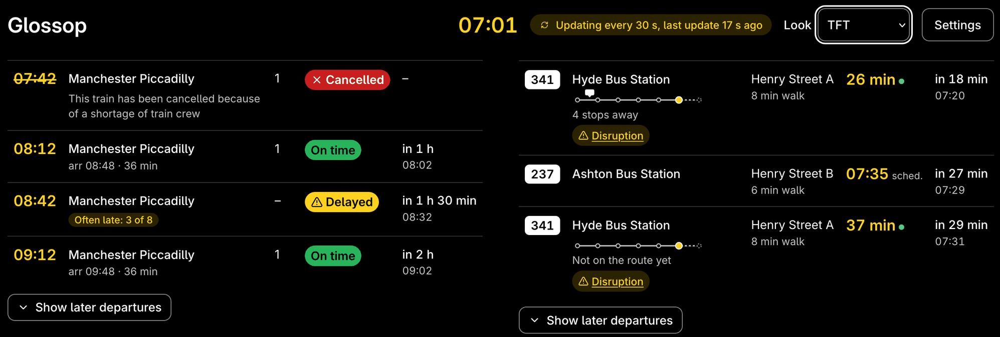
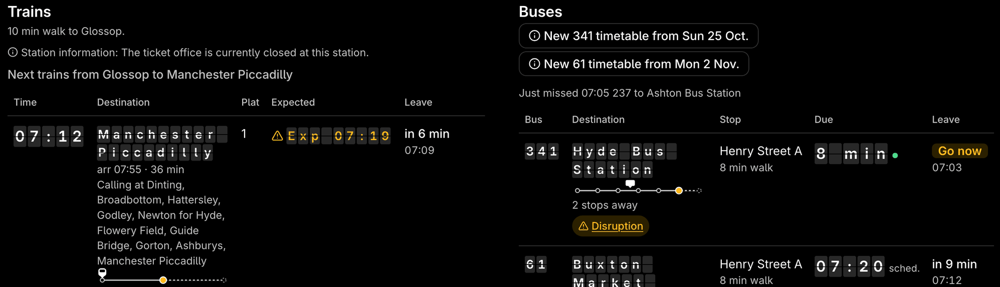
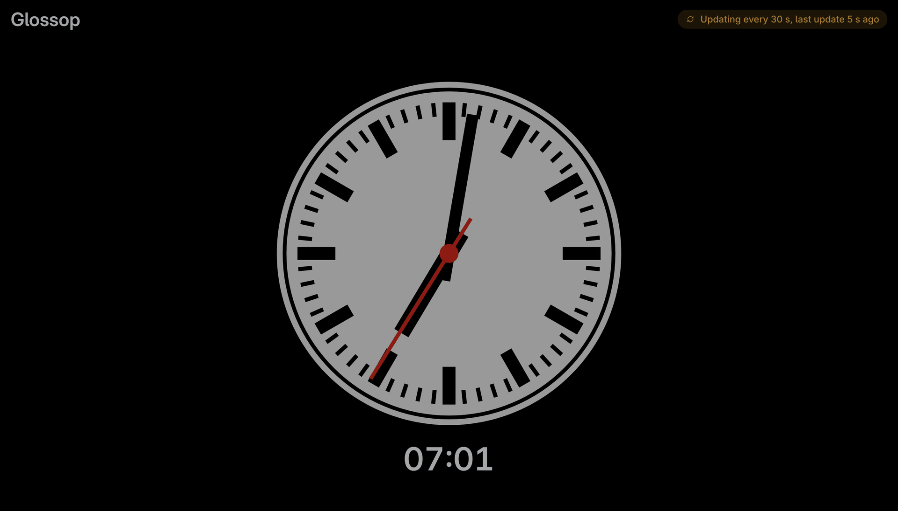

# The dashboard

The dashboard is the board's big sibling: a web page with the next trains and buses laid out like a station screen and a stop's countdown sign, delays and reasons, cancellations and disruption notices, where each bus and train is, a map for each bus, the weather, and how often each regular departure has run late. It works on a phone too.

It is at the install's address, port 8090: `http://<pi name>.local:8090/` on a Pi, `http://<NAS name>:8090/` in Docker, `http://localhost:8090/` on a desktop. While the dashboard view is off, or before the app is set up, that address opens the settings instead.

- [What's on it](#whats-on-it)
- [Performance](#performance)
- [Disruptions and engineering works](#disruptions-and-engineering-works)
- [Wall tablet (kiosk)](#wall-tablet-kiosk)

## What's on it

- **At the top:** the place ("Glossop" from a title of "Glossop > Manchester Picc"), the time, links to [Performance](#performance) and the settings, and one status word: **Live**, **Reconnecting…**, or "Not updated since 17:42" when the trains or buses have fallen behind. The weather and the disruption checks say their own problems in their sections. A section has its own line only when it has a problem or a note. Screen readers hear when the status word changes, never its "last update" time ticking on.
- **The order:** Next to catch, then the disruption line, then the trains and buses, then Around here and the weather. On a wide screen the weather sits beside Next to catch and the trains and buses side by side under them; screen readers and the Tab key still meet the weather last.
- **Next to catch:** the next train or bus you can still reach on foot, and how long until you need to leave: "Leave in 6 min", with the seconds only in the last 2 minutes ("Leave in 1:53"), amber from 3 minutes, then **Leave now** in red in the last minute. Under it, one line says which departure it is, from where and how far ("17:55 237 Ashton-under-Lyne Interchange · Henry Street A · 5 min walk"), and how sure it is: **Live** (a train on the live board, or a bus with a live position), **Timetable only** (a bus with no live position), or **May not be running** (a bus due with no tracker). If that bus may not be running and a live train or bus leaves within 5 minutes after it, the live one is shown instead. **Then:** offers what to catch instead, the next train and the next bus with their leave times. The rain warning shows here too, and **Remind me** works as in a departure's sheet. Screen readers hear when the departure changes and the change has held for half a minute, never the countdown.
- **Trains:** time, destination (with National Rail's route words under it, such as "via Guide Bridge", and when it gets there, "arr 18:25 · 33 min"), platform ("–" until it's known; "Bus" for a rail replacement bus, which also says "Replacement bus" under its destination; "2 (changed)", on amber, when it isn't the platform the train was given earlier, or the one it usually leaves from; screen readers hear each change once), expected ("On time", "Exp 18:56", "Delayed", or "Cancelled" with the reason), and when to leave. The first train also has its "Calling at" line, as the board's screens say it ("Calling at: Dinting, Broadbottom and Manchester Piccadilly. This train is formed of 3 coaches."), and, with the Service Details key below, where it is now; a train placed on its journey has a small strip before those words, its stops with the train drawn where it is. With **Position strips in each row** off, no row has a strip and only the first train says where it is. In the Dot matrix and TFT looks the calling-at line scrolls along one line, in from the right, as on a station's screen: **Pause scrolling**, above the trains, stops it and shows it whole (this browser remembers), and with reduced motion set on your device it never scrolls. A wall tablet leaves it out.
- **Buses:** the line and destination, the stop ("Henry Street A") and its walk, when it's due, and when to leave. A bus with a live position counts down in minutes ("4 min", "Due") with a small live mark and says where it is ("2 stops away"), after a small strip of the stops before yours with the bus drawn on it; a bus known only from the timetable shows its time with "sched.", and never minutes, and its strip with no bus on it ("No live position"). With **Position strips in each row** off, the words stay and the strips go.
- **Last buses:** from 19:00, or once 3 or fewer of a line's buses are left today, a line under the buses says when the last of each line and destination goes, "Last 341 to Hyde Bus Station 23:05", and ", gone" once it has. After midnight, a line whose evening buses are still running shows the last of them. Every bus's sheet says it too, under **Last bus**, at any time of day. See [Bus times](buses.md#how-bus-times-are-worked-out).
- **When to leave:** "in 26 min" with the time, then **Go now** from a minute before until 2 minutes after. After that the departure leaves the list, and one dimmed line says "Just missed 17:40 …" until it has gone. Cancelled departures stay.
- **5 of each:** the next 5 trains and 5 buses; **Show later departures** shows the rest, up to the number set in the settings.
- **More about a departure:** select its destination (or anywhere on its row) to open its sheet: the status and reasons, the facts (operator, coaches, platform, the platform a train usually leaves from once it has a few days of history, "Usually: Platform 1", the stop and its walk, when to leave, when it arrives, and for a bus with a live position which bus it is, under **Bus**), and **Remind me**. A rail replacement bus's sheet says so ("Replacement bus, running in place of the train"). Where the operator sends them, a train's sheet lists its coaches from the front: each coach's number, First Class or Standard, its toilet (and whether it is accessible or out of order) and how busy it is, with where it is quietest in words ("Quietest at the back"), and "Front 2 coaches detach here" when Darwin says so. Many operators send none, and then the sheet has the number of coaches alone. A train's sheet also shows its whole journey with the stops it has passed and where it is; a bus's shows the stops before yours with the bus drawn where it is, the full route on a street map, and its stops. **Bus** gives the bus's fleet number and registration where its tracker sends them, "3017 (AB25 CDE)", or either alone; with a registration, a link looks the bus up on bustimes.org, which leaves the app. Anything else the tracker sends is left out, and the rows and the board never show it.
- **Where the train is** (optional): with a key for the Rail Data Marketplace's **Service Details** product in `RDM_DETAILS_API_KEY`, the next three trains are placed on their journeys ("Left Hadfield 22:44, on time", "At Glossop now"), in words and a small strip in their rows, and their sheets list the stops before Glossop too. Without it, everything else works as before.
- **Punctuality:** each sheet ends with how that departure ran on recent days of the same kind (weekdays, Saturdays, Sundays), such as "Late 4 of the last 10 weekdays (avg 6 min)", day by day. Late means 3 minutes or more for trains and 2 for buses. A rail replacement bus keeps its own record, apart from the train it stands in for. It needs a few days of running before it says anything. When at least a third of the days (and at least 3) went wrong, the row says so too, as "Often late: 4 of 10". Under the phrase, a small table gives the figures for every departure on that route, whatever its time, over the last 7 and 28 days, as on the [Performance](#performance) page.
- **Remind me:** a reminder a minute before you need to leave. On a desktop (the address starts `http://localhost`) the browser can show a notification as well. Anywhere else on plain `http://`, such as a phone on your home network, the reminder shows only on the page, while it's open; the sheet says which. If a sheet or the area map is open when it is due, it shows there too.
- **Look:** a list at the top, remembered per browser. **Standard** is the usual page, light or dark as your device is set. **Dot matrix** is the station-board style, amber on black, with the times, destinations and status in the same dot-matrix lettering as the e-paper board; a destination too long for its column is cut short with "…" on one line (its sheet has the whole name), and the rest stays in plain type so it's easy to read. **TFT** is white and yellow on black, like the newer station screens: the times in bold yellow, and **On time**, late and **Cancelled** each in a green, yellow or red pill that backs up its words. **Split-flap** puts the boards' times, destinations and statuses on dark tiles split across the middle, like an old flap board: late in amber letters, **Cancelled** in black on amber tiles. When one changes, its letters flip through to the new ones in under half a second (at once if your device is set to reduce motion); screen readers hear the words, never the letters in between. Choose with the mouse, or Tab to it and use the arrow keys. A browser that had the old **Board look** turned on opens in Dot matrix.

  

  
- **Weather:** now (temperature, feels like, wind, and the next sunrise or sunset), the rain warning, and the next 4 hours in a row (the hour it is now as **Now**), each with a bar for the chance of rain (written out from 30%). **More hours** shows the rest of the next 12.
- **Disruption:** one line under Next to catch. When something affects your journeys now (at or near your stops, or a National Rail message about your trains), it leads, in amber, or red when severe: "Roadworks at Henry Street A (your stop) until 20:00 today · 2 more this week". Otherwise it says "No disruption on your journeys". Select it to see every notice, in force now first; **Coming up this week** opens the rest. Screen readers hear a new one once, never the line itself. Nothing shows without disruption checks. See [Disruptions and engineering works](#disruptions-and-engineering-works).

Nothing on the page can change anything: it only shows, and needs no password. Changes go through the [settings](settings.md), which do. It checks for new times every minute (trains) and 30 seconds (buses), and stops from 01:00 to 05:00 unless someone has it open. With a filter station and a Service Details key, the train check also follows trains that have left until they reach it, for [Delay Repay](#delay-repay).

The dashboard shows buses only from the BODS timetable (see [Bus times](buses.md)). If your bus times come from TransportAPI, it shows trains and the weather, with a note saying why there are no buses.

## Performance

**Performance** in the dashboard's header opens a page of how your trains and buses have run over the last 7 and 28 days, today included: all of them together, then route by route (a train's destination; a bus's line and destination from one of your stops). It's at `/performance` on the dashboard's address, needs no password, and isn't on the wall tablet.

For trains it gives the measures the rail industry reports:

- **Right Time:** left at or before its booked time.
- **T-3** and **T-15:** left under 3 minutes, or under 15 minutes, late.
- **Cancelled:** shown as cancelled when it was due. A cancelled train misses every other measure, as the industry counts it.

Buses get **On time** (under the bus late threshold, 2 minutes unless you change **Count buses as late from** on the Dashboard settings page; early counts as on time) and **T-15**. Bus data never says a bus was cancelled, so there's no column for it.

Each figure is a count with its percentage, "Right Time 62% (31 of 50)", out of the departures whose outcome is known. Those that left with no time to tell how late (a train shown only as "Delayed", a bus with no live tracker) are counted on their own as **Not known** or **No tracker**. The figures are measured at your station, not at the end of the journey, so they won't match a train company's own. A span with fewer than 3 days recorded says **Not enough days yet**. The figures are plain tables, readable with a keyboard and a screen reader, in both looks.

### Delay Repay

With a filter station (**Only trains calling at** on the settings' Trains and buses page) and a [Service Details key](keys.md#rail-data-marketplace-service-details), the page also lists the trains that reached it 15 or more minutes late in the last 28 days, the thresholds train companies pay Delay Repay from: the date, the train, its booked and actual arrival there, how many minutes late, **15 to 29 min** or **30 min or more**, and the operator, with a link to [National Rail's compensation page](https://www.nationalrail.co.uk/help-and-assistance/compensation-and-refunds/), which links to each company's claim form. Without either, the section says it is off and why.

- **How it knows:** while a train is on the board, its time at the filter station comes with it. Once it has left, the dashboard asks Service Details for that train's journey, which gives the time Darwin reports it arrived: one ask per train, only while it is due there (from 10 minutes before), and only when it checks for trains anyway (never in the quiet hours unless someone has the page open). If Darwin stops knowing the train before it reports the time, its last estimate as it got there is used, shown as **estimated**. The Live Departure Board key can't ask for arrivals at another station (they're another RDM product), which is why the Service Details key is needed.
- **What's left out:** trains cancelled there, rail replacement buses (their times are rough, and each company treats them its own way), and any train nobody saw arrive, such as one that got there while the dashboard was stopped.
- Check the times with the train company before you claim: its own records decide.

## Disruptions and engineering works

- **Buses:** roadworks, diversions and stop closures come from Bus Open Data (the same `BODS_API_KEY`), checked every 10 minutes. Only those at your stops, at the stops your buses use nearby, or on your lines (run by the same operator) with a stop in your area or with no stops named (a withdrawn or shortened service) are shown, for now and the next 7 days, those at your stops first. Roadworks at the far end of one of your lines are left out. A bus row with one in force gets a **Disruption** link to it.
- **Trains** (optional): engineering works come from the National Rail Knowledgebase through the Rail Data Marketplace. Subscribe to its **Knowledgebase Incidents** product, put its key in `RDM_KB_API_KEY` (see [Getting your keys](keys.md#rail-data-marketplace-knowledgebase-incidents)), and copy the address the product page gives into **Engineering works address** on the Keys page, or into `config.toml`:

  ```toml
  [dashboard]
  kb_incidents_url = "https://…"
  ```

  It's checked every 30 minutes. Only incidents for the companies running your trains that name one of your stations are shown. With the key but no address, the page says so; without the key, nothing changes. National Rail's own messages on the train board join the disruption line; those about the station itself, like a closed ticket office or lifts out of use, are a quiet "Station information" line rather than a disruption, and aren't announced.

## Wall tablet (kiosk)

For a tablet on the wall, open the dashboard's address with `?kiosk` on the end: `http://<pi name>.local:8090/?kiosk`. The page then fits one screen, in larger type, with nothing to press:

- **What it shows:** the place, the time and the status word; Next to catch (the countdown, which departure, how sure it is, and **Then:**); the disruption line, without the notices behind it; the next 4 trains and 4 buses; and the weather now with the next 4 hours. On a landscape screen the weather sits beside Next to catch and the trains and buses side by side; on a portrait one they're stacked. Around here, the small position strips in the rows (whatever the setting), reminders, the sheets and **Show later departures** are left out.
- **Look:** Dot matrix, unless that tablet has had another look chosen. To change it, open the address without `?kiosk`, choose under **Look**, then go back.
- **When it's behind:** a wide amber banner across the top says "Not updated since 17:42", or "Offline" when the tablet can't reach the dashboard, big enough to read across the room.
- **At night:** during the dashboard's quiet hours (**Quiet hours** on the Dashboard page, 01:00 to 05:00 unless you change it), the page dims to dark grey, dim amber or dim white and yellow on black, as its look is, and shows a large platform clock in place of the departures: the classic British one, a grey face (white, dimmed) with black batons and hands and a red seconds hand, with the time in words under it. The place and the status stay at the top, and the banner still says when the page is behind. The seconds hand sweeps round; if the tablet is set to reduce motion, it ticks instead. Every few minutes the whole page moves a pixel or two, so nothing is burnt into the screen.

  
- **New versions:** the page reloads itself once a day at 03:30, the tablet's time, once the dashboard answers.

The page can't keep the screen on by itself: browsers allow that only on `https://` pages, and the dashboard is plain `http://` on your home network. Set the tablet's own screen timeout (auto-lock, sleep) to never, ideally with it plugged in. To keep it on the page, use Guided Access on an iPad (Settings > Accessibility), screen pinning on Android, or a kiosk browser app.
