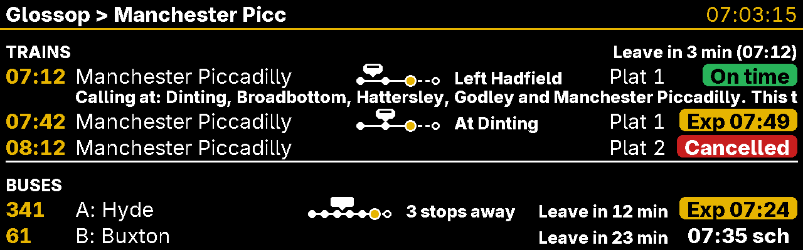
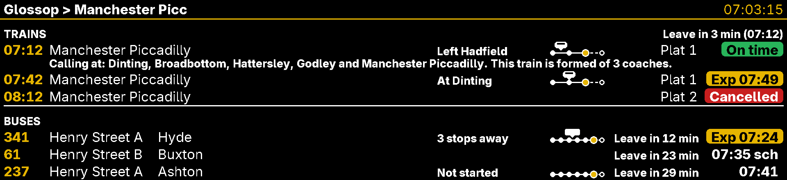
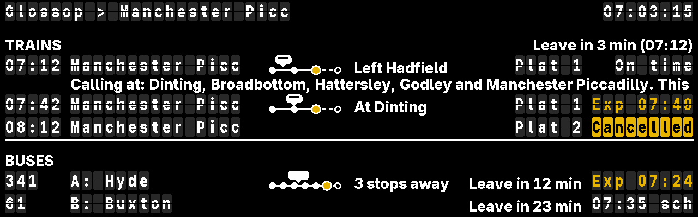
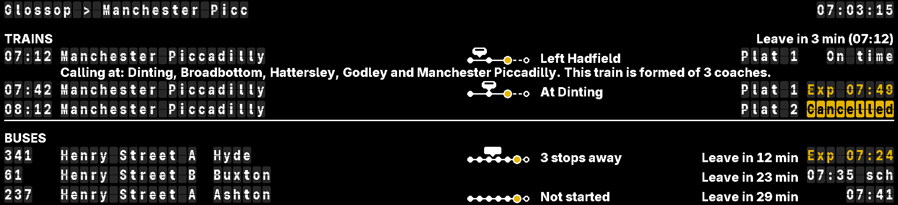
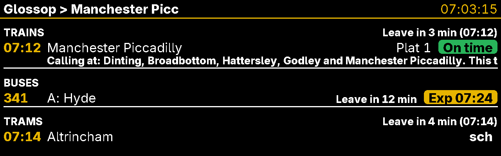
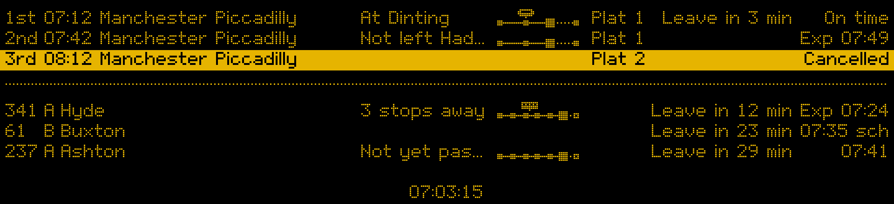
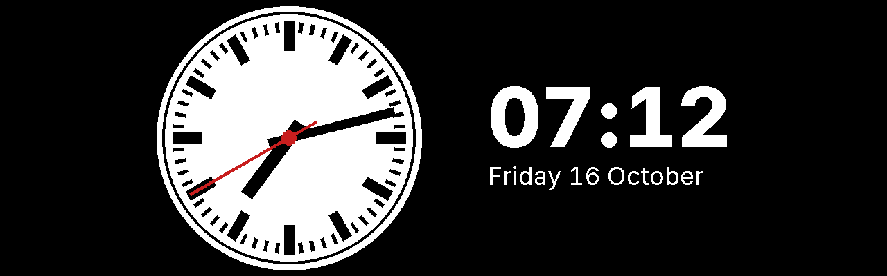

# Reading the board

For everyone in the house: what each line on the board means.

- [The station board look](#the-station-board-look)
- [The plain look](#the-plain-look)
- [The TFT look](#the-tft-look)
- [The split-flap look](#the-split-flap-look)
- [The bigger e-paper display](#the-bigger-e-paper-display)
- [The HDMI screen](#the-hdmi-screen)
- [When it checks](#when-it-checks)
- [Other things the board can show](#other-things-the-board-can-show)

The board can run on three kinds of display. They all show the same information:

| Display | Size | How it updates |
|---|---|---|
| Inky pHAT e-paper | small, 2.13" | Redraws only when something changes, at most every 2 minutes. Each redraw takes about 20 seconds and flickers. That's normal. |
| Waveshare e-paper | wide, 10.85" | Same as the pHAT, just bigger. |
| HDMI screen | wide, 7.9" or 11.3" | Updates every second, with a running clock, countdowns, where each train and bus is, a second page showing where your bus is, and a platform clock page if you want one. |

Each mode of transport the board shows has a section of its own: trains, then buses, then trams where they are set up. A tram's row reads like a train's: its time, where it goes, and `sch`, as it comes from the timetable alone (see [Tram times](trams.md)). London's are live from TfL: the time it is expected, where it goes, its platform, and `Live` on e-paper or a countdown (`3 min`, `Due`) on a screen, with its line first ("Central: Epping") when the section has several (see [London](london.md)). A board showing one mode alone, because it is set to (**Modes of transport** on the settings' [Board](settings.md#board) page) or because only that one is set up, gives it all the room, with no empty section for the others. With two or three, they share the rows, each keeping at least one, as trains and buses do in the pictures here. How many a display has room for is in [Modes of transport](configuration.md#modes-of-transport). Each section says when to leave for its mode, unless that mode is unticked under **When to leave** on the Board page.

The words always carry the meaning. Colour and highlighting only back them up, so the board reads the same in black and white or to someone who is colour-blind.

## The station board look

This is the usual look: amber dots on black, like a railway station sign.

**Trains**

Each line reads: *which train*, *scheduled time*, *destination*, *status*.

| You see | It means |
|---|---|
| `1st 07:12 … On time` | The next train, running to time. |
| `Exp 07:49` | Running late; expected to leave at 07:49. |
| `Delayed` | Late, but no expected time yet. It stays on the board past its time until National Rail stops listing it. |
| `Cancelled`, on a highlighted bar | It isn't running. |
| `No report` | No live report for this train yet. Like `Delayed`, it stays until National Rail stops listing it. |
| `Bus: Manchester Piccadilly` | A rail replacement bus, running in place of the train during engineering works, in time order with the trains. Where the board shows platforms, it says `Bus` in the platform column instead. |
| `Ferry: Ryde Pier Head` | A ferry from the station's pier, which National Rail lists with the trains where one connects. Like a replacement bus, it says `Ferry` in the platform column where the board has one. |
| `Leave by 07:07` | Set off at 07:07 to walk to the station and catch the train above it. It sits under the first train you can still reach, so if the 1st is too soon, it moves down to the 2nd. |

**Buses**

Each line reads: *route*, *stop*, *destination*, *when to leave*, *when it goes*.

| You see | It means |
|---|---|
| `341 A Hyde` | Route 341 from stop A, going to Hyde. |
| `Leave by 07:16` | Set off at 07:16 to walk to that stop in time. |
| `07:41` | Live tracking says it's on time. For a bus starting at your stop (and the same journey at your later stops), that can be the bus coming in to work it, tracked on the journey before (see [Bus times](buses.md#how-bus-times-are-worked-out)). |
| `Exp 07:24` | Live tracking says it's running late and will leave at 07:24: the bus itself, or the bus coming in to work it, late enough to make it late. |
| `07:35 sch` | Timetable time only ("scheduled"): there's no live position for this bus yet, so it could be late. |
| `Cancelled`, on a highlighted bar | It isn't running. |

**Bottom line**

| You see | It means |
|---|---|
| `UPDATED 07:03` | When the board last changed. The e-paper only redraws when something changes, so this can be a few minutes ago. |
| `NOT UPDATING: BUSES`, highlighted | No new bus information has arrived for a while. What's shown is the last known, and may be out of date. The same applies to trains, and to trams (`TRAMS`); London's section is named as its heading is, like `UNDERGROUND` or `DLR`. |
| `RAIN FROM 07:00 (70%)` | Rain is likely (here a 70% chance) before you'd reach your next train or bus. Only shown when rain is likely; nothing on dry days. |
| `! DISRUPTION …` | A National Rail incident notice for the station, or, with London stops, a TfL line at them not running well. It sits on the left while it lasts, with `UPDATED` kept on the right, and goes when the notice is withdrawn. Where it doesn't fit, it's cut short with `…`. A rain warning sits there the same way; while there's a notice, the notice takes its place. |

## The plain look

The same information in black on white, with red highlights. The words are the same as the station board look; only where some of them sit differs. Someone may have switched to it on the [Board page](settings.md#board) of the settings.

The differences:

| Plain look | Station board look |
|---|---|
| `Upd 07:03` in the top bar | `UPDATED 07:03` at the bottom |
| `Leave by 07:07 (07:12)` next to TRAINS: leave by 07:07 for the 07:12 | `Leave by 07:07` under the train |
| `Leave by` once, next to BUSES, over a column of leave times (`07:16`), so the destinations have more room | `Leave by 07:16` on each bus line |
| `Cancelled` on a black bar | `Cancelled` on a highlighted bar |
| `! NOT UPDATING` in the accent colour, next to TRAINS or BUSES | `NOT UPDATING: …` at the bottom |
| A rain warning or disruption notice in the top bar, in place of the title (on a screen, both, the rain warning beside the clock) | At the bottom |

The plain look shows 3 trains and 2 buses (3 buses on the 11.3" bar screen, which has the room), and fewer on the original, smaller pHAT, with a bigger **Text size**, or with trams too.

## The TFT look

On an HDMI screen only: white and yellow on black, like the newer station screens. It is the plain look's layout and words, with the times in bold yellow and each status in a coloured pill. Someone may have switched to it on the [Board page](settings.md#board) of the settings; e-paper doesn't offer it.

- `On time` in a green pill, `Exp 07:49` or `Delayed` in a yellow one, and `Cancelled` in a red one. A cancelled train isn't on a highlighted bar: its pill says it. A bus running to time shows its time in white, with no pill, as does `07:35 sch`.
- The title in white and the running clock in yellow at the top, with a yellow line under them.
- `! NOT UPDATING` in yellow next to TRAINS or BUSES, a rain warning or disruption notice in place of the title, and everything else the [HDMI screen](#the-hdmi-screen) shows, as in the plain look.

The colours only back up the words: every pill says what it means.

## The split-flap look

On an HDMI screen only: white letters on dark grey tiles, each split across the middle, like the old flap boards at big stations. It is the plain look's layout and words, with the title, the clock and each row's time, destination, platform and status a letter a tile. The small words (TRAINS, BUSES, leave times, where a train is) stay in plain type between them. Someone may have switched to it on the [Board page](settings.md#board) of the settings; e-paper doesn't offer it.

- `Exp 07:49` and `Delayed` in amber letters, and `Cancelled` in black on amber tiles. A cancelled train isn't on a highlighted bar: its tiles say it.
- When a row's time, destination, platform or status changes, its tiles flip through to the new letters, as a flap board's do, in half a second. When the first train goes and the rows move up, each row flips to its new departure. The clock and the title change at once.
- On the 7.9" screen a destination keeps 16 letters beside where its train is; a longer one, such as Manchester Piccadilly, scrolls, as a long notice does. The 11.3" bar screen keeps it whole.
- `! NOT UPDATING` in amber next to TRAINS or BUSES, a rain warning or disruption notice in place of the title, and everything else the [HDMI screen](#the-hdmi-screen) shows, as in the plain look.

## The bigger e-paper display

The 10.85" display shows the same board with bigger dots and more room, so long destinations fit, and each train's platform shows (`Plat 1`). A rail replacement bus says `Bus` where the platform goes, and a ferry `Ferry`. Platforms aren't shown on the small display, where there isn't room. Nor are National Rail's route words, which the bigger boards show after the destination (`Manchester Piccadilly via Guide Bridge`).

| You see | It means |
|---|---|
| `Plat 2 (changed)` | The train's platform has changed since the board last checked: it was given another one before. It stays until the train goes. The plain, TFT and split-flap looks draw it in the accent colour too. |

## The HDMI screen

The screen can redraw every second, so it shows a bit more. **What to show** on the [Board page](settings.md#board) of the settings can leave any of it out but the times, and the board then draws the rest with no gap where it was: platforms, where each train and bus is, the calling-at line, disruption notices, the rain warning, the last bus, the bus page and the clock page, and station announcements, which are off until you tick them. **When to leave** there says which modes get leave times, on e-paper too.

**Three modes:** a screen has room for trains, buses and trams together where its look and text size keep a whole row for each: the station board, TFT and split-flap looks, and the plain look up to text size 12 on the 7.9" screen and 13 on the bar screen. Each has its section, with at least a row, and its own leave time. The Board page of the settings offers only the looks and text sizes with room for the modes the board shows, and says why (see [Modes of transport](configuration.md#modes-of-transport)).

- **A running clock** in place of "Updated": at the bottom in the station board look, at the top right in the others.
- **Countdowns** in place of clock times: `Leave in 3 min` instead of `Leave by 07:07`, then `Leave now` in the last minute. They round down, so `Leave in 3 min` means you have at least 3 minutes, never less. In the plain look each bus line says its own countdown, with no `Leave by` next to BUSES.
- On the screen, a bus you can no longer reach on foot loses its leave time, rather than saying "Leave now".
- **Platforms**, as on the bigger e-paper display.
- **Calling at**, under the first train, as on a station's own screens: `Calling at: Dinting, Broadbottom, Hattersley, Godley and Manchester Piccadilly. This train is formed of 3 coaches.` It scrolls along its line (see below). **What to show**'s Everything has it and The usual doesn't, so tick **Calling at** if you want it. Stops the train no longer calls at are left out of the list and named after it (`Does not call at Hattersley.`), or alone when it no longer calls at any, the coaches are left unsaid when National Rail doesn't give them, a rail replacement bus says `This is a replacement bus.`, and a ferry `This is a ferry.` A cancelled train has no line. In the station board look it starts under the train's time, above `Leave in 3 min`, in smaller dots (capitals 5 dots tall, not 7), as the leave line under a train is on the 7.9" screen; in the plain, TFT and split-flap looks, under the destination, in smaller type. On the bar screen the station board look leaves out the dotted rule over the bottom line to keep its third bus. To get the calling points, a screen asks National Rail for the board with them, the same request with more in its answer. E-paper doesn't show it: it can't scroll.
- **Where each train or bus is**, after its destination: in words (`At Dinting`, `3 stops away`, or `On its way, 6 min` and then `Bus in, waiting` for a bus coming in to work a departure from your stop, `Waiting to start` at the same journey's later stops while it is in there), then a little line of its stops, as on the dashboard. Trains say where they are only with a [Service Details key](keys.md#rail-data-marketplace-service-details); without one, only buses do. The line is solid up to your stop, which is the bigger one, and dotted after it; the train or bus is drawn over the line where it is, and not at all while the board doesn't know. The words say it all; the line only backs them up. A row the board knows nothing for, like a cancelled train or a bus with no live position, leaves the space blank.
- In the station board look, a rain warning or disruption notice sits at the bottom left and the clock moves to the right. With both, they sit side by side: the notice on the left, the rain warning beside the clock. A dotted rule sets the bottom line off from the buses, as between trains and buses.
- **The last bus:** in the hour before the day's last bus from your stops goes, `Last bus 23:05` sits on the bottom line the same way, from the bus timetable. A disruption notice or a rain warning takes its place while there is one. In the plain, TFT and split-flap looks it takes the title's place in the top bar, as they do. E-paper doesn't show it.
- **Long text scrolls** rather than being cut short with `…`: a destination, the calling-at line, where a train or bus is, a disruption notice or a rain warning too long for its space shows from its start for 2 seconds, moves slowly left (about 3 letters a second, a dot at a time in the station board look) until its end is in view, waits 2 seconds, then starts again. Each stays inside its own space, and text that fits never moves. E-paper can't animate, so it still cuts long text short; so does the screen with **Scrolling text** off on the [General page](settings.md#general) of the settings (`scrolling = false`). The split-flap look's tiles still turn.
- **Station announcements,** if you tick **Announcements** and the Pi has a speaker: the screen says the next train to depart 4 minutes before it goes, cancellations, delays and platform alterations, in a station's words, never in the quiet hours. See [Station announcements on a screen](displays.md#station-announcements-on-a-screen). E-paper doesn't speak.

### The 11.3" bar screen

The bar screen shows the same as the 7.9" screen, with one line for each train or bus. In the station board look its text is a third bigger, and `Leave in 3 min` sits on its train's line, between the platform and the status, rather than on a line of its own under it; the plain, TFT and split-flap looks keep their text size and use the extra width. Either way there is room for 3 trains, 3 buses and the clock, or fewer of each with trams too.

Each bus line also names its stop where other boards show its label: `341 Henry Street A Hyde` rather than `341 A Hyde` (in the plain look, rather than `A: Hyde`). The name comes from the bus timetable. It shows alone when none of your other stops has the same name, and with the label when two or more do, as Glossop's two Henry Street stops do. The names line up in a column as wide as the longest of your stops' names, up to about 16 letters; a longer name scrolls. While the board doesn't know a stop's name (buses from TransportAPI, or before the timetable is built), that line shows the label, as before. The 7.9" screen keeps the label: a name there would leave too little room for the destination.

### Where the next bus is

If it's set up (see [The bus position page](displays.md#the-bus-position-page)), the screen switches every 25 seconds: 15 seconds of departures, then 10 seconds of this page (then 10 of [the clock page](#the-clock-page), if it's on).

- **Top line:** the bus you can still catch, and when it goes (`341 to Hyde … Exp 07:24`).
- **Second line:** when to leave, and how many stops away the bus is, counting your stop.
- In the plain, TFT and split-flap looks the top bar has the bus and the clock, and the second line says when it goes and when to leave (`Exp 07:24   Leave in 3 min`), with how many stops away it is.
- **The line of stops:** the stops the bus calls at before yours. Your stop is the highlighted one on the right (Henry Street in this sample); the bus is drawn on the road where it is now.

It also says:

| You see | It means |
|---|---|
| `Not yet past Bowland Road` | The bus is further back than the first stop shown. |
| `At your stop` | It's at your stop now. |
| `Position not updating` | Live positions have stopped arriving. Use the departure times instead. |

The page only appears while **Bus page** is ticked under **What to show**, the board is checking buses (see [When it checks](#when-it-checks)), and the next bus you can still catch is on a line set up for the page at that stop. Without a live position for it yet, it says `Not yet past …`.

### The clock page

Off unless you tick it: **Clock page** under **What to show** on the [Board page](settings.md#board) of the settings, or `"clock_page"` in `[board] show` in `config.toml` (see [What each view shows](configuration.md#what-each-view-shows)). Then, after the departures (and the bus page, when it shows), the screen shows a platform clock for 10 seconds: the screen goes round every 25 seconds, or 35 with the bus page too.

It is drawn after the classic British platform clock, the same in every look: a white face with black batons for the hours and minutes, black hands, and a red seconds hand that moves on each second. Beside it are the time, like `07:24`, and the date, like `Friday 16 October`, in words. E-paper doesn't show it.

## When it checks

The board only fetches new times during set windows. Train times and the bus timetable cost nothing, so their windows can cover the whole day; if bus times come from TransportAPI instead (see [Bus times](buses.md)), its free limit means short windows, such as weekday mornings and early evenings. Outside the windows it keeps showing what it last knew, and doesn't say "not updating", because it isn't trying to. Departures drop off once their time has passed, so the evening never shows the morning's buses. The windows are on the [Board page](settings.md#board) of the settings.

Trams from the Metrolink timetable cost nothing too, so the board reads it every minute, 05:00 to midnight by default; London's are live from TfL, a call for each stop each minute (see [London](london.md#how-often-it-asks)).

On bank holidays trains and buses run a Sunday service, so the board treats them like Sundays: weekday-only windows are off, and windows that include Sundays apply.

## Other things the board can show

- **Set me up**, with the settings address (`<pi name>.local:8090/settings`; type it as shown, the browser adds `http://`): the app isn't set up yet. See [First run](setup-wizard.md).
- **Board off**, with the same address: the board view is switched off on the [General page](settings.md#general) of the settings. Nothing is fetched for it until it is back on.
- **A 6-digit code:** someone asked for one to set the settings password. It goes once it is used, or after 10 minutes.
