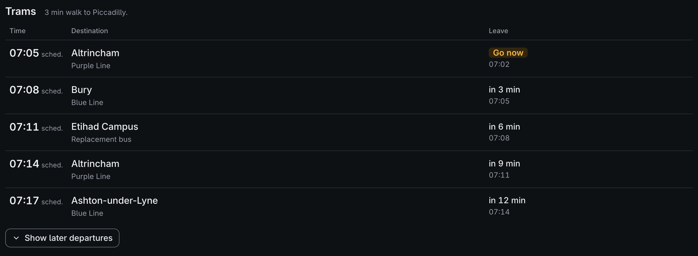

# Tram times

The board and the dashboard can show Manchester's Metrolink trams too, wherever home is, in a section of their own called **Trams**. London's Underground, DLR, trams, cable car and river buses come live from TfL in the same section instead: see [London](london.md).

- [Where tram times come from](#where-tram-times-come-from)
- [Setting it up](#setting-it-up)
- [How the timetable is kept](#how-the-timetable-is-kept)
- [What the trams show](#what-the-trams-show)

## Where tram times come from

Tram times come from the timetable Transport for Greater Manchester (TfGM) publishes for every bus and tram in the county, built again each night. It is free and needs no key: the file is `https://odata.tfgm.com/opendata/downloads/TfGMgtfsnew.zip`, listed on data.gov.uk as *GM Public Transport Schedules – GTFS and TXC datasets*, under the [Open Database License](https://opendatacommons.org/licenses/odbl/1-0/). The dashboard says "Tram times contain Transport for Greater Manchester data" at its foot while it shows trams, as the licence asks.

They are booked times only. TfGM's live tram data (the times on the stops' own screens) is closed to new users: keys made before still work, but no new ones can be had, and the Bus Open Data Service has no trams. So a tram is shown at its booked time, marked as the timetable's, and there is no expected time, no "where it is" and no punctuality record for trams.

Only Metrolink is read. TfGM lists the replacement buses it runs when part of the line is closed as tram routes too, so they show among the trams, marked **Bus** on the board and "Replacement bus" on the dashboard.

## Setting it up

The [setup wizard](setup-wizard.md#the-steps) asks for your tram stops after the bus stops. It lists the 5 Metrolink stops nearest home, within 5 km as the crow flies, and **Find a stop by name** finds any other, however far away, from a list that comes with the app (from NaPTAN), so nothing is sent anywhere to find them. Tick up to 4. Each gets a label, T, U, V and W, and a walk time, as the bus stops do; a stop over an hour's walk away gets none, so the board gives no time to leave for it.


In `config.toml` it looks like this:

```toml
[metro]
directions = ["Bury"]          # optional: only trams heading to these
[metro.stops]
T = "9400ZZMAPIC"              # Piccadilly: 9400ZZMA and the three letters TfGM calls the stop by
[metro.walk_minutes]
T = 6
```

A stop's code is `9400ZZMA` and its three letters, as NaPTAN has it; `src/twobells/data/metrolink_stops.csv` lists every stop's. Up to 4 stops; anything else stops the board loading, saying why. The [settings](settings.md#trains-and-buses) have a **Trams** section on the Trains and buses page (switch them off and on, the walks, which way, the stop codes under Advanced) and on the Board page (how many show, and when the board checks), and **Most trams listed** on the Dashboard page, all shown once trams are set up. Before then, the Trains and buses page's **Trams** section has only **Tram stop codes**: typing some there sets trams up. Trams are the third [mode of transport](configuration.md#modes-of-transport): a small display has room for two of trains, buses and trams.

## How the timetable is kept

- **Built** by the same hands as the bus timetable: on a Pi by `twobells-timetable.timer`, which checks every hour, and `twobells-timetable.path`, as soon as the settings are saved; in Docker and on a desktop by the dashboard, every hour; only while a view that is on shows trams. It is built again weekly and when your tram stops change; after a build fails, not for 6 hours (each try downloads the whole file) unless your tram stops change, and the old one is used meanwhile, until it is 4 weeks old. Until the first build is done, a minute or two after saving on a Pi, the board's Trams section says `No trams`, with `NOT UPDATING: TRAMS` (in the plain looks, `! NOT UPDATING`) while it checks, and the dashboard's says there is no tram timetable yet ("Building the tram timetable…" while the dashboard builds it); the [Overview](settings.md#overview) says when it is built.
- **Small:** the download is about 45 MB, and its stop times about 170 MB unzipped, so it is never held whole: it is read a line at a time and only Metrolink's departures from your stops are kept, a few thousand a stop over the weeks the file covers, in `tram-timetable.json` in the store. It took about 20 seconds on a laptop for two busy stops; a Pi Zero takes longer, well within the half hour the timer gives the bus and tram timetables together.
- **Checked:** every field is checked as it is read, and a row that isn't what the timetable format says is left out. The download may be no more than 250 MB, each part of the file may unzip to no more than it should and must be packed as TfGM's are (stored or deflated, not bzip2 or LZMA, which could unpack hundreds of MB at once), a line longer than 4,096 characters is read past a piece at a time and left out, and a file listing more than 100 parts is refused before they are read, so a broken or hostile file can't fill the memory or the card.
- **Read** every minute through the trams' day, 05:00 to midnight by default, which costs nothing. The timetable's own days and dates decide which trams run, bank holidays included.
- **Building it now:** on a Pi, as for the bus timetable (see [Bus times](buses.md#how-bus-times-are-worked-out)), delete the old one, and the failed build's note, first:

  ```bash
  sudo rm -f /var/lib/twobells/tram-timetable.json /var/lib/twobells/tram-timetable-failed.json
  sudo systemctl start twobells-timetable.service
  journalctl -u twobells-timetable -n 5
  ```

## What the trams show

- **On the board:** each tram's booked time, where it goes, and `sch` where a train's status goes, as a bus known only from the timetable says; with two or more tram stops, the stop's label before the destination ("T: Bury"). The section says when to leave for the next tram you can reach, by its stop's walk, while **Trams** is ticked under **When to leave** on the Board page. See [Reading the board](reading-the-board.md).
- **On the dashboard:** a **Trams** section with each tram's time marked "sched.", its line (like "Blue Line") under the destination, its stop where there are several, and when to leave. Next to catch takes trams as it does buses known only from the timetable, saying **Timetable only**, while **Trams** is ticked for it under **What to show**. A tram's sheet has its line, stop, booked time and leave time, and says why there is no expected time. See [The dashboard](dashboard.md#whats-on-it).


