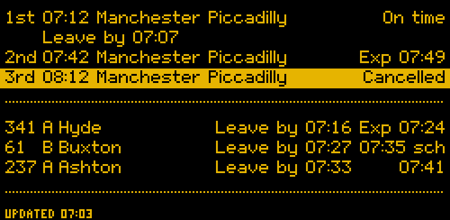
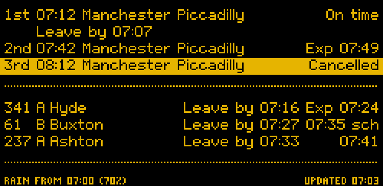
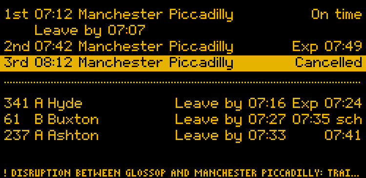
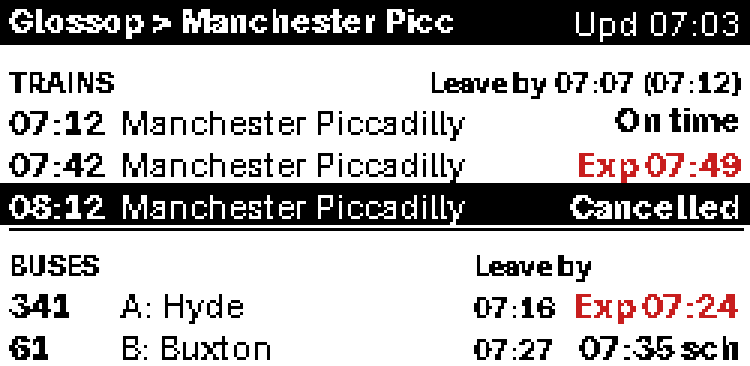
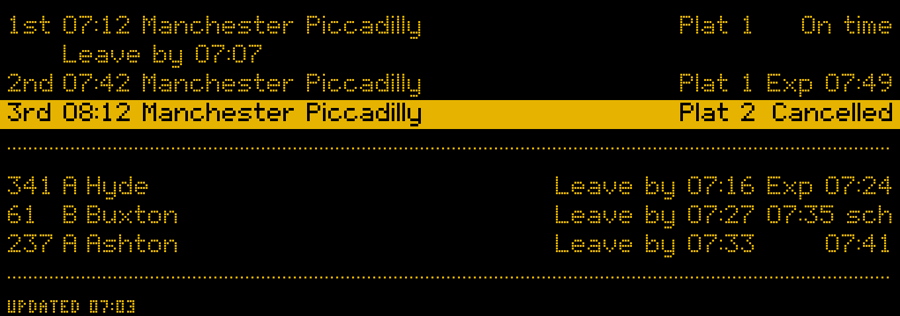
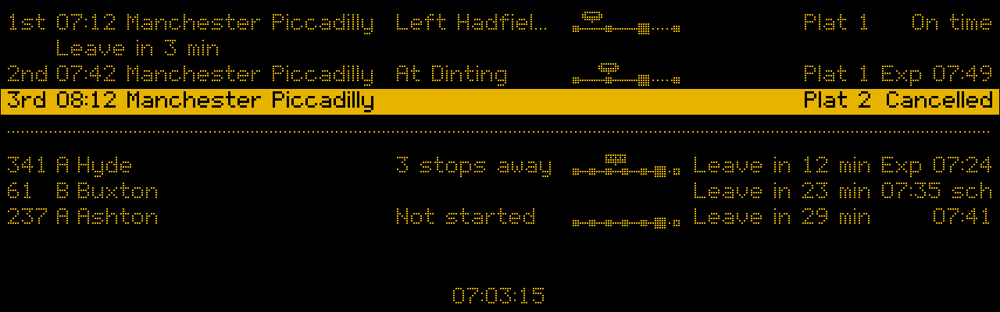
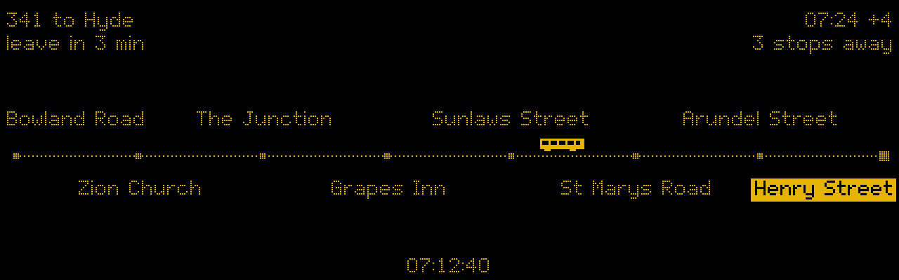

# Departure board user guide

The app shows the next trains from your station and the next buses from your stops, and tells you when to set off so you catch them. The examples in this guide come from Glossop, with trains to Manchester and buses from two stops in the town centre.

One install is one app with two views of the same departures:

- **The board:** an e-paper display or a small HDMI screen on a Raspberry Pi.
- **The dashboard:** a web page with more on it, for a phone or a computer at home.

A Pi can run either view or both. Docker (on a NAS, say) and a desktop computer run the dashboard. Each install has one settings site, at `/settings`, with one password.

Contents:

1. [Reading the board](#1-reading-the-board): for everyone in the house.
2. [The dashboard](#2-the-dashboard): what's on the web page.
3. [Installing](#3-installing): on a Pi, in Docker, or on a desktop.
4. [First run and the setup wizard](#4-first-run-and-the-setup-wizard)
5. [The settings](#5-the-settings): the Overview, Trains and buses, Board, Dashboard, Keys and General pages.
6. [Password and reset codes](#6-password-and-reset-codes)
7. [Keys](#7-keys)
8. [Looking after a Pi](#8-looking-after-a-pi): its services, displays, bus times and more.
9. [Docker](#9-docker)
10. [Desktop](#10-desktop)
11. [Commands](#11-commands)
12. [Troubleshooting](#12-troubleshooting)
13. [Upgrading from before the two views](#13-upgrading-from-before-the-two-views)

Developer details (code layout, tests, the emulator) are in the [README](../README.md).

---

## 1. Reading the board

The board can run on three kinds of display. They all show the same information:

| Display | Size | How it updates |
|---|---|---|
| Inky pHAT e-paper | small, 2.13" | Redraws only when something changes, at most every 2 minutes. Each redraw takes about 20 seconds and flickers. That's normal. |
| Waveshare e-paper | wide, 10.85" | Same as the pHAT, just bigger. |
| HDMI screen | wide, 7.9" | Updates every second, with a running clock, countdowns and a second page showing where your bus is. |

The words always carry the meaning. Colour and highlighting only back them up, so the board reads the same in black and white or to someone who is colour-blind.

### The station board look

This is the usual look: amber dots on black, like a railway station sign.



**Trains (top half)**

Each line reads: *which train*, *scheduled time*, *destination*, *status*.

| You see | It means |
|---|---|
| `1st 07:12 … On time` | The next train, running to time. |
| `Exp 07:49` | Running late; expected to leave at 07:49. |
| `Delayed` | Late, but no expected time yet. |
| `Cancelled`, on a highlighted bar | It isn't running. |
| `No report` | No live report for this train yet. |
| `Leave by 07:07` | Set off at 07:07 to walk to the station and catch the train above it. It sits under the first train you can still reach, so if the 1st is too soon, it moves down to the 2nd. |

**Buses (bottom half)**

Each line reads: *route*, *stop*, *destination*, *when to leave*, *when it goes*.

| You see | It means |
|---|---|
| `341 A Hyde` | Route 341 from stop A, going to Hyde. |
| `Leave by 07:16` | Set off at 07:16 to walk to that stop in time. |
| `07:41` | Live tracking says it's on time. |
| `Exp 07:24` | Live tracking says it's running late and will leave at 07:24. |
| `07:35 sch` | Timetable time only ("scheduled"): there's no live position for this bus yet, so it could be late. |
| `Cancelled`, on a highlighted bar | It isn't running. |

**Bottom line**

| You see | It means |
|---|---|
| `UPDATED 07:03` | When the board last changed. The e-paper only redraws when something changes, so this can be a few minutes ago. |
| `NOT UPDATING: BUSES`, highlighted | No new bus information has arrived for a while. What's shown is the last known, and may be out of date. The same applies to trains. |
| `RAIN FROM 07:00 (70%)` | Rain is likely (here a 70% chance) before you'd reach your next train or bus. Only shown when rain is likely; nothing on dry days. |
| `! DISRUPTION …` | A National Rail incident notice for the station. It takes the whole line while it lasts, and goes when the notice is withdrawn. On the small display it's cut short with `…`. |





### The plain look

The same information in black on white, with red highlights. The words are the same as the station board look; only where some of them sit differs. Someone may have switched to it on the Board page of the settings.



The differences:

| Plain look | Station board look |
|---|---|
| `Upd 07:03` in the top bar | `UPDATED 07:03` at the bottom |
| `Leave by 07:07 (07:12)` next to TRAINS: leave by 07:07 for the 07:12 | `Leave by 07:07` under the train |
| `Leave by` once, next to BUSES, over a column of leave times (`07:16`), so the destinations have more room | `Leave by 07:16` on each bus line |
| `Cancelled` on a black bar | `Cancelled` on a highlighted bar |
| `! NOT UPDATING` in the accent colour, next to TRAINS or BUSES | `NOT UPDATING: …` at the bottom |
| A rain warning or disruption notice in the top bar, in place of the title | At the bottom |

The plain look shows 3 trains and 2 buses.

### The bigger e-paper display

The 10.85" display shows the same board with bigger dots and more room, so long destinations fit, and each train's platform shows (`Plat 1`). Platforms aren't shown on the small display, where there isn't room.



### The HDMI screen

The screen can redraw every second, so it shows a bit more:



- **A running clock** at the bottom, in place of "Updated".
- **Countdowns** in place of clock times: `Leave in 3 min` instead of `Leave by 07:07`, then `Leave now` in the last minute. They round down, so `Leave in 3 min` means you have at least 3 minutes, never less. In the plain look each bus line says its own countdown, with no `Leave by` next to BUSES.
- On the screen, a bus you can no longer reach on foot loses its leave time, rather than saying "Leave now".
- **Platforms**, as on the bigger e-paper display.
- A rain warning or disruption notice sits at the bottom left and the clock moves to the right. A notice too long for one line is shown a part at a time, changing every 5 seconds; each part starts with `!` and all but the last end with `…`.

#### Where the next bus is

If it's set up (see [The bus position page](#the-bus-position-page)), the screen switches every 25 seconds: 15 seconds of departures, then 10 seconds of this page.



- **Top line:** the bus you can still catch, and when it goes (`341 to Hyde … Exp 07:24`).
- **Second line:** when to leave, and how many stops away the bus is, counting your stop.
- **The line of stops:** the stops the bus calls at before yours. Your stop is the highlighted one on the right (Henry Street in this sample); the bus is drawn on the road where it is now.

It also says:

| You see | It means |
|---|---|
| `Not yet past Bowland Road` | The bus is further back than the first stop shown. |
| `At your stop` | It's at your stop now. |
| `Position not updating` | Live positions have stopped arriving. Use the departure times instead. |

The page only appears when the board is checking buses (see *When it checks* below) and there's a tracked bus you can still catch.

### When it checks

The board only fetches new times during set windows. Train times and the bus timetable cost nothing, so their windows can cover the whole day; if bus times come from TransportAPI instead (see [Bus times](#bus-times)), its free limit means short windows, such as weekday mornings and early evenings. Outside the windows it keeps showing what it last knew, and doesn't say "not updating", because it isn't trying to. Departures drop off once their time has passed, so the evening never shows the morning's buses. The windows are on the Board page of the settings.

On bank holidays trains and buses run a Sunday service, so the board treats them like Sundays: weekday-only windows are off, and windows that include Sundays apply.

### Other things the board can show

- **Set me up**, with the settings address (`<pi name>.local:8090/settings`; type it as shown, the browser adds `http://`): the app isn't set up yet. See [First run](#4-first-run-and-the-setup-wizard).
- **Board off**, with the same address: the board view is switched off on the General page of the settings. Nothing is fetched for it until it is back on.
- **A 6-digit code:** someone asked for one to set the settings password. It goes once it is used, or after 10 minutes.

---

## 2. The dashboard

The dashboard is the board's big sibling: a web page with the next trains and buses laid out like a station screen and a stop's countdown sign, delays and reasons, cancellations and disruption notices, where each bus and train is, a map for each bus, the weather, and how often each regular departure has run late. It works on a phone too.

It is at the install's address, port 8090: `http://<pi name>.local:8090/` on a Pi, `http://<NAS name>:8090/` in Docker, `http://localhost:8090/` on a desktop. While the dashboard view is off, or before the app is set up, that address opens the settings instead.

### What's on it

- **At the top:** the place ("Glossop" from a title of "Glossop > Manchester Picc"), the time, and one status word: **Live**, **Reconnecting…**, or "Not updated since 17:42" when the trains or buses have fallen behind. The weather and the disruption checks say their own problems in their sections. A section has its own line only when it has a problem or a note.
- **The order:** Next to catch, then the disruption line, then the trains and buses, then Around here and the weather. On a wide screen the weather sits beside Next to catch and the trains and buses side by side under them; screen readers and the Tab key still meet the weather last.
- **Next to catch:** the next train or bus you can still reach on foot, and how long until you need to leave: "Leave in 6 min", with the seconds only in the last 2 minutes ("Leave in 1:53"), amber from 3 minutes, then **Leave now** in red in the last minute. Under it, one line says which departure it is, from where and how far ("17:55 237 Ashton-under-Lyne Interchange · Henry Street A · 5 min walk"), and how sure it is: **Live** (a train on the live board, or a bus with a live position), **Timetable only** (a bus with no live position), or **May not be running** (a bus due with no tracker). If that bus may not be running and a live train or bus leaves within 5 minutes after it, the live one is shown instead. **Then:** offers what to catch instead, the next train and the next bus with their leave times. The rain warning shows here too, and **Remind me** works as in a departure's sheet. Screen readers hear when the departure changes and the change has held for half a minute, never the countdown.
- **Trains:** time, destination (with when it gets there, "arr 18:25 · 33 min"), platform ("–" until it's known), expected ("On time", "Exp 18:56", "Delayed", or "Cancelled" with the reason), and when to leave. The first train also lists where it calls and, with the Service Details key below, where it is now; a train placed on its journey has a small strip before those words, its stops with the train drawn where it is. With **Position strips in each row** off, no row has a strip and only the first train says where it is.
- **Buses:** the line and destination, the stop ("Henry Street A") and its walk, when it's due, and when to leave. A bus with a live position counts down in minutes ("4 min", "Due") with a small live mark and says where it is ("2 stops away"), after a small strip of the stops before yours with the bus drawn on it; a bus known only from the timetable shows its time with "sched.", and never minutes, and its strip with no bus on it ("No live position"). With **Position strips in each row** off, the words stay and the strips go.
- **When to leave:** "in 26 min" with the time, then **Go now** from a minute before until 2 minutes after. After that the departure leaves the list, and one dimmed line says "Just missed 17:40 …" until it has gone. Cancelled departures stay.
- **5 of each:** the next 5 trains and 5 buses; **Show later departures** shows the rest, up to the number set in the settings.
- **More about a departure:** select its destination (or anywhere on its row) to open its sheet: the status and reasons, the facts (operator, coaches, platform, the stop and its walk, when to leave, when it arrives), and **Remind me**. A train's sheet shows its whole journey with the stops it has passed and where it is; a bus's shows the stops before yours with the bus drawn where it is, the full route on a street map, and its stops.
- **Where the train is** (optional): with a key for the Rail Data Marketplace's **Service Details** product in `RDM_DETAILS_API_KEY`, the next three trains are placed on their journeys ("Left Hadfield 22:44, on time", "At Glossop now"), in words and a small strip in their rows, and their sheets list the stops before Glossop too. Without it, everything else works as before.
- **Punctuality:** each sheet ends with how that departure ran on recent days of the same kind (weekdays, Saturdays, Sundays), such as "Late 4 of the last 10 weekdays (avg 6 min)", day by day. Late means 3 minutes or more for trains and 2 for buses. It needs a few days of running before it says anything. When at least a third of the days (and at least 3) went wrong, the row says so too, as "Often late: 4 of 10".
- **Remind me:** a reminder a minute before you need to leave. On a desktop (the address starts `http://localhost`) the browser can show a notification as well. Anywhere else on plain `http://`, such as a phone on your home network, the reminder shows only on the page, while it's open; the sheet says which. If a sheet or the area map is open when it is due, it shows there too.
- **Board look:** switches to the station-board style, amber on black, with the times, destinations and status in the same dot-matrix lettering as the e-paper board. A destination too long for its column is cut short with "…" on one line; its sheet has the whole name. The rest stays in plain type so it's easy to read. It's remembered per browser.
- **Weather:** now (temperature, feels like, wind, and the next sunrise or sunset), the rain warning, and the next 4 hours in a row (the hour it is now as **Now**), each with a bar for the chance of rain (written out from 30%). **More hours** shows the rest of the next 12.
- **Disruption:** one line under Next to catch. When something affects your journeys now (at or near your stops, or a National Rail message about your trains), it leads, in amber, or red when severe: "Roadworks at Henry Street A (your stop) until 20:00 today · 2 more this week". Otherwise it says "No disruption on your journeys". Select it to see every notice, in force now first; **Coming up this week** opens the rest. Screen readers hear a new one once, never the line itself. Nothing shows without disruption checks. See [Disruptions and engineering works](#disruptions-and-engineering-works).

Nothing on the page can change anything: it only shows, and needs no password. Changes go through the settings, which do. It checks for new times every minute (trains) and 30 seconds (buses), and stops from 01:00 to 05:00 unless someone has it open.

The dashboard shows buses only from the BODS timetable (see [Bus times](#bus-times)). If your bus times come from TransportAPI, it shows trains and the weather, with a note saying why there are no buses.

### Disruptions and engineering works

- **Buses:** roadworks, diversions and stop closures come from Bus Open Data (the same `BODS_API_KEY`), checked every 10 minutes. Only those at your stops, at the stops your buses use nearby, or on your lines (run by the same operator) with a stop in your area or with no stops named (a withdrawn or shortened service) are shown, for now and the next 7 days, those at your stops first. Roadworks at the far end of one of your lines are left out. A bus row with one in force gets a **Disruption** link to it.
- **Trains** (optional): engineering works come from the National Rail Knowledgebase through the Rail Data Marketplace. Subscribe to its **Knowledgebase Incidents** product, put its key in `RDM_KB_API_KEY`, and copy the address the product page gives into **Engineering works address** on the Keys page, or into `config.toml`:

  ```toml
  [dashboard]
  kb_incidents_url = "https://…"
  ```

  It's checked every 30 minutes. Only incidents for the companies running your trains that name one of your stations are shown. With the key but no address, the page says so; without the key, nothing changes. National Rail's own messages on the train board join the disruption line; those about the station itself, like a closed ticket office or lifts out of use, are a quiet "Station information" line rather than a disruption, and aren't announced.

### Wall tablet (kiosk)

For a tablet on the wall, open the dashboard's address with `?kiosk` on the end: `http://<pi name>.local:8090/?kiosk`. The page then fits one screen, in larger type, with nothing to press:

- **What it shows:** the place, the time and the status word; Next to catch (the countdown, which departure, how sure it is, and **Then:**); the disruption line, without the notices behind it; the next 4 trains and 4 buses; and the weather now with the next 4 hours. On a landscape screen the weather sits beside Next to catch and the trains and buses side by side; on a portrait one they're stacked. Around here, the small position strips in the rows (whatever the setting), reminders, the sheets and **Show later departures** are left out.
- **Look:** the Board look, unless that tablet has had the Board look turned off. To change it, open the address without `?kiosk`, choose with **Board look**, then go back.
- **When it's behind:** a wide amber banner across the top says "Not updated since 17:42", or "Offline" when the tablet can't reach the dashboard, big enough to read across the room.
- **At night:** during the dashboard's quiet hours (**Quiet hours** on the Dashboard page, 01:00 to 05:00 unless you change it), the page dims to dark grey or dim amber on black. Every few minutes the whole page moves a pixel or two, so nothing is burnt into the screen.
- **New versions:** the page reloads itself once a day at 03:30, the tablet's time, once the dashboard answers.

The page can't keep the screen on by itself: browsers allow that only on `https://` pages, and the dashboard is plain `http://` on your home network. Set the tablet's own screen timeout (auto-lock, sleep) to never, ideally with it plugged in. To keep it on the page, use Guided Access on an iPad (Settings > Accessibility), screen pinning on Android, or a kiosk browser app.

---

## 3. Installing

**Where it works:**

- **Trains:** anywhere in Great Britain. Times come from National Rail (Darwin).
- **Buses:** England only. The timetable and live positions come from the Bus Open Data Service (BODS), which covers England's buses.
- **Rain warning:** anywhere. The forecast comes from Open-Meteo.
- **Bank holidays:** England and Wales, Scotland, or Northern Ireland, from GOV.UK.

Pick one:

- **[A Raspberry Pi](#on-a-raspberry-pi)**, for the board, and the dashboard too if you like.
- **[Docker](#9-docker)**, on a NAS or any always-on computer, for the dashboard.
- **[A desktop](#10-desktop)** (a Mac or a Linux laptop), for the dashboard while it's running.

Whichever you pick, you need no `config.toml`: the [setup wizard](#4-first-run-and-the-setup-wizard) saves everything for you.

### On a Raspberry Pi

Raspberry Pi OS Lite (Bookworm or later), with Wi-Fi and SSH set up in Raspberry Pi Imager. A Zero W runs the board; the Waveshare panel and the HDMI screen want a Zero 2 W or better (see [Choosing a display](#choosing-a-display)).

Install from a release (from the first release on): download its tarball and `SHA256SUMS` from the [releases page](https://github.com/acornelissen/inky-departures/releases), check the tarball against it, then run the installer from inside. On the Pi, with the version you want in the first line:

```bash
VERSION=0.1.0
base="https://github.com/acornelissen/inky-departures/releases/download/v$VERSION"
curl -fLO "$base/inky-departures-$VERSION.tar.gz"
curl -fLO "$base/SHA256SUMS"
curl -fLO "$base/SHA256SUMS.sigstore.json"
sha256sum --check --ignore-missing SHA256SUMS &&
  tar -xzf "inky-departures-$VERSION.tar.gz" &&
  cd "inky-departures-$VERSION" &&
  sudo ./deploy/pi/install.sh
```

`sha256sum` must say `OK`. If it doesn't, nothing after it runs: delete the download and don't run anything from it. Nothing is ever piped from the internet into `sudo bash`.

`SHA256SUMS` is signed too, so you can check who made it. With [cosign](https://docs.sigstore.dev/cosign/system_config/installation/) installed, run this after the downloads and before the `sha256sum` line. It must say `Verified OK`:

```bash
cosign verify-blob SHA256SUMS --bundle SHA256SUMS.sigstore.json \
  --certificate-identity "https://github.com/acornelissen/inky-departures/.github/workflows/release.yml@refs/tags/v$VERSION" \
  --certificate-oidc-issuer https://token.actions.githubusercontent.com
```

A copy of the repo works the same way: `sudo ./deploy/pi/install.sh` from its folder.

`install.sh` installs the app in `/opt/departureboard`, starts the web server and the fetch service, and prints the command that starts the board. It never starts the board itself:

```bash
sudo systemctl enable --now departureboard.timer             # e-paper
sudo systemctl enable --now departureboard-screen.service    # the HDMI screen
```

For the HDMI screen, set `display = "hdmi-1280x400"` in `/etc/departureboard/config.toml` (`install.sh` puts one there) and run `install.sh` again: it installs pygame and names the screen's service. `install.sh --screen` only installs pygame up front; which service it names still follows `display`. See [Choosing a display](#choosing-a-display).

Then open `http://<pi name>.local:8090/settings` on a phone or computer on your home network, and carry on with [First run](#4-first-run-and-the-setup-wizard).

---

## 4. First run and the setup wizard

Until it is set up, the board shows **Set me up** and the settings address, and the dashboard's address opens the settings.

1. Open the settings: `http://<pi name>.local:8090/settings` on a Pi, `http://<NAS name>:8090/settings` in Docker; a desktop opens it for you.
2. Claim them with a 6-digit code and a new password (see [Password and reset codes](#6-password-and-reset-codes)). On a Pi with the board running, the code shows on the board; otherwise it goes to the log.
3. The setup wizard opens.

The wizard's steps:

1. **Home:** type your postcode, or search for an address, and check the place it finds. A map is there if you want it, but every step works without one.
2. **Station:** pick from the stations nearest home, type another station's code, or choose no trains. Optionally, say where you usually go (like `MAN`) to show only trains calling there.
3. **Bus stops:** tick the stops you use, up to 10. Each gets a short label for the board; the letter on the stop's sign is suggested.
4. **Walk times:** worked out from the walking route to each; change any that are wrong.
5. **Keys:** paste the keys every view uses: the Rail Data Marketplace key for trains and the BODS key for buses. Each has **How to get this key** and a **Test this key** button. See [Keys](#7-keys). Keys only one view uses are on the settings' Keys page.
6. **Views** (a Pi only): the board, the dashboard, or both. The board is ticked at first. Docker and a desktop have only the dashboard, so they skip this step.
7. **Check and save:** with bus stops, saving first finds the bus companies serving them and builds their timetable, which can take a few minutes; leave the page open, or cancel. You can also ask for each line's route strip, for the screen's bus page (slower). Once the timetable is built, the roads for the dashboard's bus maps are found, for up to 5 minutes more, with a progress bar: press **Wait for the roads** to save once they are found, or **Carry on** to save now and let them finish on their own. Until then the maps draw straight lines between stops, and **Your place** on the settings' Overview says how far they have got. If they are stopped part way (the dashboard starting again with the new settings, say), the next timetable build, within the hour, finds the rest.

Saving keeps your other settings: the look, rotation, text size and so on. Change anything else on the [settings pages](#5-the-settings) afterwards. Choosing no trains, or no bus stops, switches them off (shown as **Off** on the Trains and buses page); running setup again and picking a station or stops switches them back on. **Change home, station or stops**, under **Shortcuts** on the Overview, opens the wizard again at any time.

**Changing only the stops, or only the station:** **Change stops only** and **Change station only** on the Overview (`/settings/setup/?step=stops` and `/settings/setup/?step=station`) open the wizard at that step, with today's choices ticked. Then come the walk times, starting from the ones you have, the keys only if the one it needs isn't set, and **Check and save**, which saves only that part: home, the views and everything else stay as they are. Stops are found near roughly where home is, the position kept for the weather (to about 1 km), and your stops are listed even if they aren't near it; for a search from home exactly, run the whole wizard. Keeping the same stops with the same labels needs no new bus company search. **Back to settings**, on the first step, returns to the settings.

Where home goes: your postcode to postcodes.io (or the address you type to OpenStreetMap's Nominatim), then its position once to the OpenStreetMap foot router for walk times. The maps, only if you open them, load pictures from OpenStreetMap, which then sees roughly where home is. The app keeps only a rough position, to about 1 km, for the weather.

The wizard is the one part of the settings that needs JavaScript. The rest works without it; with it, the settings pages also mark what you have changed and ask before you leave with changes not saved.

**On a Pi** the wizard's lookups run in a separate service. The web server is kept to your home network, by its own checks and by the Pi's firewall rules for it, so it can't open a connection to the internet itself. That narrows what a flaw in it could do, but it isn't a wall: the web server and the fetch service run as the same user, and the web server still tells the fetch service what to look up. The lookups, key tests and bus company search run in `departureboard-fetch.service`, which goes out to the internet and listens on nothing. The web server passes each request through a private folder in the Pi's memory (`/run/departureboard-fetch`), deleted as soon as it is read: nothing from setup, not your home's position nor a pasted key, is written to the SD card as a file. Memory itself can reach the card if the Pi swaps to it (with `dphys-swapfile`, say), as with anything else the Pi is doing. Saved keys never go that way, as the fetch service reads them itself. The bus company search runs at a lower priority than everything else, so the board and the wizard's other lookups stay quick while it works. In Docker and on a desktop, the lookups run in the server itself.

**By hand instead:** put the keys in `secrets.env` and replace each `CHANGE_ME` in `config.toml` (on a Pi, both are in `/etc/departureboard/`). If you don't want trains or buses, put `enabled = false` in `[train]` or `[bus]` (or remove the section); its `CHANGE_ME`s can stay. `examples/glossop.toml` in the repo is a filled-in one to compare against.

Until it is set up, the board never fails and restarts: the e-paper timer draws the page once and leaves it, and the screen keeps it up, checking every few seconds whether setup has finished. Either way, the board shows departures within a minute of being set up (a screen restarts itself first, which takes about 10 seconds).

---

## 5. The settings

The settings are at `/settings` on the install's address, port 8090, from any phone or computer on the home network. Sign in with the settings password.

They are in pages by task, one tab each:

- **Overview** (`/settings`): whether everything is working, where your departures are for, the keys' state, and shortcuts. It only shows; nothing is changed here.
- **Trains and buses** (`/settings/trains-and-buses`): the title, your station, stops and the weather, which both views use.
- **Board** (`/settings/board`): the board's own settings. Only while the board view is on.
- **Dashboard** (`/settings/dashboard`): the dashboard's own. Only while the dashboard view is on.
- **Keys** (`/settings/keys`): the keys, each in a small form of its own, saved and tested on its own.
- **General** (`/settings/general`): the views and bank holidays, and the time zone.

A setting is on one page only. Each page's settings are in sections; a page with more than three lists them at the top, to jump to. The settings most people never change wait under **Advanced** at the end of their section: open it to see them. A section that is switched off says **Off** by its heading, and keeps its settings for turning it back on; one that isn't set up yet says **Not set up**, with a link to the [setup wizard](#4-first-run-and-the-setup-wizard). Numbers have their unit beside the box; something set in `config.toml` only, like the display, is shown with **Set in config.toml** and can't be changed here.

Change what you need on a page, then press **Save changes** in the bar at the foot of the window, which also says when the changes take effect. As you go, each field you have changed is marked **Changed**, and the bar says how many changes aren't saved yet, like *2 unsaved changes*; put a field back as it was and its mark goes. Leaving the page, by a tab or by closing it, asks first while there are changes not saved. On the Keys page each key's form counts its own. In a checking time or quiet hours row, **Weekdays**, **Weekends** and **Every day** tick its days at once. These need JavaScript; without it the pages work the same, without the marks. The page then says what you changed, for example *Saved 2 changes: Title; Trains shown, 3 to 2* (never a key). If something isn't right, nothing is saved. A box under the tabs lists the problems, each named by section and field (for example *Trains – Station code*); click one to jump to it, where the error is shown in words. Nothing is saved either unless the settings then load in every view that is on, so a change for one view can't break the other.

What you save replaces what's in `config.toml`, including emptying a box: clearing *Only trains calling at* really does show every train again. Settings a page doesn't show are kept, like the bus companies and route strips setup found, the weather's location, and the other pages'.

### Overview

- If the dashboard can't start, why, at the top.
- **Health:** one line, **All working** or how many problems there are, as of the time the page was drawn, with **Reload** to look again; on a bank holiday, that the board checks at its Sunday times. While all is working the feeds wait behind **Show each feed**, so the rest of the page comes up; with a problem they show at once. Each feed, under **On the board** and **On the dashboard** when both views are on: trains, where each train is (with its key), the bus times from the timetable and the live bus positions (or the board's buses with TransportAPI's lookups used today, when the board uses it), the weather, engineering works and bus disruptions (with their keys), and on a Pi the board's display and when it last redrew. For each: when it last updated, whether it is being checked now (or resting outside its checking times, or in the dashboard's quiet hours), the last error in words, and, when something is wrong, what that means for you, like *The dashboard's train times may be out of date.* A feed not heard from yet says **Waiting**, which isn't a problem. On a Pi, **Network guard** under **On this device** says whether the web server can connect out to the internet, as it found when it started: **On**, **Off** (a problem: nothing stops it, though it still refuses visitors from outside your home network itself) or **Can't tell**. See [Security of the web server](#the-services).
- **Your place**, in names: the station, its walk, and the one trains must call at, like *Glossop (GLO), 12 min walk; only trains calling at Manchester Piccadilly (MAN)*; each bus stop with its name from the bus timetable and its walk, like *A: Henry Street, 5 min walk* (its stop code until the timetable has it); the bus timetable, saying **Out of date** and why only when it is due to be built again (a week old, your stops changed, or a timetable in it ended), and how finding the bus maps' roads is getting on; whether home is set (to about 1 km, for the weather); and whether the weather is on. Names come from the station list in the app and the bus timetable, so this page never asks the internet.
- **Keys:** each key the views on use, in one line: **Set**, **Not set**, or **Needed for** what uses it (trains, buses, the board's buses). Keys are never shown. **Change or test keys** opens the Keys page.
- **Shortcuts:** **Change home, station or stops** runs the whole [setup wizard](#4-first-run-and-the-setup-wizard); **Change stops only** and **Change station only** start it at that step. **Open the dashboard**, while it runs. **Wall tablet:** the address for a [tablet on the wall](#wall-tablet-kiosk), made from the address you opened the settings with, like `http://glossop.local:8090/?kiosk`. Opened on the computer itself (`localhost`), the page says to use its address on the home network instead, as a tablet can't reach `localhost`.

The version running is at the foot of every page.

### Trains and buses

- **Title:** the board shows all of it. The dashboard shows the part before `>` as its heading: Glossop, from `Glossop > Manchester`.
- **Trains**
  - **Show trains:** on or off. Off, no trains are shown or checked for; the rest of this section is kept, unchecked, for turning them back on.
  - **Station code:** 3 letters, like `GLO` for Glossop, with the station's name for the one saved. National Rail's station pages show it.
  - **Only trains calling at:** a station code, for example `MAN`, so only trains to Manchester show. Empty shows every train.
  - **Walk to the station:** in minutes, for the leave time. Empty means no leave time.
- **Buses**
  - **Show buses:** on or off, as for trains.
  - **Stops:** the stops setup found, by their label (the letter shown on the board), name and stop code, with **Change them with setup**, which starts the wizard at its stops.
  - **Walk to each stop:** a box for each stop, named by the stop and its label, like *Henry Street (A)*, in minutes. An empty box means no leave time for that stop.
  - **Only buses heading to:** optional, separated by commas, for example `Ashton, Hyde`. Empty shows every bus.
  - Advanced: **Stop codes**, one per line, written `LABEL = stop code`, for example `A = 1000DGHS0900`. Find stop codes on [bustimes.org](https://bustimes.org): the code is the last part of a stop page's address.
- **Weather** (once setup or `config.toml` gives a location; see [Rain warning set-up](#rain-warning-set-up))
  - **Show the weather:** on or off. The rain warning on the board and the dashboard's forecast.
  - **Warn of rain when the chance is at least:** 50 % means warn when rain is more likely than not.
  - **Location:** shown, not changed here: setup sets it from home.

Trains and buses can't both be off, or there would be nothing to show.

### Board

How the board is doing is on the [Overview](#overview), under **On the board**: when trains, buses and bus positions were last fetched and whether it's checking now, the last error in words (keys are never shown), a note when bus times aren't coming from the timetable and live positions as they should (`From TransportAPI: …` or `Timetabled times only; live positions failed: …`), how many of today's TransportAPI lookups are used, and when the display last redrew. **See how the board is doing**, at the top of the Board page, opens it. It's the first place to look when the board seems wrong.

- **Display**
  - **Look:** station board or plain.
  - **Rotation:** if the display is mounted upside down (or, for the screen, on its side).
  - **Display:** which display `config.toml` sets. Changing it means switching services, so it's set there only.
  - Advanced: **Accent colour**, the look's own (amber for the station board, red for plain) or another that stays readable on the look's background (a colour too faint on the background isn't offered); **Redraw at most every** so many minutes, e-paper only (lower means fresher but more wear and flicker; 2 is a good balance); **Text size**, the plain look only, 9 to 16 (11 is standard; bigger shows fewer departures on a small display).
- **Trains** and **Buses**, each:
  - **Trains shown** or **Buses shown**.
  - **When to check for trains** and **When to check for buses:** each checking time is a row of its own: tick its days, and give it a **From** and a **To** time, 24-hour like `06:30`. A To earlier than its From runs past midnight: Friday from 22:00 to 01:00 runs from Friday night into Saturday morning. Two empty rows follow the saved ones for new times; leave a row empty to remove it. Outside these times the board shows what it last knew, without saying "not updating". In `config.toml` the same times are written like `Mon-Fri 06:30-09:30`: days can be `Mon-Sun`, `Sat,Sun`, `Mon-Fri`, or wrap round the week like `Fri-Mon`, and `Fri 22:00-01:00` runs past midnight. A saved time the page can't show as days and times is shown as it is, and has to be removed before the page saves.
  - Advanced: **Check every** so many minutes, and **Say "not updating" after** so many minutes. For buses, while TransportAPI is used (its source, or its keys saved for it to stand in for the bus timetable), **Most TransportAPI lookups a day** too: a hard limit, used only while it stands in for the timetable. The free plan allows 30 a day, and each check costs one per stop.

### Dashboard

- **Departures**
  - **Most trains listed** and **Most buses listed:** the first 5 show; the rest are behind **Show later departures**. A wall tablet shows 4.
  - **Position strips in each row:** on or off. On, each departure row has a small drawing of its stops with the train or bus where it is; off, the rows keep their words without it. A wall tablet never shows them.
  - Advanced: **Check for trains every** and **Check for buses every** so many seconds; **Check the forecast every** so many minutes; **Count trains as late from** and **Count buses as late from** so many minutes, for the punctuality history; **Keep punctuality history for** so many days (1 to 3650).
- **Quiet hours**
  - **When to stop checking:** rows of days and times, as for the board's checking times; 01:00 to 05:00 every day unless you change it. The dashboard stops checking for departures and the weather then, unless a browser has it open: a wall tablet keeps it checking, and dims. Leave every row empty to check all the time.

The same settings can go under `[dashboard]` in `config.toml`. All are optional:

| Setting | Default | What it does |
|---|---|---|
| `train_rows`, `bus_rows` | 10 | How many of each to list (1 to 20) |
| `train_interval_seconds` | 60 | How often to check trains (at least 30) |
| `bus_interval_seconds` | 30 | How often to check buses (at least 15) |
| `weather_interval_minutes` | 30 | How often to check the forecast (at least 10) |
| `quiet_windows` | `["Mon-Sun 01:00-05:00"]` | Quiet hours: when not to check, unless the page is open |
| `late_minutes_train`, `late_minutes_bus` | 3, 2 | How late counts as late in the history (1 to 60) |
| `history_days` | 90 | How many days of history to keep and show (1 to 3650) |
| `row_strips` | `true` | Each row's small drawing of its stops, with the train or bus on it (never on a wall tablet) |
| `kb_incidents_url` | a placeholder | The engineering works address from the RDM Knowledgebase Incidents product page |
| `allowed_hosts` | `[]` | Extra names the dashboard and settings answer to (`config.toml` only) |
| `state_dir` | see [Where things are kept](#where-things-are-kept) | Where the app keeps its files (`config.toml` only) |

### Keys

Keys are never shown, not even here. Each key has a small form of its own, headed by what it unlocks:

- **Trains** (the Rail Data Marketplace key) and **Buses** (the bus data key, from the Bus Open Data Service, the government's free bus data): always.
- **Buses from TransportAPI** (its app ID and app key, in one form): while the board view is on.
- **Where each train is** (RDM calls it Service Details) and **Engineering works** (Knowledgebase Incidents, with the **Engineering works address** in the same form): while the dashboard view is on.

A label by each heading says how the key stands: **Not set**, **Needed for trains** (or whatever is switched on without it), **Saved, not tested**, **Works, tested 10 Oct 10:42**, or **Refused, tested …**. Paste a key and press **Save key** (or Enter) to replace the saved one. Each form saves its own key only: every other key and setting stays as it is. The page then names the key it saved, never the key itself. If the key isn't pasted right, nothing is saved and a box at the top says so: paste it again.

See [Keys](#7-keys) for where to get each.

### Testing a key

**Save and test** saves the key you pasted, then tests it, so there's no need to paste it again. With the box empty, **Test saved key** tests the key already saved. A test makes one small request to the key's service and says what it found by the key's box: it works, it's the wrong key, it's for another Rail Data Marketplace product, the service isn't answering, or it can't tell. Whether the last test worked or was refused, and when, is kept for the label (in `keytests.json`, never the key or what the service said); pasting a new key forgets it. Each key can be tested once every 10 seconds. Testing the TransportAPI app ID and key together uses one of today's 30 TransportAPI lookups.

### General

- **Views** (a Pi only): the board, the dashboard, or both. At least one stays on.
- **Bank holidays:** trains and buses run Sunday times on bank holidays, so only checking times that include `Sun` apply then. Pick the part of the UK whose bank holidays to follow (England and Wales, Scotland, or Northern Ireland), or ignore them. Dates come from GOV.UK.
- Advanced: **Time zone**, like `Europe/London`, with every zone suggested as you type. Departures and checking times are in this zone.

### When changes take effect

- **E-paper:** within a few minutes (it never redraws more often than every 2 minutes). Changing the look, accent colour or rotation redraws it too.
- **HDMI screen:** within a second. If you change the rotation, accent colour or time zone, the screen restarts itself, which takes about 10 seconds.
- **The dashboard on a Pi:** within a few minutes.
- **The dashboard in Docker or on a desktop:** the server starts again by itself within a few seconds to use the new settings. You stay signed in.

The save bar says which applies before you save.

Turning a view off doesn't stop or disable any service. The board shows **Board off** and fetches nothing; the dashboard's address opens the settings.

A few things aren't on the settings pages. The setup wizard sets where bus times come from (`source` and `operators`, see [Bus times](#bus-times)) and, if you ask, the stop list for the bus position page; or set them in `config.toml`. The type of display, addresses such as `[train] base_url`, `allowed_hosts` and `state_dir` are set in `config.toml` only.

### Where things are kept

Each install keeps everything it saves in one folder, its store:

| Install | Folder |
|---|---|
| Pi | `/var/lib/departureboard` |
| Docker | `/data`, in the `dashboard-data` volume |
| Desktop | `~/Library/Application Support/departureboard` on a Mac; on Linux, `departureboard` in `$XDG_STATE_HOME`, else in `~/.local/state` |

`--state-dir` names another. Without it, `state_file` or `[dashboard] state_dir` in `config.toml` can, except on a Pi, where systemd gives every service `/var/lib/departureboard` (as `$STATE_DIRECTORY`) and that wins. In Docker the container passes `--state-dir /data`. In it:

- `settings.toml`: what the settings pages and the wizard save, layered over `config.toml`, which is never rewritten. It holds only the settings they manage; anything else put in it is ignored, and the log names it. Addresses (`[train]` and `[bus]` `base_url`), `state_file`, `display` and the other hand-edited settings belong in `config.toml`. A `settings.toml` that can't be read is replaced on the next save, with a copy kept as `settings.toml.broken`.
- `secrets.env`: keys pasted in the settings or the wizard, readable by the app's user only. They win over the keys you give it in a `secrets.env` of your own.
- `web.json`: the settings password, as a hash.
- `keytests.json`: whether each key's last test on the Keys page worked or was refused, and when; never the key. Readable by the app's user only.
- `sessions.json`: who is signed in to the settings, kept as a hash of each browser's session so a restart doesn't sign anyone out, and `form.key`, which the sign-in forms are signed with. Like `web.json` and `secrets.env`, readable by the app's user only. A new password ends every session.
- The bus timetable, the punctuality history, bank holidays, the board's state, and lock files.

`config.toml` is optional. Without one, the app uses its defaults and what you save. To undo everything saved in the settings, delete `settings.toml` and `secrets.env` from the store.

---

## 6. Password and reset codes

The settings have one password per install, at least 10 characters. Claiming them the first time, and setting a new password when you've forgotten it, both need a one-time code. The code shows:

- **on the board**, while the board view is on (e-paper can take a minute to change);
- **in the log** otherwise: on a Pi `sudo journalctl -u departureboard-web`; in Docker `docker logs departureboard`, or in Container Manager, **Container**, `departureboard`, **Log**; on a desktop, the Terminal window running it. The line reads `Settings reset code: 123 456, valid until 14:05`.

To claim the settings, open them and press **Show a code on the board** (or **Put a code in the log**), then type the code with a new password. A forgotten password works the same way, from **Forgot password?** on the sign-in page; setting a new one signs every browser out.

A code lasts 10 minutes and works once; five wrong tries void it. A new one can be made once a minute, up to 10 a day.

Or set the password from the command line, even while the server runs. It asks for the new password twice and doesn't show it as you type; every browser signed in is signed out. `--reset-code` prints a code straight to you instead (no once-a-minute limit), to type on the sign-in page under **Forgot password?**, or on the claim page the first time.

- **Pi:**

  ```bash
  sudo -u departureboard /opt/departureboard/venv/bin/departureboard serve --install pi --set-password
  sudo -u departureboard /opt/departureboard/venv/bin/departureboard serve --install pi --reset-code
  ```

  Run as root, it refuses, with the line `Run this as the service's user: sudo -u departureboard …`: a file root wrote in the store would be root's alone, and the services would fail on it.
- **Docker**, on the NAS over SSH:

  ```bash
  docker exec -it departureboard python -m departureboard serve --set-password --state-dir /data
  docker exec -it departureboard python -m departureboard serve --reset-code --state-dir /data
  ```

  Put `sudo` in front if Docker refuses permission. Both write only to the container's `/data` volume.
- **Desktop:** `departureboard serve --set-password` or `departureboard serve --reset-code`, with the same `--config` and `--state-dir` as you start it with, if any.

If you can't sign in:

- **"That password isn't right":** after 5 wrong tries, that device is locked out for 15 minutes and sees "Too many attempts. Try again in 15 minutes."
- **"Busy, try again in a moment":** a few sign-ins were being checked at once; try again.
- **"Set a password first":** no password has been set yet; claim the settings as above.
- **"Forbidden":** the settings only answer devices on the home network, using a local name or address. They won't work over mobile data or a VPN to elsewhere.

The settings use plain HTTP on your home network. Use a password you don't use anywhere else, and don't forward port 8090 on your router.

---

## 7. Keys

All are free. [Getting your keys](keys.md) walks through signing up for each one, step by step.

| Key | For | Where to paste it |
|---|---|---|
| `RDM_API_KEY` | trains | the wizard, or the Keys page |
| `BODS_API_KEY` | bus times, positions and disruptions | the wizard, or the Keys page |
| `TAPI_APP_ID`, `TAPI_APP_KEY` | the board's bus times without the BODS timetable (optional) | the Keys page, while the board view is on |
| `RDM_DETAILS_API_KEY` | where each train is, on the dashboard (optional) | the Keys page, while the dashboard view is on |
| `RDM_KB_API_KEY` | engineering works, on the dashboard (optional) | the Keys page, while the dashboard view is on |

Keys pasted in the settings are saved in the store's `secrets.env`, and need no restart. Or keep them in a file of your own, one `NAME=key` per line, from `deploy/secrets.env.example`: `/etc/departureboard/secrets.env` on a Pi, `secrets.env` next to `docker-compose.yml` in Docker, and any file you give with `--secrets` on a desktop. Keys are never shown, only whether each is set.

---

## 8. Looking after a Pi

### The services

| Unit | What it does |
|---|---|
| `departureboard-web.service` | The web server, `departureboard serve --install pi` on port 8090: the settings at `/settings` and, while its view is on, the dashboard at `/`. Home network only, and it can't reach the internet (see **Security of the web server** below). |
| `departureboard-fetch.service`, `departureboard-fetch.path` | `departureboard fetch`: the web server's internet work. The wizard's lookups, key tests and bus company search, and, while the dashboard view is on, the dashboard's feeds. It goes out to the internet and listens on nothing, and hands what it finds to the web server through files in `/run/departureboard-fetch`, in memory. It starts at boot, and the `.path` unit starts it whenever the web server leaves a request. With the dashboard view off, it stops a minute after the last one. |
| `departureboard-timetable.timer` | Builds the BODS bus timetable when one is due (see [Bus times](#bus-times)). |
| `departureboard.timer` | The e-paper board: one `departureboard run` a minute. |
| `departureboard-screen.service` | The HDMI screen: `departureboard run --loop`. |

`install.sh` enables the web server and the fetch service, and the timetable timer when buses come from BODS. The board's timer or screen service is yours to enable: `install.sh` prints the command and never enables it, and `update.sh` never enables or disables it either.

All of them run as the `departureboard` user, with the store in `/var/lib/departureboard`. Commands that write to the store refuse to run as root and say how to run them as that user instead.

**Security of the web server:**

- Only private and link-local addresses get in, and the web server can't connect out to the internet. The server checks every visitor's address itself, and two layers in the Pi's kernel back it up, each covering both directions:
  - the unit's systemd IP firewall (`IPAddressDeny=any` with `IPAddressAllow=` the home network's ranges);
  - the network guard: nftables rules for the web server alone, in `/opt/departureboard/departureboard-web.nft` (from `deploy/pi/departureboard-web.nft`, owned by root). The unit loads them as root as the server starts (`nft -f`) and removes them as it stops. They match the server's own connections by its cgroup, so the fetch service, the same user, still reaches the internet. They also drop connections to port 8090 from outside the home network. `install.sh` installs `nftables` for them, and `update.sh` installs it if it's missing.
- On a Pi Zero or Pi 1, systemd can't apply its IP firewall: Raspberry Pi OS boots those with `cgroup_disable=memory`, and the BPF firewall can't be set up (the log says "Preparation of BPF allow maps failed: Cannot allocate memory" each time the web server starts). The memory cap (`MemoryMax=`) doesn't apply there either. The nftables guard doesn't need either of them, so it covers for the firewall.
- If the guard can't load (nft missing, say), the web server starts anyway, as its own address check still turns away visitors from outside. It says so: `install.sh` and `update.sh` print a warning, and so does the server's log. **Network guard**, under **On this device** in the settings' [Overview](#overview), says whether the server can connect out:
  - **On:** something stops it, the guard or the systemd firewall.
  - **Off:** nothing stops it. This counts as a problem. The server still turns away visitors from outside your home network itself. Run `sudo systemctl restart departureboard-web`, then look for the reason in `journalctl -u departureboard-web`.
  - **Can't tell:** the check found no route to the internet at all, so it couldn't see. This isn't a problem in itself.
- The server checks this when it starts, by sending one empty UDP packet to `192.0.2.1`, an address kept for documentation that is never routed. A guard refuses it at once. Something that flushes every nftables rule while the server runs, like `nft flush ruleset` or restarting `nftables.service`, removes the guard until the server restarts, and the Overview won't know.
- Whatever the kernel does, keep the Pi behind your router with no port forwarded to 8090. Sign-in, lockout, the task limit and the two-at-a-time password checks apply either way.
- Requests must name a local host, which stops DNS-rebinding pages.
- A signed-in session, a form token and a same-origin check are needed to change anything.
- The wizard under `/settings/setup/` is the only part that needs JavaScript. It serves a fixed list of files with set content types, and its JSON API needs the session, its form token in an `X-CSRF-Token` header, a same-origin request and a body under 16 kB. Its pages, and a signed-in visitor's settings pages, are the only ones whose Content-Security-Policy allows a script (`script-src 'self'`): on the settings pages that is `/settings/settings.js` alone, which marks unsaved changes and connects to nothing. The sign-in, reset and first-claim pages allow none.
- Five wrong passwords lock an address out for 15 minutes. Being on the network is not enough to set a password: that needs a [one-time code](#6-password-and-reset-codes).

### Updating

To move to another release, run `upgrade.sh` with its version, from the folder of the release you have (or a copy of the repo):

```bash
sudo ./deploy/pi/upgrade.sh 0.2.0
```

It downloads that release's tarball and `SHA256SUMS` over https into a temporary folder, and stops unless the tarball's SHA-256 matches. With `cosign` installed it checks the signature of `SHA256SUMS` first. Then it unpacks the release and runs its `deploy/pi/update.sh`, and removes the temporary folder. Options after the version go to `update.sh`.

Or get the new release onto the Pi as for installing, check it, then from its folder:

```bash
sudo ./deploy/pi/update.sh
```

`update.sh` installs the new code, refreshes the systemd units, restarts the web server and the fetch service, starts a bus timetable build if buses come from BODS, restarts the screen's service if it is running, and runs the e-paper board once if its timer is on. `--config FILE` and `--secrets FILE` replace `/etc/departureboard/config.toml` and `secrets.env` too (the secrets copy is shredded).

### Choosing a display

| | Inky pHAT | Waveshare 10.85" e-Paper (G) | 7.9" HDMI screen |
|---|---|---|---|
| Size | 250×122 | 1360×480 | 1280×400 (on its side) |
| Colours | black, white, red or yellow | black, white, red, yellow | full colour |
| Redraw | about 20 s, on change only | about 21 s, on change only | instant, every second |
| Clock, countdowns, bus page | no | no | yes |
| Light at night | none | none | the screen stays lit |
| Pi | Zero W or later | Zero 2 W or later | Zero 2 W or later (Zero needs a mini-HDMI adapter) |
| `display =` in `config.toml` | `"inky"` | `"waveshare-10in85g"` | `"hdmi-1280x400"`, plus `rotate = 90` or `270` |
| Runs as | `departureboard.timer` | `departureboard.timer` | `departureboard-screen.service` |

The display is set in `/etc/departureboard/config.toml` only. It starts as `"inky"`.

- **The Waveshare panel** needs `dtoverlay=spi0-0cs` in `/boot/firmware/config.txt`: it is two controllers side by side, and the board drives both chip selects itself. The driver follows Waveshare's `epd10in85g.py` command sequence over `spidev` and `gpiozero`. Each sign dot is 4×4 panel pixels.
- **An original Inky pHAT** (before 2019) is smaller, 212×104, and has no chip the board can detect it by: set `display = "inky-phat-v1"` and `panel_colour = "red"`, `"yellow"` or `"black"`. It also needs `dtoverlay=spi0-0cs`. On a display that small the plain look, black on white, is the easiest to read; text size 12 makes it a little bigger and still shows 2 trains and 1 bus.
- **The HDMI screen** is 400×1280 portrait out of the box; the board runs it on its side. It draws full screen with pygame, no desktop needed. pygame is installed only for the screen: `install.sh --screen`, or `install.sh` and `update.sh` when `config.toml` already says `hdmi-…`. To switch from e-paper:

  ```bash
  sudo systemctl disable --now departureboard.timer
  sudo systemctl enable --now departureboard-screen.service
  ```

  State is written only when new data arrives, not on every redraw, to spare the SD card. Touch isn't used yet, and the backlight stays on. Feeds are polled on the same schedule as on e-paper, so the TransportAPI budget is unchanged.

If the display errors about chip select, add `dtoverlay=spi0-0cs` to `/boot/firmware/config.txt` and reboot.

### Bus times

Bus times are worked out the way [bustimes.org](https://bustimes.org) does it, from the Bus Open Data Service (BODS): the timetable for your stops, plus where the buses are right now. BODS covers England only; elsewhere, `source = "transportapi"` under `[bus]` takes bus times from TransportAPI alone. The setup wizard sets this up for you; in `config.toml` it looks like this:

```toml
[bus]
source = "bods"
operators = ["BNML", "HIPK"]    # the bus companies serving your stops (these are Glossop's)
interval_minutes = 2
windows = ["Mon-Sun 06:00-23:00"]
```

- **The timetable** is built on the Pi by `departureboard-timetable.timer`. It checks every hour and rebuilds weekly, when a timetable in it ends, or when your stops or operators change. It downloads the operators' timetables from BODS and keeps only the journeys calling at your stops, with the days each runs: school-term-only journeys run only in the terms the timetable gives, and bank holidays follow the operator's own rules. It also keeps journeys of the same lines that end at a stand within 150 m of your stop without calling at it, only to spot the bus coming in to work a departure from your stop; they never show as departures. On a Pi the dashboard's feeds read this timetable and never build it.
- **Each check**, the board asks BODS where those lines' buses are, matches each bus to its timetabled journey, and shows how late it is. A bus running early is shown on time, since buses wait at timing points. A bus without a live position shows its timetable time with `sch`.
- **Building it now**, rather than waiting up to an hour: the service builds only when a build is due, so delete the old timetable first. Use the service, which reads the keys in `/etc/departureboard/secrets.env` and writes the timetable as the app's user:

  ```bash
  sudo rm -f /var/lib/departureboard/bus-timetable.json     # only to rebuild
  sudo systemctl start departureboard-timetable.service      # a few minutes on a Zero W
  journalctl -u departureboard-timetable -n 5
  ```

  Run by hand with your own config and keys (on a laptop, say), `departureboard timetable --force` does both in one step.

Until there's a usable timetable (none yet, built for other stops, run out, or not rebuilt for four weeks), TransportAPI stands in on the board if its keys are set, checked every `fallback_interval_minutes` (default 12), within the daily budget, and only inside `fallback_windows`. By default those are the commute, `["Mon-Fri 07:00-08:30", "Mon-Fri 17:00-18:00"]`, which fits 28 lookups with two stops, whatever the bus windows say. Both are set in `config.toml` only. Without TransportAPI keys the board says it isn't updating buses.

### The bus budget

This applies only to TransportAPI: with `source = "bods"`, only while it stands in for the timetable. Its free plan allows 30 lookups a day, and each check costs one per stop. With two stops, checking every 12 minutes from 07:00 to 08:30 and 17:00 to 18:00 uses 28 a day. The board keeps 2 spare for test lookups. It never goes over **Most TransportAPI lookups a day**: once the budget is spent, bus times stop updating until midnight, and after the "not updating" time passes the board says so.

Bus positions for the screen's second page come from BODS, with no daily allowance to manage. They're checked every 30 seconds, only during the bus windows, and never written to the SD card.

### Rain warning set-up

The forecast comes from [Open-Meteo](https://open-meteo.com) (free, no key), and works anywhere. The setup wizard sets the location from home. To set it by hand, add it to `config.toml`, rounded to two decimal places (about 1 km); the app rounds it again before sending it:

```toml
[weather]
lat = 53.44    # Glossop's; use your own
lon = -1.95
threshold_percent = 50
```

`enabled = false` in `[weather]` switches the warning off and keeps the location, as **Show the weather: Off** on the Trains and buses page does. The board checks the forecast every 30 minutes, only while it is checking trains or buses. If it can't be fetched, the last forecast is used for up to 3 hours.

### Bank holidays

Dates come from GOV.UK, which lists England and Wales, Scotland, and Northern Ireland separately. The app uses England and Wales unless told otherwise: choose another under **Bank holidays** on the General page of the settings, or set `bank_holiday_division = "scotland"` or `"northern-ireland"` in `config.toml`. All three lists are kept for a week in the store. If GOV.UK can't be reached, the app keeps the dates it has and tries again in 6 hours. To ignore bank holidays for the checking windows, choose **Ignore them** there, or set `bank_holidays = false`. Bus times from the timetable always follow the operators' own bank holiday rules.

### The bus position page

Screen only. It needs `BODS_API_KEY` and a stop list for each route you want to follow. The wizard can build them (tick the route option before saving). Or build one on a laptop:

```bash
departureboard route 341 --stop A --noc BNML --config config.toml --secrets secrets.env
```

Paste the printed `[bus.routes]` block into `config.toml`. It picks enough stops before yours to cover your walk plus 5 minutes of bus travel, at most 8. `BNML` is the operator code for Bee Network. The setup wizard and `departureboard setup discover` find your stops' operator codes, and save or print them as `[bus] operators`. Timetable downloads for a large operator can be hundreds of MB; `--txc FILE` uses one you've already downloaded instead.

A bus that starts its journey at your stop is followed on its way in. If, say, most 341s to Hyde start at your stop, the page follows the 341 arriving from the other direction, which then turns round as your bus.

### Checking the keys and codes

One live call each, as root so they can read `/etc/departureboard/secrets.env`:

```bash
sudo /opt/departureboard/venv/bin/departureboard probe train
sudo /opt/departureboard/venv/bin/departureboard probe bus
```

With TransportAPI, the bus probe uses one lookup per stop from your 30 daily lookups. With BODS, build the timetable first. The bus probe tells you whether you're getting live estimates (an expected time and status `late`/`on_time`) or only timetabled times (`unknown`, shown as `sch` on the board).

---

## 9. Docker

For a Synology NAS or any computer running Docker. It runs the dashboard and its settings in one container, `departureboard`, built here as the image `departureboard:local`. The container runs as an unprivileged user (`departureboard`, uid 10001) with a read-only system, keeps its data in the `dashboard-data` volume, and restarts by itself. Its health shows in Container Manager.

1. Copy the project folder to the NAS, for example to `docker/departureboard` (File Station, or `scp`).
2. In that folder, copy `deploy/secrets.env.example` to `secrets.env`. Fill in your keys, or leave them empty and paste them in the settings later. Keep it private: in File Station, give only your own account access.
3. In **Container Manager**, go to **Project**, then **Create**. Pick the folder; it uses the `docker-compose.yml` there. Create the project. It builds the image on the NAS and starts it. Elsewhere: `docker compose up -d --build` in the folder.
4. Open `http://<NAS name>:8090/` or `http://<NAS IP address>:8090/` from the home network, and [set it up](#4-first-run-and-the-setup-wizard). Codes go to the container's log.

No `config.toml` is needed. To keep one by hand, put it in the folder and copy `docker-compose.override.yml.example` to `docker-compose.override.yml`: it mounts `config.toml` read-only, and the settings save over it in the volume, never into it.

The dashboard and settings only answer to local addresses: the NAS's IP address, a name without dots (`nas`), or a name ending `.local`, `.lan` or `.home.arpa`. To use another name, such as `ds.home`, add it to that `config.toml`:

```toml
[dashboard]
allowed_hosts = ["ds.home"]
```

Don't publish port 8090 on your router or through QuickConnect or DSM's reverse proxy: the dashboard has no password, by design, for the home network only, and the settings sign-in is not meant to face the internet either. For extra safety, add a DSM firewall rule that allows 8090 only from your home network's addresses.

**Updating:** copy the new project files over the old ones, then in Container Manager choose the project, then **Action**, then **Build** (or `docker compose up -d --build`). Your history, timetable, saved settings, keys and password stay in the volume. After editing `secrets.env`, build again too: just restarting the container doesn't read it again.

**The published image.** From the first release, each release also publishes a signed image, `ghcr.io/acornelissen/inky-departures`, so there is nothing to build. `deploy/docker/docker-compose.ghcr.yml` runs it with the same settings, pinned by version and digest. [Docker on other NASes and on Linux](docker.md) says how to check the image, and how to run it on QNAP, Unraid, TrueNAS SCALE, and Docker or Podman on Linux.

---

## 10. Desktop

On a Mac or a Linux laptop, the dashboard runs while you leave it running. It needs Python 3.11 or later, and its only dependency is Pillow: the Pi's extras (the Inky driver, pygame) aren't needed. Install it with [uv](https://docs.astral.sh/uv/) or [pipx](https://pipx.pypa.io/), which give it a virtual environment of its own and put the `departureboard` command in `~/.local/bin`. From PyPI, from the first release on:

```bash
uv tool install departureboard      # or: pipx install departureboard
departureboard serve
```

Before the first release, run `uv tool install .` or `pipx install .` in a copy of the repo instead. To update: `uv tool upgrade departureboard` or `pipx upgrade departureboard`.

`departureboard serve` runs as a desktop install unless told otherwise. It opens in your browser, at `http://localhost:8090/` (or the next free port), and the settings on the first run. The first build of the bus timetable takes a minute or so. Ctrl-C stops it.

- `--lan` lets phones on the home Wi-Fi open it, at the address it prints. `--host` and `--port` pick others (a port you name is that port or nothing); `--no-browser` leaves the browser alone.
- `--config config.toml` and `--secrets secrets.env` use files of your own, if you keep them. When either changes, or a setting is saved, it starts again by itself within a few seconds.
- It keeps its files in its [store](#where-things-are-kept): `~/Library/Application Support/departureboard` on a Mac, and `~/.local/state/departureboard` on Linux (unless `$XDG_STATE_HOME` says otherwise). `--state-dir` names another folder.
- To see the board without a Pi, `departureboard emulate --demo` draws it in your browser on sample data.

### Start it when you log in

The release tarball and the repo have a file for each in `deploy/desktop`. Both run `departureboard serve` from `~/.local/bin` on this computer only, at `http://localhost:8090/`, without opening the browser, and start it again if it fails. Run the commands from the tarball's or the repo's folder.

**On a Mac** (a launchd agent). The file names your home folder as `/Users/YOU`; `sed` puts yours in:

```bash
mkdir -p ~/Library/LaunchAgents
sed "s|/Users/YOU|$HOME|g" deploy/desktop/uk.departureboard.serve.plist \
  > ~/Library/LaunchAgents/uk.departureboard.serve.plist
launchctl bootstrap "gui/$(id -u)" ~/Library/LaunchAgents/uk.departureboard.serve.plist
```

It starts now and at each login. Its log, with any reset code, is `~/Library/Logs/departureboard.log`. To stop it until the next login: `launchctl bootout "gui/$(id -u)/uk.departureboard.serve"`. To stop it for good, run that and delete `~/Library/LaunchAgents/uk.departureboard.serve.plist`.

**On Linux** (a systemd user service):

```bash
mkdir -p ~/.config/systemd/user
cp deploy/desktop/departureboard.service ~/.config/systemd/user/
systemctl --user daemon-reload
systemctl --user enable --now departureboard.service
```

It starts now and whenever you log in. Its log, with any reset code: `journalctl --user -u departureboard -f`. To stop it: `systemctl --user stop departureboard.service`; to stop it starting at login: `systemctl --user disable --now departureboard.service`.

If `command -v departureboard` doesn't print `~/.local/bin/departureboard` (with your home folder), change that path in the file before copying it.

---

## 11. Commands

`departureboard <command> --help` lists every option, and `departureboard --version` prints the version. On a Pi, the app is `/opt/departureboard/venv/bin/departureboard`; run it as the `departureboard` user for commands that write to the store (`sudo -u departureboard …`).

Every command but `demo` takes `--config FILE` and `--secrets FILE`, which default to `/etc/departureboard/config.toml` and `/etc/departureboard/secrets.env`. Neither has to be there.

| Command | What it does | Options |
|---|---|---|
| `serve` | The web server: the settings at `/settings`, and the dashboard at `/` where its view is on. `departureboard-web.service` runs it on a Pi, and the container in Docker. | `--install pi`, `docker` or `desktop` (the default): what it runs on. `--state-dir DIR`, `--host` (default all addresses on a Pi and in Docker, this computer only on a desktop), `--port` (default 8090, or on a desktop the next free one), `--lan` for every address, `--no-browser`. `--set-password` or `--reset-code`: see [Password and reset codes](#6-password-and-reset-codes). |
| `fetch` | A Pi's internet work for its web server. `departureboard-fetch.service` runs it; there's no need to run it yourself. | `--state-dir DIR`. |
| `run` | One tick of the board: check what's due, redraw if anything changed. `departureboard.timer` runs it every minute. | `--png FILE` draws to a picture instead of the display. `--loop` keeps running, as the screen's service does; `--tick SECONDS` sets how often it ticks then (1 on a screen, 60 on e-paper). |
| `timetable` | Builds the bus timetable for your stops from BODS, if a build is due. `departureboard-timetable.timer` runs it hourly. | `--force` builds it now. |
| `probe train` or `probe bus` | One live call, to check the keys, station and stops. | `--stop LABEL=ATCO` (once per stop) asks those stops instead of the settings'. `--save DIR` keeps TransportAPI's raw answers. `--details` (trains only) adds coaches and calling points. |
| `route LINE` | Prints a `[bus.routes]` block for the screen's bus page. | `--stop LABEL` (needed), and `--noc CODE` or `--txc FILE`; see [The bus position page](#the-bus-position-page). |
| `setup discover` | Finds the bus companies serving your stops, builds their timetable, and prints the settings to add to `config.toml`. Needs `BODS_API_KEY`. | `--stop LABEL=ATCO` (needed, once per stop). `--routes` also builds a route strip for each line. |
| `demo` | Draws a sample board (a Glossop morning) to a picture, with no keys. | `--png FILE` (default `preview.png`), `--display` (default `inky`), `--theme sign` or `plain`, `--accent red` or `yellow`, `--notice` for a sample disruption notice, `--rain` for a sample rain warning. |
| `emulate` | Runs the board against a panel drawn in your browser (see the README). | `--demo` for sample data on a fast clock, `--fake-train` for fake trains and live buses, `--display`, `--accent red` or `yellow` (demo only), `--tick SECONDS`, `--port` (default 8780), `--no-browser`. |

Useful on a Pi:

```bash
journalctl -u departureboard -f                 # e-paper board log
journalctl -u departureboard-screen -f          # screen board log
journalctl -u departureboard-web -f             # web server log: settings, dashboard, reset codes
journalctl -u departureboard-fetch -f           # the wizard's lookups and the dashboard's feeds
journalctl -u departureboard-timetable -n 20    # bus timetable builds
sudo systemctl start departureboard-timetable.service   # build the bus timetable now, if due
```

---

## 12. Troubleshooting

| What you see | Likely cause | What to do |
|---|---|---|
| Board says **Set me up** | Not set up yet | Open the address it shows and follow the [setup wizard](#4-first-run-and-the-setup-wizard) |
| Board says **Board off** | The board view is off | Tick **The board** under **Views** on the General page of the settings |
| Setup can't find a postcode, stops or bus companies | The Pi can't reach the services setup asks, or one is down | Check the Pi's internet connection; `journalctl -u departureboard-fetch -n 20` |
| Setup says **The fetch service didn't answer in time** | The fetch service isn't being started | `sudo systemctl enable --now departureboard-fetch.path`; `systemctl status departureboard-fetch.path departureboard-fetch.service` |
| Setup keeps saying **didn't answer in time**, and `systemctl status departureboard-fetch.path` says `failed` with `start-limit-hit` | The fetch service kept stopping at once, so systemd stopped starting it | Find why with `journalctl -u departureboard-fetch -n 30` and fix that, then `sudo systemctl reset-failed departureboard-fetch.service departureboard-fetch.path` and `sudo systemctl start departureboard-fetch.path` |
| Setup says **The board's settings can't be read** | The fetch service can't read `/etc/departureboard/config.toml` | `journalctl -u departureboard-fetch -n 20` says why; fix `config.toml`, or delete it to use the defaults |
| A command says `Run this as the service's user: sudo -u departureboard …` | It was run as root, on the services' store | Run it as `sudo -u departureboard /opt/departureboard/venv/bin/departureboard …` |
| E-paper blank after install | The board isn't started, or nothing fetched yet | `sudo systemctl enable --now departureboard.timer`; wait a minute; `journalctl -u departureboard -f` |
| `NOT UPDATING: TRAINS` | Rail key wrong, or the feed is down | Test the key on the Keys page of the settings; `departureboard probe train` |
| `NOT UPDATING: BUSES` | No bus timetable yet and no TransportAPI keys; or TransportAPI's daily budget spent, its key wrong, or its feed down | **On the board** in the settings' Overview; `departureboard probe bus` |
| Every bus says `sch` | No live positions for those buses right now, or live positions failing (the Overview says so) | Usually nothing; times are from the timetable |
| The Overview says `From TransportAPI: there is no bus timetable yet` | The timetable hasn't been built, or the build failed | `journalctl -u departureboard-timetable -n 20`; start it as in [Bus times](#bus-times) |
| The Overview says `From TransportAPI: the bus timetable is for other stops` | You changed the stops; it rebuilds within the hour | Wait, or start the timetable service |
| Buses not updating while the Overview says `From TransportAPI` | Outside `fallback_windows`, or the daily budget is spent | Fix the timetable (see the row above); TransportAPI is only a stand-in |
| E-paper errors about chip select | SPI chip selects in use | Add `dtoverlay=spi0-0cs` to `/boot/firmware/config.txt` and reboot |
| Screen black | Screen service not running | `systemctl status departureboard-screen.service` |
| Screen upside down or sideways | Rotation | Change **Rotation** on the Board page of the settings |
| No bus position page | Not a screen, outside the bus windows, no `BODS_API_KEY`, or no route set up for the next bus | Check those in that order |
| Bus page always says `Not yet past …` | The strip is short (in town 8 stops is about 7 minutes) | Normal; the bus appears when it's close |
| No rain line on a rainy day | The chance is below the threshold, it's outside the checking windows, no location, or the forecast couldn't be fetched for over 3 hours | Check the Overview of the settings, and **Weather** on the Trains and buses page |
| Board quiet on a bank holiday | Weekday windows are off on bank holidays | Add a window including Sun, or choose "Ignore bank holidays" |
| No code on the board when claiming the settings | The board isn't running | Start it, or print a code on the Pi with `--reset-code` (see [Password and reset codes](#6-password-and-reset-codes)) |
| The dashboard's address opens the settings | The dashboard view is off, the app isn't set up, or the dashboard's settings don't load | The settings' Overview says why when it can't start; tick **The dashboard** under **Views** on the General page on a Pi |
| The dashboard on a Pi doesn't update | The fetch service isn't running | `systemctl status departureboard-fetch.service`; `journalctl -u departureboard-fetch -n 20` |
| The dashboard says there are no buses because they come from TransportAPI | It shows buses only from the BODS timetable | Run setup again to find your stops' bus companies |
| Settings won't open | Server stopped, or you're not on the home network | `systemctl status departureboard-web.service` on a Pi; the container's state in Docker |
| Settings say **Forbidden** | Opened from outside the home network, or through an unusual address | Use `http://<name>.local:8090/settings` from home Wi-Fi, or add the name to `allowed_hosts` |
| Docker: port 8090 already in use | The old `departureboard-dashboard` container is still there | See [Upgrading](#13-upgrading-from-before-the-two-views) |

---

## 13. Upgrading from before the two views

The board's settings page and the dashboard used to be separate programs, each with its own folder and password. They are now one app, and the old commands `web`, `dashboard` and `setup serve` are replaced by `serve` and `fetch`. The old names still work, unlisted, until the first public release. This upgrade signs you out once: sign in again, with the password you had (the store keeps it).

**A NAS (Docker).** The keys file is now `secrets.env`, and the container is `departureboard`:

1. `docker compose down` in the project folder (on Synology, stop the project in Container Manager).
2. Get the new files: `git pull`, or copy them over the old ones.
3. `mv dashboard.env secrets.env`
4. Only if you mounted a `config.toml` of your own: `cp docker-compose.override.yml.example docker-compose.override.yml`. Without one, the app uses what you saved in the settings.
5. `docker compose up -d --build --remove-orphans` (on Synology: **Project**, then **Action**, then **Build**, after renaming).

Without `down` or `--remove-orphans`, the old `departureboard-dashboard` container keeps port 8090 and the new one can't start; on Synology, stop and delete it under **Container**, then build again. The `dashboard-data` volume is kept, with your history, timetable, saved settings, keys and password. Build from the same folder, so Docker finds the same volume.

**A Pi.** Get the new release (or copy of the repo) onto the Pi, then from its folder:

```bash
sudo ./deploy/pi/update.sh
```

The settings moved from `http://<pi name>.local:8080/` to `http://<pi name>.local:8090/settings`, and nothing listens on 8080 any more, so old bookmarks stop working on purpose. `update.sh` replaces the old setup service with the fetch service.

**A desktop.** `departureboard serve` replaces `departureboard dashboard`, with the same `--config` and `--secrets`. The dashboard's old folder (`departureboard-dashboard`) is used as it is; if a `departureboard` folder is already there, what the old one holds is copied in once and the old folder is left alone.
